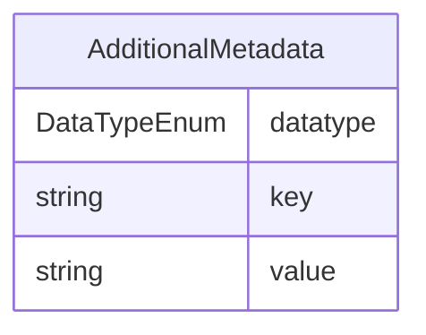

# Class: AdditionalMetadata 


_A single generic key/value metadata entry, used as a GraphQL-compatible replacement for an open-ended (range: Any) field. A list of these represents an arbitrary, extensible bag of program-specific metadata._


URI: [pals:class/AdditionalMetadata](https://pals-project.readthedocs.io/class/AdditionalMetadata)





<!-- no inheritance hierarchy -->

## Slots

| Name | Cardinality and Range | Description | Inheritance |
| ---  | --- | --- | --- |
| [key](../slots/key.md) | 1 <br/> [String](../types/String.md) | The metadata field name. | direct |
| [value](../slots/value.md) | 1 <br/> [String](../types/String.md) | The metadata value, serialized as a string. | direct |
| [datatype](../slots/datatype.md) | 0..1 <br/> [DataTypeEnum](../enums/DataTypeEnum.md) | Hint for the value's original type, so consumers can parse it back (e.g. float, integer, boolean) rather than treating everything as an opaque string. | direct |


## Usages

| used by | used in | type | used |
| ---  | --- | --- | --- |
| [MetaParamGroup](../classes/MetaParamGroup.md) | [additional_metadata](../slots/additional_metadata.md) | range | [AdditionalMetadata](../classes/AdditionalMetadata.md) |


## Identifier and Mapping Information


### Schema Source


* from schema: https://w3id.org/accelerator-core


## Mappings

| Mapping Type | Mapped Value |
| ---  | ---  |
| self | pals:AdditionalMetadata |
| native | pals:AdditionalMetadata |


## LinkML Source

<!-- TODO: investigate https://stackoverflow.com/questions/37606292/how-to-create-tabbed-code-blocks-in-mkdocs-or-sphinx -->

### Direct

<details>
```yaml
name: AdditionalMetadata
description: 'A single generic key/value metadata entry, used as a GraphQL-compatible
  replacement for an open-ended (range: Any) field. A list of these represents an
  arbitrary, extensible bag of program-specific metadata.'
from_schema: https://w3id.org/accelerator-core
attributes:
  key:
    name: key
    description: The metadata field name.
    from_schema: https://w3id.org/accelerator-core
    rank: 1000
    domain_of:
    - AdditionalMetadata
    range: string
    required: true
  value:
    name: value
    description: The metadata value, serialized as a string.
    from_schema: https://w3id.org/accelerator-core
    rank: 1000
    domain_of:
    - AdditionalMetadata
    range: string
    required: true
  datatype:
    name: datatype
    description: Hint for the value's original type, so consumers can parse it back
      (e.g. float, integer, boolean) rather than treating everything as an opaque
      string.
    from_schema: https://w3id.org/accelerator-core
    rank: 1000
    domain_of:
    - AdditionalMetadata
    range: DataTypeEnum

```
</details>

### Induced

<details>
```yaml
name: AdditionalMetadata
description: 'A single generic key/value metadata entry, used as a GraphQL-compatible
  replacement for an open-ended (range: Any) field. A list of these represents an
  arbitrary, extensible bag of program-specific metadata.'
from_schema: https://w3id.org/accelerator-core
attributes:
  key:
    name: key
    description: The metadata field name.
    from_schema: https://w3id.org/accelerator-core
    rank: 1000
    alias: key
    owner: AdditionalMetadata
    domain_of:
    - AdditionalMetadata
    range: string
    required: true
  value:
    name: value
    description: The metadata value, serialized as a string.
    from_schema: https://w3id.org/accelerator-core
    rank: 1000
    alias: value
    owner: AdditionalMetadata
    domain_of:
    - AdditionalMetadata
    range: string
    required: true
  datatype:
    name: datatype
    description: Hint for the value's original type, so consumers can parse it back
      (e.g. float, integer, boolean) rather than treating everything as an opaque
      string.
    from_schema: https://w3id.org/accelerator-core
    rank: 1000
    alias: datatype
    owner: AdditionalMetadata
    domain_of:
    - AdditionalMetadata
    range: DataTypeEnum

```
</details>