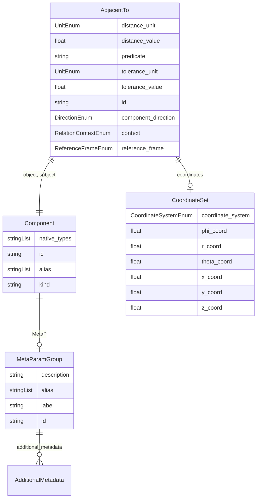

# Class: AdjacentTo 


_A relationship indicating that the subject component is adjacent to the object component and not overlapping_

_ in a specified context, such as radiation detector and a magnet._


URI: [pals_config:class/AdjacentTo](https://w3id.org/pals-config/class/AdjacentTo)





## Inheritance
* [Edge](../classes/Edge.md)
    * [ComponentRelation](../classes/ComponentRelation.md)
        * **AdjacentTo**


## Slots

| Name | Cardinality and Range | Description | Inheritance |
| ---  | --- | --- | --- |
| [distance_value](../slots/distance_value.md) | 0..1 <br/> [Float](../types/Float.md) | Distance value between two components in a relationship. Only an edge-property slot for edges that require a distance value between two components in a relationship. | direct |
| [distance_unit](../slots/distance_unit.md) | 0..1 <br/> [UnitEnum](../enums/UnitEnum.md) | Unit of the distance value between two components in a relationship. Only an edge-property slot for edges that require a distance value between two components in a relationship. | direct |
| [tolerance_value](../slots/tolerance_value.md) | 0..1 <br/> [Float](../types/Float.md) | Tolerance value for the distance between two components in a relationship. Only an edge-property slot for edges that require a tolerance value between two components in a relationship. | direct |
| [tolerance_unit](../slots/tolerance_unit.md) | 0..1 <br/> [UnitEnum](../enums/UnitEnum.md) | Unit of the tolerance value for the distance between two components in a relationship. Only an edge-property slot for edges that require a tolerance value between two components in a relationship. | direct |
| [coordinates](../slots/coordinates.md) | 0..1 _recommended_ <br/> [CoordinateSet](../classes/CoordinateSet.md) | A set of coordinates that define the spatial relationship between the two components. Only an edge-property slot for edges that require a set of coordinates to define the spatial relationship between two components in a relationship. | direct |
| [context](../slots/context.md) | 1 <br/> [RelationContextEnum](../enums/RelationContextEnum.md) | The frame of reference / domain in which this relationship is asserted to hold. | [ComponentRelation](../classes/ComponentRelation.md) |
| [component_direction](../slots/component_direction.md) | 0..1 <br/> [DirectionEnum](../enums/DirectionEnum.md) |  | [ComponentRelation](../classes/ComponentRelation.md) |
| [reference_frame](../slots/reference_frame.md) | 0..1 _recommended_ <br/> [ReferenceFrameEnum](../enums/ReferenceFrameEnum.md) |  | [ComponentRelation](../classes/ComponentRelation.md) |
| [id](../slots/id.md) | 1 <br/> [String](../types/String.md) | A unique identifier for the instance. | [Edge](../classes/Edge.md) |
| [subject](../slots/subject.md) | 1 <br/> [Component](../classes/Component.md) |  | [Edge](../classes/Edge.md) |
| [predicate](../slots/predicate.md) | 1 <br/> [String](../types/String.md) | The predicate of the relationship, which can be used to identify the relationship across different source systems. | [Edge](../classes/Edge.md) |
| [object](../slots/object.md) | 1 <br/> [Component](../classes/Component.md) |  | [Edge](../classes/Edge.md) |


## Identifier and Mapping Information


### Annotations

| property | value |
| --- | --- |
| rdf_predicate | pals_config:adjacent_to |


### Schema Source


* from schema: https://w3id.org/pals-config


## Mappings

| Mapping Type | Mapped Value |
| ---  | ---  |
| self | pals_config:AdjacentTo |
| native | pals_config:AdjacentTo |
| related | RO:0002220 |


## LinkML Source

<!-- TODO: investigate https://stackoverflow.com/questions/37606292/how-to-create-tabbed-code-blocks-in-mkdocs-or-sphinx -->

### Direct

<details>
```yaml
name: AdjacentTo
annotations:
  rdf_predicate:
    tag: rdf_predicate
    value: pals_config:adjacent_to
description: "A relationship indicating that the subject component is adjacent to\
  \ the object component and not overlapping\n in a specified context, such as radiation\
  \ detector and a magnet."
from_schema: https://w3id.org/pals-config
related_mappings:
- RO:0002220
is_a: ComponentRelation
slots:
- distance_value
- distance_unit
- tolerance_value
- tolerance_unit
- coordinates
slot_usage:
  predicate:
    name: predicate
    description: The predicate of the relationship, which can be used to identify
      the relationship across different source systems.
    required: true
    equals_string: AdjacentTo

```
</details>

### Induced

<details>
```yaml
name: AdjacentTo
annotations:
  rdf_predicate:
    tag: rdf_predicate
    value: pals_config:adjacent_to
description: "A relationship indicating that the subject component is adjacent to\
  \ the object component and not overlapping\n in a specified context, such as radiation\
  \ detector and a magnet."
from_schema: https://w3id.org/pals-config
related_mappings:
- RO:0002220
is_a: ComponentRelation
slot_usage:
  predicate:
    name: predicate
    description: The predicate of the relationship, which can be used to identify
      the relationship across different source systems.
    required: true
    equals_string: AdjacentTo
attributes:
  distance_value:
    name: distance_value
    description: Distance value between two components in a relationship. Only an
      edge-property slot for edges that require a distance value between two components
      in a relationship.
    from_schema: https://w3id.org/pals-config
    exact_mappings:
    - quantitykind:Distance
    rank: 1000
    alias: distance_value
    owner: AdjacentTo
    domain_of:
    - AdjacentTo
    - NearestTo
    range: float
  distance_unit:
    name: distance_unit
    description: Unit of the distance value between two components in a relationship.
      Only an edge-property slot for edges that require a distance value between two
      components in a relationship.
    from_schema: https://w3id.org/pals-config
    related_mappings:
    - saref:UnitOfMeasure
    rank: 1000
    alias: distance_unit
    owner: AdjacentTo
    domain_of:
    - AdjacentTo
    - NearestTo
    range: UnitEnum
  tolerance_value:
    name: tolerance_value
    description: Tolerance value for the distance between two components in a relationship.
      Only an edge-property slot for edges that require a tolerance value between
      two components in a relationship.
    from_schema: https://w3id.org/pals-config
    rank: 1000
    alias: tolerance_value
    owner: AdjacentTo
    domain_of:
    - AdjacentTo
    - NearestTo
    range: float
  tolerance_unit:
    name: tolerance_unit
    description: Unit of the tolerance value for the distance between two components
      in a relationship. Only an edge-property slot for edges that require a tolerance
      value between two components in a relationship.
    from_schema: https://w3id.org/pals-config
    related_mappings:
    - saref:UnitOfMeasure
    rank: 1000
    alias: tolerance_unit
    owner: AdjacentTo
    domain_of:
    - AdjacentTo
    - NearestTo
    range: UnitEnum
  coordinates:
    name: coordinates
    description: A set of coordinates that define the spatial relationship between
      the two components. Only an edge-property slot for edges that require a set
      of coordinates to define the spatial relationship between two components in
      a relationship.
    from_schema: https://w3id.org/pals-config
    rank: 1000
    alias: coordinates
    owner: AdjacentTo
    domain_of:
    - AdjacentTo
    - Overlaps
    - MountedOn
    - NearestTo
    range: CoordinateSet
    recommended: true
    inlined: true
  context:
    name: context
    description: The frame of reference / domain in which this relationship is asserted
      to hold.
    from_schema: https://w3id.org/pals-config
    rank: 1000
    alias: context
    owner: AdjacentTo
    domain_of:
    - ComponentRelation
    - IsPartOf
    range: RelationContextEnum
    required: true
  component_direction:
    name: component_direction
    from_schema: https://w3id.org/pals-config
    rank: 1000
    alias: component_direction
    owner: AdjacentTo
    domain_of:
    - ComponentRelation
    range: DirectionEnum
  reference_frame:
    name: reference_frame
    from_schema: https://w3id.org/pals-config
    rank: 1000
    alias: reference_frame
    owner: AdjacentTo
    domain_of:
    - ComponentRelation
    range: ReferenceFrameEnum
    recommended: true
  id:
    name: id
    description: A unique identifier for the instance.
    from_schema: https://w3id.org/pals-config
    close_mappings:
    - pals:id
    rank: 1000
    identifier: true
    alias: id
    owner: AdjacentTo
    domain_of:
    - Node
    - Affiliation
    - ParamGroup
    - Edge
    range: string
    required: true
  subject:
    name: subject
    from_schema: https://w3id.org/pals-config
    rank: 1000
    slot_uri: rdf:subject
    alias: subject
    owner: AdjacentTo
    domain_of:
    - Edge
    range: Component
    required: true
  predicate:
    name: predicate
    description: The predicate of the relationship, which can be used to identify
      the relationship across different source systems.
    from_schema: https://w3id.org/pals-config
    rank: 1000
    slot_uri: rdf:predicate
    designates_type: true
    alias: predicate
    owner: AdjacentTo
    domain_of:
    - Edge
    range: string
    required: true
    equals_string: AdjacentTo
  object:
    name: object
    from_schema: https://w3id.org/pals-config
    rank: 1000
    slot_uri: rdf:object
    alias: object
    owner: AdjacentTo
    domain_of:
    - Edge
    range: Component
    required: true

```
</details>