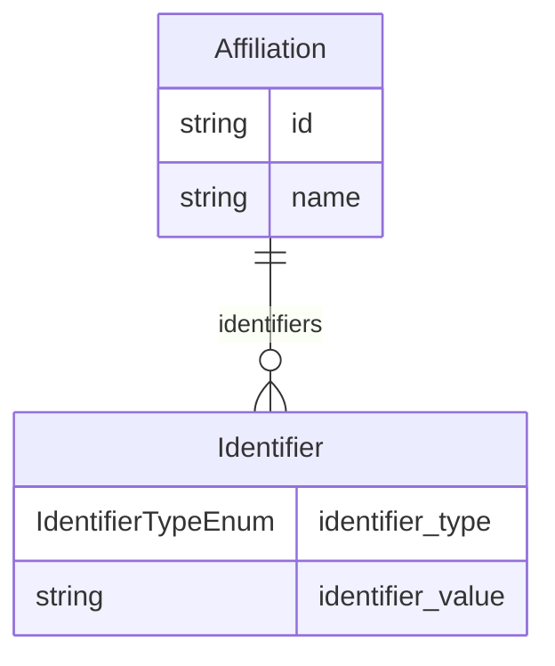

# Class: Affiliation 


_Contains affiliation information for an author or component, such as a ROR._


URI: [pals_config:class/Affiliation](https://w3id.org/pals-config/class/Affiliation)





<!-- no inheritance hierarchy -->

## Slots

| Name | Cardinality and Range | Description | Inheritance |
| ---  | --- | --- | --- |
| [id](../slots/id.md) | 1 <br/> [String](../types/String.md) | A unique identifier for the instance. | direct |
| [name](../slots/name.md) | 0..1 <br/> [String](../types/String.md) | The name of the entity. For example, the name of the component. | direct |
| [identifiers](../slots/identifiers.md) | * <br/> [Identifier](../classes/Identifier.md) | A unique and ideally persistent identifier for the facility, such as a DOI or ROR. | direct |


## Usages

| used by | used in | type | used |
| ---  | --- | --- | --- |
| [PALSAccelerator](../classes/PALSAccelerator.md) | [affiliation](../slots/affiliation.md) | range | [Affiliation](../classes/Affiliation.md) |
| [Author](../classes/Author.md) | [affiliation](../slots/affiliation.md) | range | [Affiliation](../classes/Affiliation.md) |


## Identifier and Mapping Information


### Schema Source


* from schema: https://w3id.org/pals-config


## Mappings

| Mapping Type | Mapped Value |
| ---  | ---  |
| self | pals_config:Affiliation |
| native | pals_config:Affiliation |


## LinkML Source

<!-- TODO: investigate https://stackoverflow.com/questions/37606292/how-to-create-tabbed-code-blocks-in-mkdocs-or-sphinx -->

### Direct

<details>
```yaml
name: Affiliation
description: Contains affiliation information for an author or component, such as
  a ROR.
from_schema: https://w3id.org/pals-config
slots:
- id
- name
- identifiers

```
</details>

### Induced

<details>
```yaml
name: Affiliation
description: Contains affiliation information for an author or component, such as
  a ROR.
from_schema: https://w3id.org/pals-config
attributes:
  id:
    name: id
    description: A unique identifier for the instance.
    from_schema: https://w3id.org/pals-config
    close_mappings:
    - pals:id
    rank: 1000
    identifier: true
    alias: id
    owner: Affiliation
    domain_of:
    - Node
    - Affiliation
    - ParamGroup
    - Edge
    range: string
    required: true
  name:
    name: name
    description: The name of the entity. For example, the name of the component.
    from_schema: https://w3id.org/pals-config
    rank: 1000
    alias: name
    owner: Affiliation
    domain_of:
    - Author
    - Affiliation
    range: string
  identifiers:
    name: identifiers
    description: A unique and ideally persistent identifier for the facility, such
      as a DOI or ROR.
    from_schema: https://w3id.org/pals-config
    rank: 1000
    alias: identifiers
    owner: Affiliation
    domain_of:
    - Facility
    - Affiliation
    range: Identifier
    multivalued: true

```
</details>