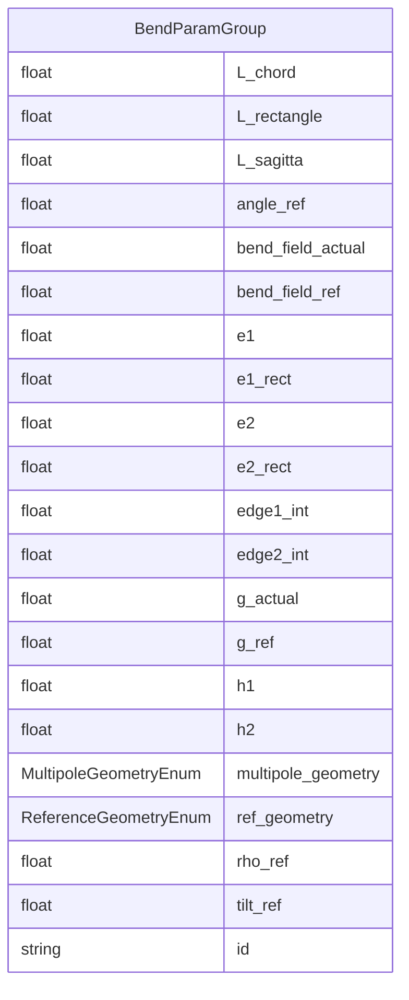

# Class: BendParamGroup 


_Mixin for bend parameters, which can be used to describe the bending properties of an accelerator element. This mixin is aligned with PALS BendP for interoperability with the Particle Accelerator Language Standard (PALS)._


URI: [pals_config:class/BendParamGroup](https://w3id.org/pals-config/class/BendParamGroup)





## Inheritance
* [ParamGroup](../classes/ParamGroup.md)
    * **BendParamGroup**


## Slots

| Name | Cardinality and Range | Description | Inheritance |
| ---  | --- | --- | --- |
| [angle_ref](../slots/angle_ref.md) | 0..1 <br/> [Float](../types/Float.md) | Reference bend angle. | direct |
| [bend_field_ref](../slots/bend_field_ref.md) | 0..1 <br/> [Float](../types/Float.md) | Reference bend field. | direct |
| [bend_field_actual](../slots/bend_field_actual.md) | 0..1 <br/> [Float](../types/Float.md) | Actual bend field. | direct |
| [e1](../slots/e1.md) | 0..1 <br/> [Float](../types/Float.md) | Entrance end pole face rotation with respect to a sector geometry. | direct |
| [e2](../slots/e2.md) | 0..1 <br/> [Float](../types/Float.md) | Exit end pole face rotation with respect to a sector geometry. | direct |
| [e1_rect](../slots/e1_rect.md) | 0..1 <br/> [Float](../types/Float.md) | Entrance end pole face rotation with respect to a rectangular geometry. | direct |
| [e2_rect](../slots/e2_rect.md) | 0..1 <br/> [Float](../types/Float.md) | Exit end pole face rotation with respect to a rectangular geometry. | direct |
| [edge1_int](../slots/edge1_int.md) | 0..1 <br/> [Float](../types/Float.md) | Entrance end fringe field integral. | direct |
| [edge2_int](../slots/edge2_int.md) | 0..1 <br/> [Float](../types/Float.md) | Exit end fringe field integral. | direct |
| [g_ref](../slots/g_ref.md) | 0..1 <br/> [Float](../types/Float.md) | Reference bend strength = 1/radius_ref | direct |
| [g_actual](../slots/g_actual.md) | 0..1 <br/> [Float](../types/Float.md) | Actual bend strength = 1/radius_actual | direct |
| [h1](../slots/h1.md) | 0..1 <br/> [Float](../types/Float.md) | Entrance end pole face curvature | direct |
| [h2](../slots/h2.md) | 0..1 <br/> [Float](../types/Float.md) | Exit end pole face curvature | direct |
| [L_chord](../slots/L_chord.md) | 0..1 <br/> [Float](../types/Float.md) | Chord length of the bend. | direct |
| [L_sagitta](../slots/L_sagitta.md) | 0..1 <br/> [Float](../types/Float.md) | Output parameter. Sagitta length. | direct |
| [L_rectangle](../slots/L_rectangle.md) | 0..1 <br/> [Float](../types/Float.md) | Rectangular length. | direct |
| [multipole_geometry](../slots/multipole_geometry.md) | 0..1 <br/> [MultipoleGeometryEnum](../enums/MultipoleGeometryEnum.md) | Multipole geometry type. Must be `follows_ref_geometry`. | direct |
| [ref_geometry](../slots/ref_geometry.md) | 0..1 <br/> [ReferenceGeometryEnum](../enums/ReferenceGeometryEnum.md) | Reference geometry type. Must be `arc`. | direct |
| [rho_ref](../slots/rho_ref.md) | 0..1 <br/> [Float](../types/Float.md) | Reference bend radius. | direct |
| [tilt_ref](../slots/tilt_ref.md) | 0..1 <br/> [Float](../types/Float.md) | Reference tilt of the bend. | direct |
| [id](../slots/id.md) | 1 <br/> [String](../types/String.md) | A unique identifier for the instance. | [ParamGroup](../classes/ParamGroup.md) |


## Usages

| used by | used in | type | used |
| ---  | --- | --- | --- |
| [HasBendP](../classes/HasBendP.md) | [BendP](../slots/BendP.md) | range | [BendParamGroup](../classes/BendParamGroup.md) |
| [Bend](../classes/Bend.md) | [BendP](../slots/BendP.md) | range | [BendParamGroup](../classes/BendParamGroup.md) |


## Rules


### 

| Rule Applied | Preconditions | Postconditions | Elseconditions |
|--------------|---------------|----------------|----------------|
| slot_conditions |```{'multipole_geometry': {'value_presence': 'PRESENT'}}``` |```{'multipole_geometry': {'equals_string': 'follows_ref_geometry'}}``` | |


### 

| Rule Applied | Preconditions | Postconditions | Elseconditions |
|--------------|---------------|----------------|----------------|
| slot_conditions |```{'ref_geometry': {'value_presence': 'PRESENT'}}``` |```{'ref_geometry': {'equals_string': 'arc'}}``` | |


## Identifier and Mapping Information


### Schema Source


* from schema: https://w3id.org/pals-config


## Mappings

| Mapping Type | Mapped Value |
| ---  | ---  |
| self | pals_config:BendParamGroup |
| native | pals_config:BendParamGroup |
| exact | pals:BendP |


## LinkML Source

<!-- TODO: investigate https://stackoverflow.com/questions/37606292/how-to-create-tabbed-code-blocks-in-mkdocs-or-sphinx -->

### Direct

<details>
```yaml
name: BendParamGroup
description: Mixin for bend parameters, which can be used to describe the bending
  properties of an accelerator element. This mixin is aligned with PALS BendP for
  interoperability with the Particle Accelerator Language Standard (PALS).
from_schema: https://w3id.org/pals-config
exact_mappings:
- pals:BendP
is_a: ParamGroup
attributes:
  angle_ref:
    name: angle_ref
    description: Reference bend angle.
    from_schema: https://w3id.org/pals-config
    close_mappings:
    - pals:angle_ref
    rank: 1000
    domain_of:
    - BendParamGroup
    range: float
    unit:
      ucum_code: rad
  bend_field_ref:
    name: bend_field_ref
    description: Reference bend field.
    from_schema: https://w3id.org/pals-config
    close_mappings:
    - pals:bend_field_ref
    rank: 1000
    domain_of:
    - BendParamGroup
    range: float
    unit:
      ucum_code: T
  bend_field_actual:
    name: bend_field_actual
    description: Actual bend field.
    from_schema: https://w3id.org/pals-config
    close_mappings:
    - pals:bend_field_actual
    rank: 1000
    domain_of:
    - BendParamGroup
    range: float
    unit:
      ucum_code: T
  e1:
    name: e1
    description: Entrance end pole face rotation with respect to a sector geometry.
    from_schema: https://w3id.org/pals-config
    close_mappings:
    - pals:e1
    rank: 1000
    domain_of:
    - BendParamGroup
    range: float
    unit:
      ucum_code: rad
  e2:
    name: e2
    description: Exit end pole face rotation with respect to a sector geometry.
    from_schema: https://w3id.org/pals-config
    close_mappings:
    - pals:e2
    rank: 1000
    domain_of:
    - BendParamGroup
    range: float
    unit:
      ucum_code: rad
  e1_rect:
    name: e1_rect
    description: Entrance end pole face rotation with respect to a rectangular geometry.
    from_schema: https://w3id.org/pals-config
    close_mappings:
    - pals:e1_rect
    rank: 1000
    domain_of:
    - BendParamGroup
    range: float
    unit:
      ucum_code: rad
  e2_rect:
    name: e2_rect
    description: Exit end pole face rotation with respect to a rectangular geometry.
    from_schema: https://w3id.org/pals-config
    close_mappings:
    - pals:e2_rect
    rank: 1000
    domain_of:
    - BendParamGroup
    range: float
    unit:
      ucum_code: rad
  edge1_int:
    name: edge1_int
    description: Entrance end fringe field integral.
    from_schema: https://w3id.org/pals-config
    close_mappings:
    - pals:edge1_int
    rank: 1000
    domain_of:
    - BendParamGroup
    range: float
    unit:
      ucum_code: T.m
  edge2_int:
    name: edge2_int
    description: Exit end fringe field integral.
    from_schema: https://w3id.org/pals-config
    close_mappings:
    - pals:edge2_int
    rank: 1000
    domain_of:
    - BendParamGroup
    range: float
    unit:
      ucum_code: T.m
  g_ref:
    name: g_ref
    description: Reference bend strength = 1/radius_ref
    from_schema: https://w3id.org/pals-config
    close_mappings:
    - pals:g_ref
    rank: 1000
    domain_of:
    - BendParamGroup
    range: float
    unit:
      ucum_code: 1/m
  g_actual:
    name: g_actual
    description: Actual bend strength = 1/radius_actual
    from_schema: https://w3id.org/pals-config
    close_mappings:
    - pals:g_actual
    rank: 1000
    domain_of:
    - BendParamGroup
    range: float
    unit:
      ucum_code: 1/m
  h1:
    name: h1
    description: Entrance end pole face curvature
    from_schema: https://w3id.org/pals-config
    close_mappings:
    - pals:h1
    rank: 1000
    domain_of:
    - BendParamGroup
    range: float
    unit:
      ucum_code: 1/m
  h2:
    name: h2
    description: Exit end pole face curvature
    from_schema: https://w3id.org/pals-config
    close_mappings:
    - pals:h2
    rank: 1000
    domain_of:
    - BendParamGroup
    range: float
    unit:
      ucum_code: 1/m
  L_chord:
    name: L_chord
    description: Chord length of the bend.
    from_schema: https://w3id.org/pals-config
    close_mappings:
    - pals:L_chord
    rank: 1000
    domain_of:
    - BendParamGroup
    range: float
    unit:
      ucum_code: m
  L_sagitta:
    name: L_sagitta
    description: Output parameter. Sagitta length.
    from_schema: https://w3id.org/pals-config
    close_mappings:
    - pals:L_sagitta
    rank: 1000
    domain_of:
    - BendParamGroup
    range: float
    unit:
      ucum_code: m
  L_rectangle:
    name: L_rectangle
    description: Rectangular length.
    from_schema: https://w3id.org/pals-config
    close_mappings:
    - pals:L_rectangle
    rank: 1000
    domain_of:
    - BendParamGroup
    range: float
    unit:
      ucum_code: m
  multipole_geometry:
    name: multipole_geometry
    description: Multipole geometry type. Must be `follows_ref_geometry`.
    from_schema: https://w3id.org/pals-config
    close_mappings:
    - pals:multipole_geometry
    rank: 1000
    domain_of:
    - BendParamGroup
    range: MultipoleGeometryEnum
  ref_geometry:
    name: ref_geometry
    description: Reference geometry type. Must be `arc`.
    from_schema: https://w3id.org/pals-config
    close_mappings:
    - pals:ref_geometry
    rank: 1000
    domain_of:
    - BendParamGroup
    range: ReferenceGeometryEnum
  rho_ref:
    name: rho_ref
    description: Reference bend radius.
    from_schema: https://w3id.org/pals-config
    close_mappings:
    - pals:rho_ref
    rank: 1000
    domain_of:
    - BendParamGroup
    range: float
    unit:
      ucum_code: m
  tilt_ref:
    name: tilt_ref
    description: Reference tilt of the bend.
    from_schema: https://w3id.org/pals-config
    close_mappings:
    - pals:tilt_ref
    rank: 1000
    domain_of:
    - BendParamGroup
    range: float
    unit:
      ucum_code: rad
rules:
- preconditions:
    slot_conditions:
      multipole_geometry:
        name: multipole_geometry
        value_presence: PRESENT
  postconditions:
    slot_conditions:
      multipole_geometry:
        name: multipole_geometry
        equals_string: follows_ref_geometry
  description: multipole_geometry must be follows_ref_geometry
- preconditions:
    slot_conditions:
      ref_geometry:
        name: ref_geometry
        value_presence: PRESENT
  postconditions:
    slot_conditions:
      ref_geometry:
        name: ref_geometry
        equals_string: arc
  description: ref_geometry must be arc

```
</details>

### Induced

<details>
```yaml
name: BendParamGroup
description: Mixin for bend parameters, which can be used to describe the bending
  properties of an accelerator element. This mixin is aligned with PALS BendP for
  interoperability with the Particle Accelerator Language Standard (PALS).
from_schema: https://w3id.org/pals-config
exact_mappings:
- pals:BendP
is_a: ParamGroup
attributes:
  angle_ref:
    name: angle_ref
    description: Reference bend angle.
    from_schema: https://w3id.org/pals-config
    close_mappings:
    - pals:angle_ref
    rank: 1000
    alias: angle_ref
    owner: BendParamGroup
    domain_of:
    - BendParamGroup
    range: float
    unit:
      ucum_code: rad
  bend_field_ref:
    name: bend_field_ref
    description: Reference bend field.
    from_schema: https://w3id.org/pals-config
    close_mappings:
    - pals:bend_field_ref
    rank: 1000
    alias: bend_field_ref
    owner: BendParamGroup
    domain_of:
    - BendParamGroup
    range: float
    unit:
      ucum_code: T
  bend_field_actual:
    name: bend_field_actual
    description: Actual bend field.
    from_schema: https://w3id.org/pals-config
    close_mappings:
    - pals:bend_field_actual
    rank: 1000
    alias: bend_field_actual
    owner: BendParamGroup
    domain_of:
    - BendParamGroup
    range: float
    unit:
      ucum_code: T
  e1:
    name: e1
    description: Entrance end pole face rotation with respect to a sector geometry.
    from_schema: https://w3id.org/pals-config
    close_mappings:
    - pals:e1
    rank: 1000
    alias: e1
    owner: BendParamGroup
    domain_of:
    - BendParamGroup
    range: float
    unit:
      ucum_code: rad
  e2:
    name: e2
    description: Exit end pole face rotation with respect to a sector geometry.
    from_schema: https://w3id.org/pals-config
    close_mappings:
    - pals:e2
    rank: 1000
    alias: e2
    owner: BendParamGroup
    domain_of:
    - BendParamGroup
    range: float
    unit:
      ucum_code: rad
  e1_rect:
    name: e1_rect
    description: Entrance end pole face rotation with respect to a rectangular geometry.
    from_schema: https://w3id.org/pals-config
    close_mappings:
    - pals:e1_rect
    rank: 1000
    alias: e1_rect
    owner: BendParamGroup
    domain_of:
    - BendParamGroup
    range: float
    unit:
      ucum_code: rad
  e2_rect:
    name: e2_rect
    description: Exit end pole face rotation with respect to a rectangular geometry.
    from_schema: https://w3id.org/pals-config
    close_mappings:
    - pals:e2_rect
    rank: 1000
    alias: e2_rect
    owner: BendParamGroup
    domain_of:
    - BendParamGroup
    range: float
    unit:
      ucum_code: rad
  edge1_int:
    name: edge1_int
    description: Entrance end fringe field integral.
    from_schema: https://w3id.org/pals-config
    close_mappings:
    - pals:edge1_int
    rank: 1000
    alias: edge1_int
    owner: BendParamGroup
    domain_of:
    - BendParamGroup
    range: float
    unit:
      ucum_code: T.m
  edge2_int:
    name: edge2_int
    description: Exit end fringe field integral.
    from_schema: https://w3id.org/pals-config
    close_mappings:
    - pals:edge2_int
    rank: 1000
    alias: edge2_int
    owner: BendParamGroup
    domain_of:
    - BendParamGroup
    range: float
    unit:
      ucum_code: T.m
  g_ref:
    name: g_ref
    description: Reference bend strength = 1/radius_ref
    from_schema: https://w3id.org/pals-config
    close_mappings:
    - pals:g_ref
    rank: 1000
    alias: g_ref
    owner: BendParamGroup
    domain_of:
    - BendParamGroup
    range: float
    unit:
      ucum_code: 1/m
  g_actual:
    name: g_actual
    description: Actual bend strength = 1/radius_actual
    from_schema: https://w3id.org/pals-config
    close_mappings:
    - pals:g_actual
    rank: 1000
    alias: g_actual
    owner: BendParamGroup
    domain_of:
    - BendParamGroup
    range: float
    unit:
      ucum_code: 1/m
  h1:
    name: h1
    description: Entrance end pole face curvature
    from_schema: https://w3id.org/pals-config
    close_mappings:
    - pals:h1
    rank: 1000
    alias: h1
    owner: BendParamGroup
    domain_of:
    - BendParamGroup
    range: float
    unit:
      ucum_code: 1/m
  h2:
    name: h2
    description: Exit end pole face curvature
    from_schema: https://w3id.org/pals-config
    close_mappings:
    - pals:h2
    rank: 1000
    alias: h2
    owner: BendParamGroup
    domain_of:
    - BendParamGroup
    range: float
    unit:
      ucum_code: 1/m
  L_chord:
    name: L_chord
    description: Chord length of the bend.
    from_schema: https://w3id.org/pals-config
    close_mappings:
    - pals:L_chord
    rank: 1000
    alias: L_chord
    owner: BendParamGroup
    domain_of:
    - BendParamGroup
    range: float
    unit:
      ucum_code: m
  L_sagitta:
    name: L_sagitta
    description: Output parameter. Sagitta length.
    from_schema: https://w3id.org/pals-config
    close_mappings:
    - pals:L_sagitta
    rank: 1000
    alias: L_sagitta
    owner: BendParamGroup
    domain_of:
    - BendParamGroup
    range: float
    unit:
      ucum_code: m
  L_rectangle:
    name: L_rectangle
    description: Rectangular length.
    from_schema: https://w3id.org/pals-config
    close_mappings:
    - pals:L_rectangle
    rank: 1000
    alias: L_rectangle
    owner: BendParamGroup
    domain_of:
    - BendParamGroup
    range: float
    unit:
      ucum_code: m
  multipole_geometry:
    name: multipole_geometry
    description: Multipole geometry type. Must be `follows_ref_geometry`.
    from_schema: https://w3id.org/pals-config
    close_mappings:
    - pals:multipole_geometry
    rank: 1000
    alias: multipole_geometry
    owner: BendParamGroup
    domain_of:
    - BendParamGroup
    range: MultipoleGeometryEnum
  ref_geometry:
    name: ref_geometry
    description: Reference geometry type. Must be `arc`.
    from_schema: https://w3id.org/pals-config
    close_mappings:
    - pals:ref_geometry
    rank: 1000
    alias: ref_geometry
    owner: BendParamGroup
    domain_of:
    - BendParamGroup
    range: ReferenceGeometryEnum
  rho_ref:
    name: rho_ref
    description: Reference bend radius.
    from_schema: https://w3id.org/pals-config
    close_mappings:
    - pals:rho_ref
    rank: 1000
    alias: rho_ref
    owner: BendParamGroup
    domain_of:
    - BendParamGroup
    range: float
    unit:
      ucum_code: m
  tilt_ref:
    name: tilt_ref
    description: Reference tilt of the bend.
    from_schema: https://w3id.org/pals-config
    close_mappings:
    - pals:tilt_ref
    rank: 1000
    alias: tilt_ref
    owner: BendParamGroup
    domain_of:
    - BendParamGroup
    range: float
    unit:
      ucum_code: rad
  id:
    name: id
    description: A unique identifier for the instance.
    from_schema: https://w3id.org/pals-config
    close_mappings:
    - pals:id
    rank: 1000
    identifier: true
    alias: id
    owner: BendParamGroup
    domain_of:
    - Node
    - Affiliation
    - ParamGroup
    - Edge
    range: string
    required: true
rules:
- preconditions:
    slot_conditions:
      multipole_geometry:
        name: multipole_geometry
        value_presence: PRESENT
  postconditions:
    slot_conditions:
      multipole_geometry:
        name: multipole_geometry
        equals_string: follows_ref_geometry
  description: multipole_geometry must be follows_ref_geometry
- preconditions:
    slot_conditions:
      ref_geometry:
        name: ref_geometry
        value_presence: PRESENT
  postconditions:
    slot_conditions:
      ref_geometry:
        name: ref_geometry
        equals_string: arc
  description: ref_geometry must be arc

```
</details>