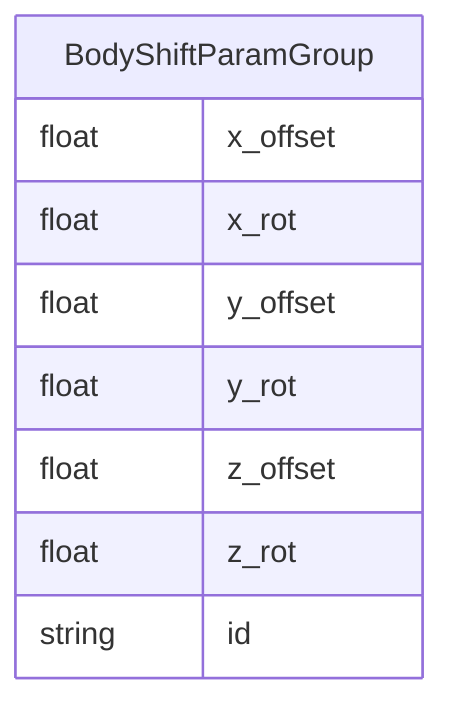

# Class: BodyShiftParamGroup 


_Mixin class for floor plan shift parameters that are aligned with PALS BodyShiftP (Floor Plan Shift Parameters)  for interoperability with the Particle Accelerator Language Standard (PALS)._


URI: [pals_config:class/BodyShiftParamGroup](https://w3id.org/pals-config/class/BodyShiftParamGroup)





## Inheritance
* [ParamGroup](../classes/ParamGroup.md)
    * **BodyShiftParamGroup**


## Slots

| Name | Cardinality and Range | Description | Inheritance |
| ---  | --- | --- | --- |
| [x_offset](../slots/x_offset.md) | 0..1 <br/> [Float](../types/Float.md) | Shift in the X direction in the facility floor plan. | direct |
| [y_offset](../slots/y_offset.md) | 0..1 <br/> [Float](../types/Float.md) | Shift in the Y direction in the facility floor plan. | direct |
| [z_offset](../slots/z_offset.md) | 0..1 <br/> [Float](../types/Float.md) | Shift in the Z direction in the facility floor plan. | direct |
| [x_rot](../slots/x_rot.md) | 0..1 <br/> [Float](../types/Float.md) | Rotation around the X-axis in the facility floor plan. | direct |
| [y_rot](../slots/y_rot.md) | 0..1 <br/> [Float](../types/Float.md) | Rotation around the Y-axis in the facility floor plan. | direct |
| [z_rot](../slots/z_rot.md) | 0..1 <br/> [Float](../types/Float.md) | Rotation around the Z-axis in the facility floor plan. | direct |
| [id](../slots/id.md) | 1 <br/> [String](../types/String.md) | A unique identifier for the instance. | [ParamGroup](../classes/ParamGroup.md) |


## Usages

| used by | used in | type | used |
| ---  | --- | --- | --- |
| [HasBodyShiftP](../classes/HasBodyShiftP.md) | [BodyShiftP](../slots/BodyShiftP.md) | range | [BodyShiftParamGroup](../classes/BodyShiftParamGroup.md) |
| [Magnet](../classes/Magnet.md) | [BodyShiftP](../slots/BodyShiftP.md) | range | [BodyShiftParamGroup](../classes/BodyShiftParamGroup.md) |
| [Solenoid](../classes/Solenoid.md) | [BodyShiftP](../slots/BodyShiftP.md) | range | [BodyShiftParamGroup](../classes/BodyShiftParamGroup.md) |
| [Multipole](../classes/Multipole.md) | [BodyShiftP](../slots/BodyShiftP.md) | range | [BodyShiftParamGroup](../classes/BodyShiftParamGroup.md) |
| [Bend](../classes/Bend.md) | [BodyShiftP](../slots/BodyShiftP.md) | range | [BodyShiftParamGroup](../classes/BodyShiftParamGroup.md) |
| [Quadrupole](../classes/Quadrupole.md) | [BodyShiftP](../slots/BodyShiftP.md) | range | [BodyShiftParamGroup](../classes/BodyShiftParamGroup.md) |
| [Octupole](../classes/Octupole.md) | [BodyShiftP](../slots/BodyShiftP.md) | range | [BodyShiftParamGroup](../classes/BodyShiftParamGroup.md) |
| [Sextupole](../classes/Sextupole.md) | [BodyShiftP](../slots/BodyShiftP.md) | range | [BodyShiftParamGroup](../classes/BodyShiftParamGroup.md) |
| [Kicker](../classes/Kicker.md) | [BodyShiftP](../slots/BodyShiftP.md) | range | [BodyShiftParamGroup](../classes/BodyShiftParamGroup.md) |
| [ACKicker](../classes/ACKicker.md) | [BodyShiftP](../slots/BodyShiftP.md) | range | [BodyShiftParamGroup](../classes/BodyShiftParamGroup.md) |
| [BeamProfileMonitor](../classes/BeamProfileMonitor.md) | [BodyShiftP](../slots/BodyShiftP.md) | range | [BodyShiftParamGroup](../classes/BodyShiftParamGroup.md) |
| [BeamPositionMonitor](../classes/BeamPositionMonitor.md) | [BodyShiftP](../slots/BodyShiftP.md) | range | [BodyShiftParamGroup](../classes/BodyShiftParamGroup.md) |
| [RadiationMonitor](../classes/RadiationMonitor.md) | [BodyShiftP](../slots/BodyShiftP.md) | range | [BodyShiftParamGroup](../classes/BodyShiftParamGroup.md) |
| [Cavity](../classes/Cavity.md) | [BodyShiftP](../slots/BodyShiftP.md) | range | [BodyShiftParamGroup](../classes/BodyShiftParamGroup.md) |
| [CrabCavity](../classes/CrabCavity.md) | [BodyShiftP](../slots/BodyShiftP.md) | range | [BodyShiftParamGroup](../classes/BodyShiftParamGroup.md) |
| [RFCavity](../classes/RFCavity.md) | [BodyShiftP](../slots/BodyShiftP.md) | range | [BodyShiftParamGroup](../classes/BodyShiftParamGroup.md) |
| [NormalConductingRFCavity](../classes/NormalConductingRFCavity.md) | [BodyShiftP](../slots/BodyShiftP.md) | range | [BodyShiftParamGroup](../classes/BodyShiftParamGroup.md) |
| [SuperConductingRFCavity](../classes/SuperConductingRFCavity.md) | [BodyShiftP](../slots/BodyShiftP.md) | range | [BodyShiftParamGroup](../classes/BodyShiftParamGroup.md) |
| [SupportingFacilityComponent](../classes/SupportingFacilityComponent.md) | [BodyShiftP](../slots/BodyShiftP.md) | range | [BodyShiftParamGroup](../classes/BodyShiftParamGroup.md) |
| [BookkeepingComponent](../classes/BookkeepingComponent.md) | [BodyShiftP](../slots/BodyShiftP.md) | range | [BodyShiftParamGroup](../classes/BodyShiftParamGroup.md) |
| [Marker](../classes/Marker.md) | [BodyShiftP](../slots/BodyShiftP.md) | range | [BodyShiftParamGroup](../classes/BodyShiftParamGroup.md) |
| [BeginningEle](../classes/BeginningEle.md) | [BodyShiftP](../slots/BodyShiftP.md) | range | [BodyShiftParamGroup](../classes/BodyShiftParamGroup.md) |
| [BeamLineSection](../classes/BeamLineSection.md) | [BodyShiftP](../slots/BodyShiftP.md) | range | [BodyShiftParamGroup](../classes/BodyShiftParamGroup.md) |


## Identifier and Mapping Information


### Schema Source


* from schema: https://w3id.org/pals-config


## Mappings

| Mapping Type | Mapped Value |
| ---  | ---  |
| self | pals_config:BodyShiftParamGroup |
| native | pals_config:BodyShiftParamGroup |
| broad | pals:BodyShiftP |


## LinkML Source

<!-- TODO: investigate https://stackoverflow.com/questions/37606292/how-to-create-tabbed-code-blocks-in-mkdocs-or-sphinx -->

### Direct

<details>
```yaml
name: BodyShiftParamGroup
description: Mixin class for floor plan shift parameters that are aligned with PALS
  BodyShiftP (Floor Plan Shift Parameters)  for interoperability with the Particle
  Accelerator Language Standard (PALS).
from_schema: https://w3id.org/pals-config
broad_mappings:
- pals:BodyShiftP
is_a: ParamGroup
attributes:
  x_offset:
    name: x_offset
    description: Shift in the X direction in the facility floor plan.
    from_schema: https://w3id.org/pals-config
    aliases:
    - delta_x
    - x_shift
    - GlobalOffsetX
    close_mappings:
    - pals:x_offset
    rank: 1000
    domain_of:
    - BodyShiftParamGroup
    range: float
  y_offset:
    name: y_offset
    description: Shift in the Y direction in the facility floor plan.
    from_schema: https://w3id.org/pals-config
    aliases:
    - delta_y
    - y_shift
    - GlobalOffsetY
    close_mappings:
    - pals:y_offset
    rank: 1000
    domain_of:
    - BodyShiftParamGroup
    range: float
  z_offset:
    name: z_offset
    description: Shift in the Z direction in the facility floor plan.
    from_schema: https://w3id.org/pals-config
    aliases:
    - delta_z
    - z_shift
    - GlobalOffsetZ
    close_mappings:
    - pals:z_offset
    rank: 1000
    domain_of:
    - BodyShiftParamGroup
    range: float
  x_rot:
    name: x_rot
    description: Rotation around the X-axis in the facility floor plan.
    from_schema: https://w3id.org/pals-config
    aliases:
    - delta_phi
    - phi_shift
    - GlobalOffsetPhi
    close_mappings:
    - pals:x_rot
    rank: 1000
    domain_of:
    - BodyShiftParamGroup
    range: float
  y_rot:
    name: y_rot
    description: Rotation around the Y-axis in the facility floor plan.
    from_schema: https://w3id.org/pals-config
    aliases:
    - delta_theta
    - theta_shift
    - GlobalOffsetTheta
    close_mappings:
    - pals:y_rot
    rank: 1000
    domain_of:
    - BodyShiftParamGroup
    range: float
  z_rot:
    name: z_rot
    description: Rotation around the Z-axis in the facility floor plan.
    from_schema: https://w3id.org/pals-config
    aliases:
    - delta_psi
    - psi_shift
    - GlobalOffsetPsi
    close_mappings:
    - pals:z_rot
    rank: 1000
    domain_of:
    - BodyShiftParamGroup
    range: float

```
</details>

### Induced

<details>
```yaml
name: BodyShiftParamGroup
description: Mixin class for floor plan shift parameters that are aligned with PALS
  BodyShiftP (Floor Plan Shift Parameters)  for interoperability with the Particle
  Accelerator Language Standard (PALS).
from_schema: https://w3id.org/pals-config
broad_mappings:
- pals:BodyShiftP
is_a: ParamGroup
attributes:
  x_offset:
    name: x_offset
    description: Shift in the X direction in the facility floor plan.
    from_schema: https://w3id.org/pals-config
    aliases:
    - delta_x
    - x_shift
    - GlobalOffsetX
    close_mappings:
    - pals:x_offset
    rank: 1000
    alias: x_offset
    owner: BodyShiftParamGroup
    domain_of:
    - BodyShiftParamGroup
    range: float
  y_offset:
    name: y_offset
    description: Shift in the Y direction in the facility floor plan.
    from_schema: https://w3id.org/pals-config
    aliases:
    - delta_y
    - y_shift
    - GlobalOffsetY
    close_mappings:
    - pals:y_offset
    rank: 1000
    alias: y_offset
    owner: BodyShiftParamGroup
    domain_of:
    - BodyShiftParamGroup
    range: float
  z_offset:
    name: z_offset
    description: Shift in the Z direction in the facility floor plan.
    from_schema: https://w3id.org/pals-config
    aliases:
    - delta_z
    - z_shift
    - GlobalOffsetZ
    close_mappings:
    - pals:z_offset
    rank: 1000
    alias: z_offset
    owner: BodyShiftParamGroup
    domain_of:
    - BodyShiftParamGroup
    range: float
  x_rot:
    name: x_rot
    description: Rotation around the X-axis in the facility floor plan.
    from_schema: https://w3id.org/pals-config
    aliases:
    - delta_phi
    - phi_shift
    - GlobalOffsetPhi
    close_mappings:
    - pals:x_rot
    rank: 1000
    alias: x_rot
    owner: BodyShiftParamGroup
    domain_of:
    - BodyShiftParamGroup
    range: float
  y_rot:
    name: y_rot
    description: Rotation around the Y-axis in the facility floor plan.
    from_schema: https://w3id.org/pals-config
    aliases:
    - delta_theta
    - theta_shift
    - GlobalOffsetTheta
    close_mappings:
    - pals:y_rot
    rank: 1000
    alias: y_rot
    owner: BodyShiftParamGroup
    domain_of:
    - BodyShiftParamGroup
    range: float
  z_rot:
    name: z_rot
    description: Rotation around the Z-axis in the facility floor plan.
    from_schema: https://w3id.org/pals-config
    aliases:
    - delta_psi
    - psi_shift
    - GlobalOffsetPsi
    close_mappings:
    - pals:z_rot
    rank: 1000
    alias: z_rot
    owner: BodyShiftParamGroup
    domain_of:
    - BodyShiftParamGroup
    range: float
  id:
    name: id
    description: A unique identifier for the instance.
    from_schema: https://w3id.org/pals-config
    close_mappings:
    - pals:id
    rank: 1000
    identifier: true
    alias: id
    owner: BodyShiftParamGroup
    domain_of:
    - Node
    - Affiliation
    - ParamGroup
    - Edge
    range: string
    required: true

```
</details>