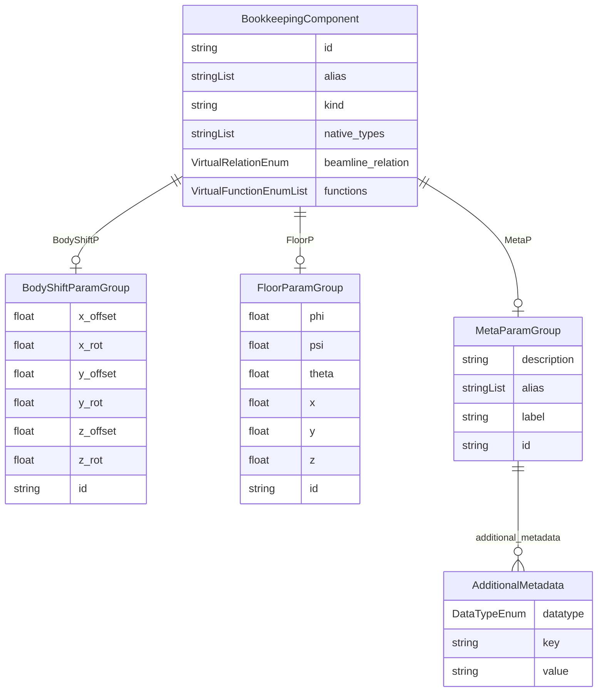

# Class: BookkeepingComponent 


_A virtual component that represents a bookkeeping or organizational role in the accelerator system,  such as a BeamLineSection, Marker or a Fork. These can include BeamLineSections, Markers, Forks, and other virtual components that are important for understanding  the structure and function of the accelerator system but are not physical devices._


URI: [pals_config:class/BookkeepingComponent](https://w3id.org/pals-config/class/BookkeepingComponent)





## Inheritance
* [Node](../classes/Node.md)
    * [Component](../classes/Component.md) [ [HasMetaP](../classes/HasMetaP.md)]
        * [VirtualComponent](../classes/VirtualComponent.md) [ [HasFloorP](../classes/HasFloorP.md)]
            * **BookkeepingComponent** [ [HasBodyShiftP](../classes/HasBodyShiftP.md)]
                * [Marker](../classes/Marker.md) [ [HasTwissP](../classes/HasTwissP.md)]
                * [BeginningEle](../classes/BeginningEle.md) [ [HasReferenceP](../classes/HasReferenceP.md) [HasTwissP](../classes/HasTwissP.md)]
                * [BeamLineSection](../classes/BeamLineSection.md) [ [HasFloorP](../classes/HasFloorP.md)]


## Slots

| Name | Cardinality and Range | Description | Inheritance |
| ---  | --- | --- | --- |
| [BodyShiftP](../slots/BodyShiftP.md) | 0..1 <br/> [BodyShiftParamGroup](../classes/BodyShiftParamGroup.md) | A mixin for floor plan shift parameters that are aligned with PALS BodyShiftP (Floor Plan Shift Parameters) for interoperability with the Particle Accelerator Language Standard (PALS). | [HasBodyShiftP](../classes/HasBodyShiftP.md) |
| [functions](../slots/functions.md) | 1..* <br/> [VirtualFunctionEnum](../enums/VirtualFunctionEnum.md) | The function of the virtual component,  which can be used to identify the component across different source systems. | [VirtualComponent](../classes/VirtualComponent.md) |
| [beamline_relation](../slots/beamline_relation.md) | 1 <br/> [VirtualRelationEnum](../enums/VirtualRelationEnum.md) | The relationship of the virtual component to the beamline,  which can be used to identify the component across different source systems. | [VirtualComponent](../classes/VirtualComponent.md) |
| [FloorP](../slots/FloorP.md) | 0..1 <br/> [FloorParamGroup](../classes/FloorParamGroup.md) | A mixin for floor plan parameters that are aligned with PALS FloorP (Floor Plan Parameters) for interoperability with the Particle Accelerator Language Standard (PALS). | [HasFloorP](../classes/HasFloorP.md) |
| [native_types](../slots/native_types.md) | * <br/> [String](../types/String.md) | The native type of the component in the source system, which can be used to identify the component across different source systems. | [Component](../classes/Component.md) |
| [MetaP](../slots/MetaP.md) | 0..1 <br/> [MetaParamGroup](../classes/MetaParamGroup.md) | A mixin for metadata parameters that are aligned with PALS MetaP (Metadata Parameters) for interoperability with the Particle Accelerator Language Standard (PALS). | [HasMetaP](../classes/HasMetaP.md) |
| [id](../slots/id.md) | 1 <br/> [String](../types/String.md) | A unique identifier for the instance. | [Node](../classes/Node.md) |
| [kind](../slots/kind.md) | 1 <br/> [String](../types/String.md) | The LinkML class name of this instance, e.g. `Quadrupole` or `BeamProfileMonitor` (no prefix). | [Node](../classes/Node.md) |
| [alias](../slots/alias.md) | * <br/> [String](../types/String.md) | An alternative name or identifier for the instance. | [Node](../classes/Node.md) |


## Identifier and Mapping Information


### Schema Source


* from schema: https://w3id.org/pals-config


## Mappings

| Mapping Type | Mapped Value |
| ---  | ---  |
| self | pals_config:BookkeepingComponent |
| native | pals_config:BookkeepingComponent |
| broad | pals:BookkeepingElement |


## LinkML Source

<!-- TODO: investigate https://stackoverflow.com/questions/37606292/how-to-create-tabbed-code-blocks-in-mkdocs-or-sphinx -->

### Direct

<details>
```yaml
name: BookkeepingComponent
description: A virtual component that represents a bookkeeping or organizational role
  in the accelerator system,  such as a BeamLineSection, Marker or a Fork. These can
  include BeamLineSections, Markers, Forks, and other virtual components that are
  important for understanding  the structure and function of the accelerator system
  but are not physical devices.
from_schema: https://w3id.org/pals-config
broad_mappings:
- pals:BookkeepingElement
is_a: VirtualComponent
mixins:
- HasBodyShiftP

```
</details>

### Induced

<details>
```yaml
name: BookkeepingComponent
description: A virtual component that represents a bookkeeping or organizational role
  in the accelerator system,  such as a BeamLineSection, Marker or a Fork. These can
  include BeamLineSections, Markers, Forks, and other virtual components that are
  important for understanding  the structure and function of the accelerator system
  but are not physical devices.
from_schema: https://w3id.org/pals-config
broad_mappings:
- pals:BookkeepingElement
is_a: VirtualComponent
mixins:
- HasBodyShiftP
attributes:
  BodyShiftP:
    name: BodyShiftP
    description: A mixin for floor plan shift parameters that are aligned with PALS
      BodyShiftP (Floor Plan Shift Parameters) for interoperability with the Particle
      Accelerator Language Standard (PALS).
    from_schema: https://w3id.org/pals-config
    rank: 1000
    alias: BodyShiftP
    owner: BookkeepingComponent
    domain_of:
    - HasBodyShiftP
    range: BodyShiftParamGroup
    inlined: true
  functions:
    name: functions
    description: The function of the virtual component,  which can be used to identify
      the component across different source systems.
    from_schema: https://w3id.org/pals-config
    close_mappings:
    - pals:virtual_function
    alias: functions
    owner: BookkeepingComponent
    domain_of:
    - PhysicalComponent
    - VirtualComponent
    range: VirtualFunctionEnum
    required: true
    multivalued: true
  beamline_relation:
    name: beamline_relation
    description: The relationship of the virtual component to the beamline,  which
      can be used to identify the component across different source systems.
    from_schema: https://w3id.org/pals-config
    close_mappings:
    - pals:virtual_beamline_relation
    alias: beamline_relation
    owner: BookkeepingComponent
    domain_of:
    - PhysicalComponent
    - VirtualComponent
    range: VirtualRelationEnum
    required: true
  FloorP:
    name: FloorP
    description: A mixin for floor plan parameters that are aligned with PALS FloorP
      (Floor Plan Parameters) for interoperability with the Particle Accelerator Language
      Standard (PALS).
    from_schema: https://w3id.org/pals-config
    rank: 1000
    alias: FloorP
    owner: BookkeepingComponent
    domain_of:
    - HasFloorP
    range: FloorParamGroup
    inlined: true
  native_types:
    name: native_types
    description: The native type of the component in the source system, which can
      be used to identify the component across different source systems.
    from_schema: https://w3id.org/pals-config
    rank: 1000
    alias: native_types
    owner: BookkeepingComponent
    domain_of:
    - Component
    range: string
    multivalued: true
  MetaP:
    name: MetaP
    description: A mixin for metadata parameters that are aligned with PALS MetaP
      (Metadata Parameters) for interoperability with the Particle Accelerator Language
      Standard (PALS).
    from_schema: https://w3id.org/pals-config
    rank: 1000
    alias: MetaP
    owner: BookkeepingComponent
    domain_of:
    - HasMetaP
    range: MetaParamGroup
    inlined: true
  id:
    name: id
    description: A unique identifier for the instance.
    from_schema: https://w3id.org/pals-config
    close_mappings:
    - pals:id
    rank: 1000
    identifier: true
    alias: id
    owner: BookkeepingComponent
    domain_of:
    - Node
    - Affiliation
    - ParamGroup
    - Edge
    range: string
    required: true
  kind:
    name: kind
    description: The LinkML class name of this instance, e.g. `Quadrupole` or `BeamProfileMonitor`
      (no prefix).
    from_schema: https://w3id.org/pals-config
    related_mappings:
    - rdf:type
    - saref:DeviceKind
    rank: 1000
    slot_uri: rdf:type
    designates_type: true
    alias: kind
    owner: BookkeepingComponent
    domain_of:
    - Node
    - PALSAccelerator
    range: string
    required: true
  alias:
    name: alias
    description: An alternative name or identifier for the instance.
    from_schema: https://w3id.org/pals-config
    close_mappings:
    - pals:alias
    rank: 1000
    alias: alias
    owner: BookkeepingComponent
    domain_of:
    - Node
    - MetaParamGroup
    range: string
    multivalued: true

```
</details>