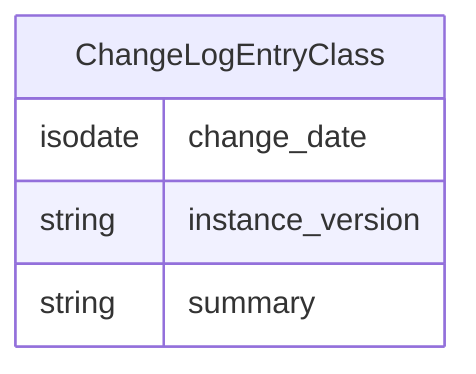

# Class: ChangeLogEntryClass 


_An individual entry in the change log, documenting a specific change to the data instance._


URI: [pals_config:class/ChangeLogEntryClass](https://w3id.org/pals-config/class/ChangeLogEntryClass)





<!-- no inheritance hierarchy -->

## Slots

| Name | Cardinality and Range | Description | Inheritance |
| ---  | --- | --- | --- |
| [change_date](../slots/change_date.md) | 1 <br/> [Isodate](../types/Isodate.md) | The date the change was made, in ISO 8601 format (YYYY-MM-DD). | direct |
| [instance_version](../slots/instance_version.md) | 1 <br/> [String](../types/String.md) | The version of the data instance that was changed. | direct |
| [summary](../slots/summary.md) | 1 <br/> [String](../types/String.md) | A brief summary of the change. | direct |


## Usages

| used by | used in | type | used |
| ---  | --- | --- | --- |
| [PALSAccelerator](../classes/PALSAccelerator.md) | [change_log](../slots/change_log.md) | range | [ChangeLogEntryClass](../classes/ChangeLogEntryClass.md) |


## Identifier and Mapping Information


### Schema Source


* from schema: https://w3id.org/pals-config


## Mappings

| Mapping Type | Mapped Value |
| ---  | ---  |
| self | pals_config:ChangeLogEntryClass |
| native | pals_config:ChangeLogEntryClass |


## LinkML Source

<!-- TODO: investigate https://stackoverflow.com/questions/37606292/how-to-create-tabbed-code-blocks-in-mkdocs-or-sphinx -->

### Direct

<details>
```yaml
name: ChangeLogEntryClass
description: An individual entry in the change log, documenting a specific change
  to the data instance.
from_schema: https://w3id.org/pals-config
attributes:
  change_date:
    name: change_date
    description: The date the change was made, in ISO 8601 format (YYYY-MM-DD).
    from_schema: https://w3id.org/pals-config
    rank: 1000
    domain_of:
    - ChangeLogEntryClass
    range: isodate
    required: true
  instance_version:
    name: instance_version
    description: The version of the data instance that was changed.
    from_schema: https://w3id.org/pals-config
    rank: 1000
    ifabsent: string(0.0.0)
    domain_of:
    - ChangeLogEntryClass
    range: string
    required: true
    pattern: ^\d+\.\d+(\.\d+)?$
  summary:
    name: summary
    description: A brief summary of the change.
    from_schema: https://w3id.org/pals-config
    exact_mappings:
    - skos:changeNote
    rank: 1000
    domain_of:
    - ChangeLogEntryClass
    range: string
    required: true

```
</details>

### Induced

<details>
```yaml
name: ChangeLogEntryClass
description: An individual entry in the change log, documenting a specific change
  to the data instance.
from_schema: https://w3id.org/pals-config
attributes:
  change_date:
    name: change_date
    description: The date the change was made, in ISO 8601 format (YYYY-MM-DD).
    from_schema: https://w3id.org/pals-config
    rank: 1000
    alias: change_date
    owner: ChangeLogEntryClass
    domain_of:
    - ChangeLogEntryClass
    range: isodate
    required: true
  instance_version:
    name: instance_version
    description: The version of the data instance that was changed.
    from_schema: https://w3id.org/pals-config
    rank: 1000
    ifabsent: string(0.0.0)
    alias: instance_version
    owner: ChangeLogEntryClass
    domain_of:
    - ChangeLogEntryClass
    range: string
    required: true
    pattern: ^\d+\.\d+(\.\d+)?$
  summary:
    name: summary
    description: A brief summary of the change.
    from_schema: https://w3id.org/pals-config
    exact_mappings:
    - skos:changeNote
    rank: 1000
    alias: summary
    owner: ChangeLogEntryClass
    domain_of:
    - ChangeLogEntryClass
    range: string
    required: true

```
</details>