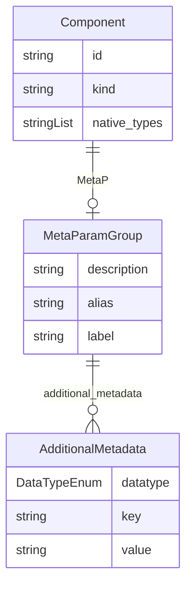

# Class: Component 


_A general class for accelerator components, which can be specialized into more specific types like AcceleratorDevice, Magnet, etc._


* __NOTE__: this is an abstract class and should not be instantiated directly


URI: [pals:class/Component](https://pals-project.readthedocs.io/class/Component)





## Inheritance
* **Component** [ [HasMetaP](../classes/HasMetaP.md)]
    * [PhysicalComponent](../classes/PhysicalComponent.md) [ [HasFloorP](../classes/HasFloorP.md) [HasLongitudinalPlacementP](../classes/HasLongitudinalPlacementP.md)]
    * [VirtualComponent](../classes/VirtualComponent.md) [ [HasFloorP](../classes/HasFloorP.md)]


## Slots

| Name | Cardinality and Range | Description | Inheritance |
| ---  | --- | --- | --- |
| [id](../slots/id.md) | 1 <br/> [String](../types/String.md) | A unique identifier for the instance. | direct |
| [kind](../slots/kind.md) | 1 <br/> [String](../types/String.md) | The LinkML class name of this instance. | direct |
| [native_types](../slots/native_types.md) | * <br/> [String](../types/String.md) | The native type of the component in the source system, which can be used to identify the component across different source systems. | direct |
| [MetaP](../slots/MetaP.md) | 0..1 <br/> [MetaParamGroup](../classes/MetaParamGroup.md) | A mixin for metadata parameters that are aligned with PALS MetaP (Metadata Parameters) for interoperability with the Particle Accelerator Language Standard (PALS). | [HasMetaP](../classes/HasMetaP.md) |


## Usages

| used by | used in | type | used |
| ---  | --- | --- | --- |
| [Facility](../classes/Facility.md) | [components](../slots/components.md) | range | [Component](../classes/Component.md) |
| [ComponentRelation](../classes/ComponentRelation.md) | [subject](../slots/subject.md) | range | [Component](../classes/Component.md) |
| [ComponentRelation](../classes/ComponentRelation.md) | [object](../slots/object.md) | range | [Component](../classes/Component.md) |


## Identifier and Mapping Information


### Schema Source


* from schema: https://w3id.org/accelerator-core


## Mappings

| Mapping Type | Mapped Value |
| ---  | ---  |
| self | pals:Component |
| native | pals:Component |
| broad | pals:Element |


## LinkML Source

<!-- TODO: investigate https://stackoverflow.com/questions/37606292/how-to-create-tabbed-code-blocks-in-mkdocs-or-sphinx -->

### Direct

<details>
```yaml
name: Component
description: A general class for accelerator components, which can be specialized
  into more specific types like AcceleratorDevice, Magnet, etc.
from_schema: https://w3id.org/accelerator-core
broad_mappings:
- pals:Element
abstract: true
mixins:
- HasMetaP
slots:
- id
- kind
attributes:
  native_types:
    name: native_types
    description: The native type of the component in the source system, which can
      be used to identify the component across different source systems.
    from_schema: https://w3id.org/accelerator-core
    rank: 1000
    domain_of:
    - Component
    range: string
    multivalued: true

```
</details>

### Induced

<details>
```yaml
name: Component
description: A general class for accelerator components, which can be specialized
  into more specific types like AcceleratorDevice, Magnet, etc.
from_schema: https://w3id.org/accelerator-core
broad_mappings:
- pals:Element
abstract: true
mixins:
- HasMetaP
attributes:
  native_types:
    name: native_types
    description: The native type of the component in the source system, which can
      be used to identify the component across different source systems.
    from_schema: https://w3id.org/accelerator-core
    rank: 1000
    alias: native_types
    owner: Component
    domain_of:
    - Component
    range: string
    multivalued: true
  id:
    name: id
    description: A unique identifier for the instance.
    from_schema: https://w3id.org/accelerator-core
    rank: 1000
    slot_uri: pals:id
    identifier: true
    alias: id
    owner: Component
    domain_of:
    - Affiliation
    - Component
    - Signal
    - Relationship
    range: string
    required: true
  kind:
    name: kind
    description: The LinkML class name of this instance.
    from_schema: https://w3id.org/accelerator-core
    rank: 1000
    slot_uri: pals:kind
    designates_type: true
    alias: kind
    owner: Component
    domain_of:
    - PALSAccelerator
    - Component
    - Signal
    range: string
    required: true
  MetaP:
    name: MetaP
    description: A mixin for metadata parameters that are aligned with PALS MetaP
      (Metadata Parameters) for interoperability with the Particle Accelerator Language
      Standard (PALS).
    from_schema: https://w3id.org/accelerator-core
    rank: 1000
    alias: MetaP
    owner: Component
    domain_of:
    - HasMetaP
    range: MetaParamGroup
    inlined: true

```
</details>