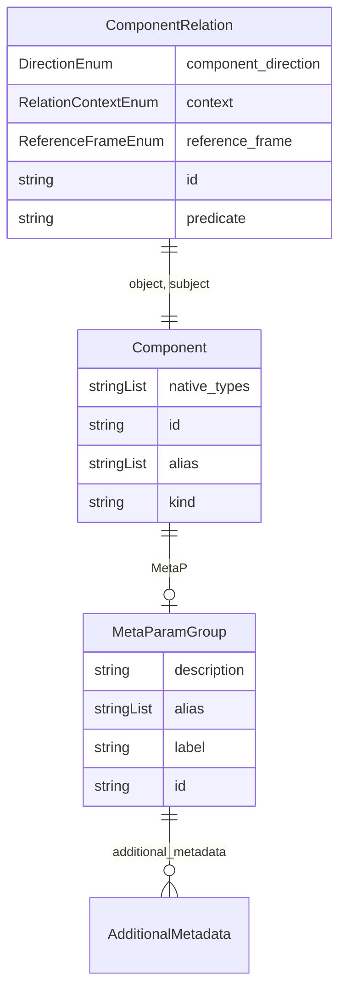

# Class: ComponentRelation 


_Association between two Components (Physical or Virtual), with supporting contextual/qualifying information about how and where the relationship holds._


* __NOTE__: this is an abstract class and should not be instantiated directly


URI: [acc:class/ComponentRelation](https://example.org/accelerator-core/class/ComponentRelation)





## Inheritance
* [Edge](../classes/Edge.md)
    * **ComponentRelation**
        * [Precedes](../classes/Precedes.md)
        * [Contains](../classes/Contains.md)
        * [Controls](../classes/Controls.md)
        * [IsPartOf](../classes/IsPartOf.md)
        * [AdjacentTo](../classes/AdjacentTo.md)
        * [Overlaps](../classes/Overlaps.md)
        * [HasConnectingBranch](../classes/HasConnectingBranch.md)
        * [MountedOn](../classes/MountedOn.md)
        * [Intersects](../classes/Intersects.md)
        * [NearestTo](../classes/NearestTo.md)


## Slots

| Name | Cardinality and Range | Description | Inheritance |
| ---  | --- | --- | --- |
| [context](../slots/context.md) | 1 <br/> [RelationContextEnum](../enums/RelationContextEnum.md) | The frame of reference / domain in which this relationship is asserted to hold. | direct |
| [component_direction](../slots/component_direction.md) | 0..1 <br/> [DirectionEnum](../enums/DirectionEnum.md) |  | direct |
| [reference_frame](../slots/reference_frame.md) | 0..1 _recommended_ <br/> [ReferenceFrameEnum](../enums/ReferenceFrameEnum.md) |  | direct |
| [id](../slots/id.md) | 1 <br/> [String](../types/String.md) | A unique identifier for the instance. | [Edge](../classes/Edge.md) |
| [subject](../slots/subject.md) | 1 <br/> [Component](../classes/Component.md) |  | [Edge](../classes/Edge.md) |
| [predicate](../slots/predicate.md) | 1 <br/> [String](../types/String.md) |  | [Edge](../classes/Edge.md) |
| [object](../slots/object.md) | 1 <br/> [Component](../classes/Component.md) |  | [Edge](../classes/Edge.md) |


## Usages

| used by | used in | type | used |
| ---  | --- | --- | --- |
| [Facility](../classes/Facility.md) | [component_relations](../slots/component_relations.md) | range | [ComponentRelation](../classes/ComponentRelation.md) |


## Identifier and Mapping Information


### Schema Source


* from schema: https://w3id.org/accelerator-core


## Mappings

| Mapping Type | Mapped Value |
| ---  | ---  |
| self | acc:ComponentRelation |
| native | acc:ComponentRelation |


## LinkML Source

<!-- TODO: investigate https://stackoverflow.com/questions/37606292/how-to-create-tabbed-code-blocks-in-mkdocs-or-sphinx -->

### Direct

<details>
```yaml
name: ComponentRelation
description: Association between two Components (Physical or Virtual), with supporting
  contextual/qualifying information about how and where the relationship holds.
from_schema: https://w3id.org/accelerator-core
is_a: Edge
abstract: true
slots:
- context
slot_usage:
  subject:
    name: subject
    range: Component
  object:
    name: object
    range: Component
attributes:
  component_direction:
    name: component_direction
    from_schema: https://w3id.org/accelerator-core
    rank: 1000
    domain_of:
    - ComponentRelation
    range: DirectionEnum
  reference_frame:
    name: reference_frame
    from_schema: https://w3id.org/accelerator-core
    rank: 1000
    domain_of:
    - ComponentRelation
    range: ReferenceFrameEnum
    recommended: true

```
</details>

### Induced

<details>
```yaml
name: ComponentRelation
description: Association between two Components (Physical or Virtual), with supporting
  contextual/qualifying information about how and where the relationship holds.
from_schema: https://w3id.org/accelerator-core
is_a: Edge
abstract: true
slot_usage:
  subject:
    name: subject
    range: Component
  object:
    name: object
    range: Component
attributes:
  component_direction:
    name: component_direction
    from_schema: https://w3id.org/accelerator-core
    rank: 1000
    alias: component_direction
    owner: ComponentRelation
    domain_of:
    - ComponentRelation
    range: DirectionEnum
  reference_frame:
    name: reference_frame
    from_schema: https://w3id.org/accelerator-core
    rank: 1000
    alias: reference_frame
    owner: ComponentRelation
    domain_of:
    - ComponentRelation
    range: ReferenceFrameEnum
    recommended: true
  context:
    name: context
    description: The frame of reference / domain in which this relationship is asserted
      to hold.
    from_schema: https://w3id.org/accelerator-core
    rank: 1000
    alias: context
    owner: ComponentRelation
    domain_of:
    - ComponentRelation
    - IsPartOf
    range: RelationContextEnum
    required: true
  id:
    name: id
    description: A unique identifier for the instance.
    from_schema: https://w3id.org/accelerator-core
    close_mappings:
    - pals:id
    rank: 1000
    identifier: true
    alias: id
    owner: ComponentRelation
    domain_of:
    - Node
    - Affiliation
    - ParamGroup
    - Edge
    range: string
    required: true
  subject:
    name: subject
    from_schema: https://w3id.org/accelerator-core
    rank: 1000
    slot_uri: rdf:subject
    alias: subject
    owner: ComponentRelation
    domain_of:
    - Edge
    range: Component
    required: true
  predicate:
    name: predicate
    from_schema: https://w3id.org/accelerator-core
    rank: 1000
    slot_uri: rdf:predicate
    designates_type: true
    alias: predicate
    owner: ComponentRelation
    domain_of:
    - Edge
    range: string
    required: true
  object:
    name: object
    from_schema: https://w3id.org/accelerator-core
    rank: 1000
    slot_uri: rdf:object
    alias: object
    owner: ComponentRelation
    domain_of:
    - Edge
    range: Component
    required: true

```
</details>