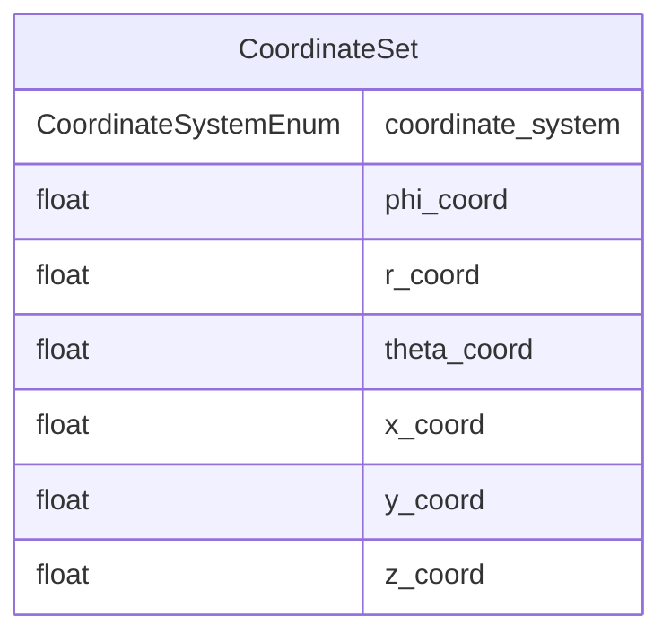

# Class: CoordinateSet 


_A set of coordinates that define the spatial relationship between two components. This can include Cartesian coordinates, cylindrical coordinates, or other coordinate systems as needed. Useful for defining the spatial relationship where the relationship is not strictly linear or where the components are not aligned along a single axis._


URI: [acc:class/CoordinateSet](https://example.org/accelerator-core/class/CoordinateSet)





<!-- no inheritance hierarchy -->

## Slots

| Name | Cardinality and Range | Description | Inheritance |
| ---  | --- | --- | --- |
| [coordinate_system](../slots/coordinate_system.md) | 0..1 <br/> [CoordinateSystemEnum](../enums/CoordinateSystemEnum.md) | The coordinate system used for the coordinates (e.g., Cartesian, Cylindrical). | direct |
| [x_coord](../slots/x_coord.md) | 0..1 <br/> [Float](../types/Float.md) | The x-coordinate in the specified coordinate system. | direct |
| [y_coord](../slots/y_coord.md) | 0..1 <br/> [Float](../types/Float.md) | The y-coordinate in the specified coordinate system. | direct |
| [z_coord](../slots/z_coord.md) | 0..1 <br/> [Float](../types/Float.md) | The z-coordinate in the specified coordinate system. | direct |
| [r_coord](../slots/r_coord.md) | 0..1 <br/> [Float](../types/Float.md) | The radial distance in cylindrical coordinates. | direct |
| [theta_coord](../slots/theta_coord.md) | 0..1 <br/> [Float](../types/Float.md) | The angular coordinate in cylindrical coordinates (in radians). | direct |
| [phi_coord](../slots/phi_coord.md) | 0..1 <br/> [Float](../types/Float.md) | The azimuthal angle in spherical coordinates (in radians). | direct |


## Usages

| used by | used in | type | used |
| ---  | --- | --- | --- |
| [AdjacentTo](../classes/AdjacentTo.md) | [coordinates](../slots/coordinates.md) | range | [CoordinateSet](../classes/CoordinateSet.md) |
| [Overlaps](../classes/Overlaps.md) | [coordinates](../slots/coordinates.md) | range | [CoordinateSet](../classes/CoordinateSet.md) |
| [MountedOn](../classes/MountedOn.md) | [coordinates](../slots/coordinates.md) | range | [CoordinateSet](../classes/CoordinateSet.md) |
| [NearestTo](../classes/NearestTo.md) | [coordinates](../slots/coordinates.md) | range | [CoordinateSet](../classes/CoordinateSet.md) |


## Identifier and Mapping Information


### Schema Source


* from schema: https://w3id.org/accelerator-core


## Mappings

| Mapping Type | Mapped Value |
| ---  | ---  |
| self | acc:CoordinateSet |
| native | acc:CoordinateSet |


## LinkML Source

<!-- TODO: investigate https://stackoverflow.com/questions/37606292/how-to-create-tabbed-code-blocks-in-mkdocs-or-sphinx -->

### Direct

<details>
```yaml
name: CoordinateSet
description: A set of coordinates that define the spatial relationship between two
  components. This can include Cartesian coordinates, cylindrical coordinates, or
  other coordinate systems as needed. Useful for defining the spatial relationship
  where the relationship is not strictly linear or where the components are not aligned
  along a single axis.
from_schema: https://w3id.org/accelerator-core
attributes:
  coordinate_system:
    name: coordinate_system
    description: The coordinate system used for the coordinates (e.g., Cartesian,
      Cylindrical).
    from_schema: https://w3id.org/accelerator-core
    rank: 1000
    domain_of:
    - CoordinateSet
    range: CoordinateSystemEnum
  x_coord:
    name: x_coord
    description: The x-coordinate in the specified coordinate system.
    from_schema: https://w3id.org/accelerator-core
    rank: 1000
    domain_of:
    - CoordinateSet
    range: float
  y_coord:
    name: y_coord
    description: The y-coordinate in the specified coordinate system.
    from_schema: https://w3id.org/accelerator-core
    rank: 1000
    domain_of:
    - CoordinateSet
    range: float
  z_coord:
    name: z_coord
    description: The z-coordinate in the specified coordinate system.
    from_schema: https://w3id.org/accelerator-core
    rank: 1000
    domain_of:
    - CoordinateSet
    range: float
  r_coord:
    name: r_coord
    description: The radial distance in cylindrical coordinates.
    from_schema: https://w3id.org/accelerator-core
    rank: 1000
    domain_of:
    - CoordinateSet
    range: float
  theta_coord:
    name: theta_coord
    description: The angular coordinate in cylindrical coordinates (in radians).
    from_schema: https://w3id.org/accelerator-core
    rank: 1000
    domain_of:
    - CoordinateSet
    range: float
  phi_coord:
    name: phi_coord
    description: The azimuthal angle in spherical coordinates (in radians).
    from_schema: https://w3id.org/accelerator-core
    rank: 1000
    domain_of:
    - CoordinateSet
    range: float

```
</details>

### Induced

<details>
```yaml
name: CoordinateSet
description: A set of coordinates that define the spatial relationship between two
  components. This can include Cartesian coordinates, cylindrical coordinates, or
  other coordinate systems as needed. Useful for defining the spatial relationship
  where the relationship is not strictly linear or where the components are not aligned
  along a single axis.
from_schema: https://w3id.org/accelerator-core
attributes:
  coordinate_system:
    name: coordinate_system
    description: The coordinate system used for the coordinates (e.g., Cartesian,
      Cylindrical).
    from_schema: https://w3id.org/accelerator-core
    rank: 1000
    alias: coordinate_system
    owner: CoordinateSet
    domain_of:
    - CoordinateSet
    range: CoordinateSystemEnum
  x_coord:
    name: x_coord
    description: The x-coordinate in the specified coordinate system.
    from_schema: https://w3id.org/accelerator-core
    rank: 1000
    alias: x_coord
    owner: CoordinateSet
    domain_of:
    - CoordinateSet
    range: float
  y_coord:
    name: y_coord
    description: The y-coordinate in the specified coordinate system.
    from_schema: https://w3id.org/accelerator-core
    rank: 1000
    alias: y_coord
    owner: CoordinateSet
    domain_of:
    - CoordinateSet
    range: float
  z_coord:
    name: z_coord
    description: The z-coordinate in the specified coordinate system.
    from_schema: https://w3id.org/accelerator-core
    rank: 1000
    alias: z_coord
    owner: CoordinateSet
    domain_of:
    - CoordinateSet
    range: float
  r_coord:
    name: r_coord
    description: The radial distance in cylindrical coordinates.
    from_schema: https://w3id.org/accelerator-core
    rank: 1000
    alias: r_coord
    owner: CoordinateSet
    domain_of:
    - CoordinateSet
    range: float
  theta_coord:
    name: theta_coord
    description: The angular coordinate in cylindrical coordinates (in radians).
    from_schema: https://w3id.org/accelerator-core
    rank: 1000
    alias: theta_coord
    owner: CoordinateSet
    domain_of:
    - CoordinateSet
    range: float
  phi_coord:
    name: phi_coord
    description: The azimuthal angle in spherical coordinates (in radians).
    from_schema: https://w3id.org/accelerator-core
    rank: 1000
    alias: phi_coord
    owner: CoordinateSet
    domain_of:
    - CoordinateSet
    range: float

```
</details>