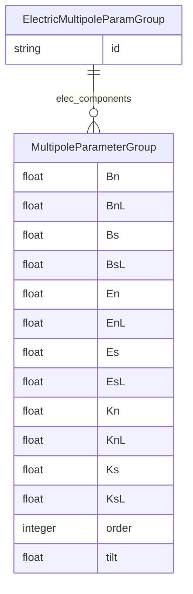

# Class: ElectricMultipoleParamGroup 


_Mixin for electric multipole parameters,  which can be used to describe the electric field components of an accelerator element. This mixin is aligned with PALS ElectricMultipoleP for interoperability with the Particle Accelerator Language Standard (PALS). Example with three multipole components (N=0,1,2): ```yaml elec_components: - order: 7_

_  tilt: 0.7_

_- order: 3_

_  En: 27.3_

_- order: 2_

_  EnL: 3.47e1_

_```_


URI: [pals_config:class/ElectricMultipoleParamGroup](https://w3id.org/pals-config/class/ElectricMultipoleParamGroup)





## Inheritance
* [ParamGroup](../classes/ParamGroup.md)
    * **ElectricMultipoleParamGroup**


## Slots

| Name | Cardinality and Range | Description | Inheritance |
| ---  | --- | --- | --- |
| [elec_components](../slots/elec_components.md) | * <br/> [MultipoleParameterGroup](../classes/MultipoleParameterGroup.md) | Electric multipole components, one per order N. | direct |
| [id](../slots/id.md) | 1 <br/> [String](../types/String.md) | A unique identifier for the instance. | [ParamGroup](../classes/ParamGroup.md) |


## Usages

| used by | used in | type | used |
| ---  | --- | --- | --- |
| [HasElectricMultipoleP](../classes/HasElectricMultipoleP.md) | [ElectricMultipoleP](../slots/ElectricMultipoleP.md) | range | [ElectricMultipoleParamGroup](../classes/ElectricMultipoleParamGroup.md) |
| [Multipole](../classes/Multipole.md) | [ElectricMultipoleP](../slots/ElectricMultipoleP.md) | range | [ElectricMultipoleParamGroup](../classes/ElectricMultipoleParamGroup.md) |
| [Bend](../classes/Bend.md) | [ElectricMultipoleP](../slots/ElectricMultipoleP.md) | range | [ElectricMultipoleParamGroup](../classes/ElectricMultipoleParamGroup.md) |
| [Quadrupole](../classes/Quadrupole.md) | [ElectricMultipoleP](../slots/ElectricMultipoleP.md) | range | [ElectricMultipoleParamGroup](../classes/ElectricMultipoleParamGroup.md) |
| [Octupole](../classes/Octupole.md) | [ElectricMultipoleP](../slots/ElectricMultipoleP.md) | range | [ElectricMultipoleParamGroup](../classes/ElectricMultipoleParamGroup.md) |
| [Sextupole](../classes/Sextupole.md) | [ElectricMultipoleP](../slots/ElectricMultipoleP.md) | range | [ElectricMultipoleParamGroup](../classes/ElectricMultipoleParamGroup.md) |
| [Kicker](../classes/Kicker.md) | [ElectricMultipoleP](../slots/ElectricMultipoleP.md) | range | [ElectricMultipoleParamGroup](../classes/ElectricMultipoleParamGroup.md) |
| [ACKicker](../classes/ACKicker.md) | [ElectricMultipoleP](../slots/ElectricMultipoleP.md) | range | [ElectricMultipoleParamGroup](../classes/ElectricMultipoleParamGroup.md) |
| [Cavity](../classes/Cavity.md) | [ElectricMultipoleP](../slots/ElectricMultipoleP.md) | range | [ElectricMultipoleParamGroup](../classes/ElectricMultipoleParamGroup.md) |
| [CrabCavity](../classes/CrabCavity.md) | [ElectricMultipoleP](../slots/ElectricMultipoleP.md) | range | [ElectricMultipoleParamGroup](../classes/ElectricMultipoleParamGroup.md) |
| [RFCavity](../classes/RFCavity.md) | [ElectricMultipoleP](../slots/ElectricMultipoleP.md) | range | [ElectricMultipoleParamGroup](../classes/ElectricMultipoleParamGroup.md) |
| [NormalConductingRFCavity](../classes/NormalConductingRFCavity.md) | [ElectricMultipoleP](../slots/ElectricMultipoleP.md) | range | [ElectricMultipoleParamGroup](../classes/ElectricMultipoleParamGroup.md) |
| [SuperConductingRFCavity](../classes/SuperConductingRFCavity.md) | [ElectricMultipoleP](../slots/ElectricMultipoleP.md) | range | [ElectricMultipoleParamGroup](../classes/ElectricMultipoleParamGroup.md) |


## Identifier and Mapping Information


### Schema Source


* from schema: https://w3id.org/pals-config


## Mappings

| Mapping Type | Mapped Value |
| ---  | ---  |
| self | pals_config:ElectricMultipoleParamGroup |
| native | pals_config:ElectricMultipoleParamGroup |
| exact | pals:ElectricMultipoleP |
| broad | pals_parametergroups:electricmultipolep-electric-multipole-parameters |


## LinkML Source

<!-- TODO: investigate https://stackoverflow.com/questions/37606292/how-to-create-tabbed-code-blocks-in-mkdocs-or-sphinx -->

### Direct

<details>
```yaml
name: ElectricMultipoleParamGroup
description: "Mixin for electric multipole parameters,  which can be used to describe\
  \ the electric field components of an accelerator element. This mixin is aligned\
  \ with PALS ElectricMultipoleP for interoperability with the Particle Accelerator\
  \ Language Standard (PALS). Example with three multipole components (N=0,1,2): ```yaml\
  \ elec_components: - order: 7\n  tilt: 0.7\n- order: 3\n  En: 27.3\n- order: 2\n\
  \  EnL: 3.47e1\n```"
from_schema: https://w3id.org/pals-config
exact_mappings:
- pals:ElectricMultipoleP
broad_mappings:
- pals_parametergroups:electricmultipolep-electric-multipole-parameters
is_a: ParamGroup
attributes:
  elec_components:
    name: elec_components
    description: Electric multipole components, one per order N.
    from_schema: https://w3id.org/pals-config
    rank: 1000
    domain_of:
    - ElectricMultipoleParamGroup
    range: MultipoleParameterGroup
    multivalued: true
    inlined: true
    inlined_as_list: true

```
</details>

### Induced

<details>
```yaml
name: ElectricMultipoleParamGroup
description: "Mixin for electric multipole parameters,  which can be used to describe\
  \ the electric field components of an accelerator element. This mixin is aligned\
  \ with PALS ElectricMultipoleP for interoperability with the Particle Accelerator\
  \ Language Standard (PALS). Example with three multipole components (N=0,1,2): ```yaml\
  \ elec_components: - order: 7\n  tilt: 0.7\n- order: 3\n  En: 27.3\n- order: 2\n\
  \  EnL: 3.47e1\n```"
from_schema: https://w3id.org/pals-config
exact_mappings:
- pals:ElectricMultipoleP
broad_mappings:
- pals_parametergroups:electricmultipolep-electric-multipole-parameters
is_a: ParamGroup
attributes:
  elec_components:
    name: elec_components
    description: Electric multipole components, one per order N.
    from_schema: https://w3id.org/pals-config
    rank: 1000
    alias: elec_components
    owner: ElectricMultipoleParamGroup
    domain_of:
    - ElectricMultipoleParamGroup
    range: MultipoleParameterGroup
    multivalued: true
    inlined: true
    inlined_as_list: true
  id:
    name: id
    description: A unique identifier for the instance.
    from_schema: https://w3id.org/pals-config
    close_mappings:
    - pals:id
    rank: 1000
    identifier: true
    alias: id
    owner: ElectricMultipoleParamGroup
    domain_of:
    - Node
    - Affiliation
    - ParamGroup
    - Edge
    range: string
    required: true

```
</details>