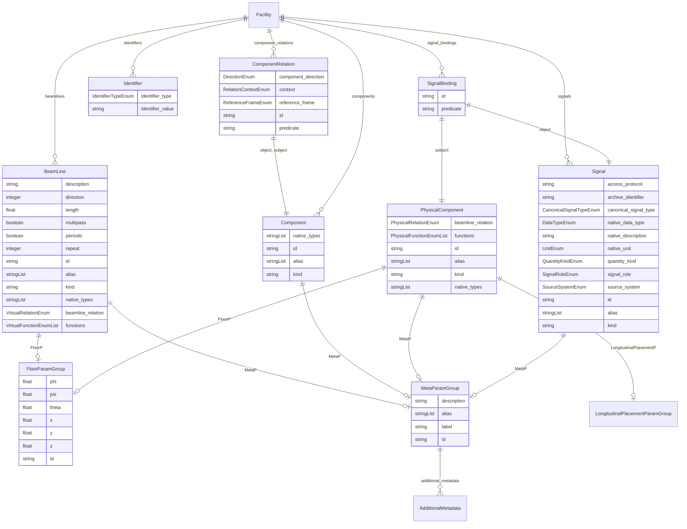

# Class: Facility 


_A facility that houses one or more accelerators._


URI: [acc:class/Facility](https://example.org/accelerator-core/class/Facility)





<!-- no inheritance hierarchy -->

## Slots

| Name | Cardinality and Range | Description | Inheritance |
| ---  | --- | --- | --- |
| [identifiers](../slots/identifiers.md) | * <br/> [Identifier](../classes/Identifier.md) | A unique and ideally persistent identifier for the facility, such as a DOI or ROR. | direct |
| [components](../slots/components.md) | * <br/> [Component](../classes/Component.md) | A list of physical components in the accelerator system. | direct |
| [beamlines](../slots/beamlines.md) | * <br/> [BeamLine](../classes/BeamLine.md) | A list of beamlines in the accelerator system. | direct |
| [signals](../slots/signals.md) | * <br/> [Signal](../classes/Signal.md) | A list of signals in the accelerator system. | direct |
| [signal_bindings](../slots/signal_bindings.md) | * <br/> [SignalBinding](../classes/SignalBinding.md) | A list of signal bindings in the accelerator system (Component <-> Signal relationships). | direct |
| [component_relations](../slots/component_relations.md) | * <br/> [ComponentRelation](../classes/ComponentRelation.md) | A list of component relations in the accelerator system (Component <-> Component relationships). | direct |


## Usages

| used by | used in | type | used |
| ---  | --- | --- | --- |
| [PALSAccelerator](../classes/PALSAccelerator.md) | [facility](../slots/facility.md) | range | [Facility](../classes/Facility.md) |


## Identifier and Mapping Information


### Schema Source


* from schema: https://w3id.org/accelerator-core


## Mappings

| Mapping Type | Mapped Value |
| ---  | ---  |
| self | acc:Facility |
| native | acc:Facility |


## LinkML Source

<!-- TODO: investigate https://stackoverflow.com/questions/37606292/how-to-create-tabbed-code-blocks-in-mkdocs-or-sphinx -->

### Direct

<details>
```yaml
name: Facility
description: A facility that houses one or more accelerators.
from_schema: https://w3id.org/accelerator-core
slots:
- identifiers
attributes:
  components:
    name: components
    description: A list of physical components in the accelerator system.
    from_schema: https://w3id.org/accelerator-core
    rank: 1000
    domain_of:
    - Facility
    range: Component
    multivalued: true
    inlined: true
    inlined_as_list: true
  beamlines:
    name: beamlines
    description: A list of beamlines in the accelerator system.
    from_schema: https://w3id.org/accelerator-core
    rank: 1000
    domain_of:
    - Facility
    range: BeamLine
    multivalued: true
    inlined: true
    inlined_as_list: true
  signals:
    name: signals
    description: A list of signals in the accelerator system.
    from_schema: https://w3id.org/accelerator-core
    rank: 1000
    domain_of:
    - Facility
    range: Signal
    multivalued: true
    inlined: true
    inlined_as_list: true
  signal_bindings:
    name: signal_bindings
    description: A list of signal bindings in the accelerator system (Component <->
      Signal relationships).
    from_schema: https://w3id.org/accelerator-core
    rank: 1000
    domain_of:
    - Facility
    range: SignalBinding
    multivalued: true
    inlined: true
    inlined_as_list: true
  component_relations:
    name: component_relations
    description: A list of component relations in the accelerator system (Component
      <-> Component relationships).
    from_schema: https://w3id.org/accelerator-core
    rank: 1000
    domain_of:
    - Facility
    range: ComponentRelation
    multivalued: true
    inlined: true
    inlined_as_list: true

```
</details>

### Induced

<details>
```yaml
name: Facility
description: A facility that houses one or more accelerators.
from_schema: https://w3id.org/accelerator-core
attributes:
  components:
    name: components
    description: A list of physical components in the accelerator system.
    from_schema: https://w3id.org/accelerator-core
    rank: 1000
    alias: components
    owner: Facility
    domain_of:
    - Facility
    range: Component
    multivalued: true
    inlined: true
    inlined_as_list: true
  beamlines:
    name: beamlines
    description: A list of beamlines in the accelerator system.
    from_schema: https://w3id.org/accelerator-core
    rank: 1000
    alias: beamlines
    owner: Facility
    domain_of:
    - Facility
    range: BeamLine
    multivalued: true
    inlined: true
    inlined_as_list: true
  signals:
    name: signals
    description: A list of signals in the accelerator system.
    from_schema: https://w3id.org/accelerator-core
    rank: 1000
    alias: signals
    owner: Facility
    domain_of:
    - Facility
    range: Signal
    multivalued: true
    inlined: true
    inlined_as_list: true
  signal_bindings:
    name: signal_bindings
    description: A list of signal bindings in the accelerator system (Component <->
      Signal relationships).
    from_schema: https://w3id.org/accelerator-core
    rank: 1000
    alias: signal_bindings
    owner: Facility
    domain_of:
    - Facility
    range: SignalBinding
    multivalued: true
    inlined: true
    inlined_as_list: true
  component_relations:
    name: component_relations
    description: A list of component relations in the accelerator system (Component
      <-> Component relationships).
    from_schema: https://w3id.org/accelerator-core
    rank: 1000
    alias: component_relations
    owner: Facility
    domain_of:
    - Facility
    range: ComponentRelation
    multivalued: true
    inlined: true
    inlined_as_list: true
  identifiers:
    name: identifiers
    description: A unique and ideally persistent identifier for the facility, such
      as a DOI or ROR.
    from_schema: https://w3id.org/accelerator-core
    rank: 1000
    alias: identifiers
    owner: Facility
    domain_of:
    - Facility
    - Affiliation
    range: Identifier
    multivalued: true

```
</details>