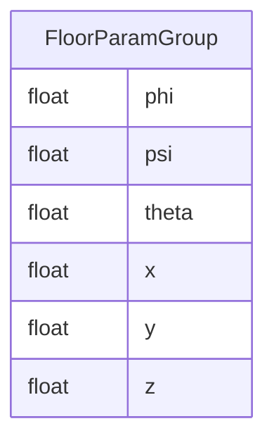

# Class: FloorParamGroup 


_Mixin class for floor plan parameters that are aligned with PALS FloorP (Floor Plan Parameters)  for interoperability with the Particle Accelerator Language Standard (PALS)._


URI: [pals:class/FloorParamGroup](https://pals-project.readthedocs.io/class/FloorParamGroup)





<!-- no inheritance hierarchy -->

## Slots

| Name | Cardinality and Range | Description | Inheritance |
| ---  | --- | --- | --- |
| [x](../slots/x.md) | 0..1 <br/> [Float](../types/Float.md) | Global X coordinate in the facility floor plan. | direct |
| [y](../slots/y.md) | 0..1 <br/> [Float](../types/Float.md) | Global Y coordinate in the facility floor plan. | direct |
| [z](../slots/z.md) | 0..1 <br/> [Float](../types/Float.md) | Global Z coordinate in the facility floor plan. | direct |
| [theta](../slots/theta.md) | 0..1 <br/> [Float](../types/Float.md) | Orientation angle around the Y-axis in the facility floor plan. | direct |
| [phi](../slots/phi.md) | 0..1 <br/> [Float](../types/Float.md) | Rotation around the X-axis in the facility floor plan. | direct |
| [psi](../slots/psi.md) | 0..1 <br/> [Float](../types/Float.md) | Rotation around the Z-axis in the facility floor plan. | direct |


## Usages

| used by | used in | type | used |
| ---  | --- | --- | --- |
| [HasFloorP](../classes/HasFloorP.md) | [FloorP](../slots/FloorP.md) | range | [FloorParamGroup](../classes/FloorParamGroup.md) |
| [PhysicalComponent](../classes/PhysicalComponent.md) | [FloorP](../slots/FloorP.md) | range | [FloorParamGroup](../classes/FloorParamGroup.md) |
| [VirtualComponent](../classes/VirtualComponent.md) | [FloorP](../slots/FloorP.md) | range | [FloorParamGroup](../classes/FloorParamGroup.md) |
| [BeamLine](../classes/BeamLine.md) | [FloorP](../slots/FloorP.md) | range | [FloorParamGroup](../classes/FloorParamGroup.md) |
| [Magnet](../classes/Magnet.md) | [FloorP](../slots/FloorP.md) | range | [FloorParamGroup](../classes/FloorParamGroup.md) |
| [Solenoid](../classes/Solenoid.md) | [FloorP](../slots/FloorP.md) | range | [FloorParamGroup](../classes/FloorParamGroup.md) |
| [Multipole](../classes/Multipole.md) | [FloorP](../slots/FloorP.md) | range | [FloorParamGroup](../classes/FloorParamGroup.md) |
| [Bend](../classes/Bend.md) | [FloorP](../slots/FloorP.md) | range | [FloorParamGroup](../classes/FloorParamGroup.md) |
| [Quadrupole](../classes/Quadrupole.md) | [FloorP](../slots/FloorP.md) | range | [FloorParamGroup](../classes/FloorParamGroup.md) |
| [Octupole](../classes/Octupole.md) | [FloorP](../slots/FloorP.md) | range | [FloorParamGroup](../classes/FloorParamGroup.md) |
| [Sextupole](../classes/Sextupole.md) | [FloorP](../slots/FloorP.md) | range | [FloorParamGroup](../classes/FloorParamGroup.md) |
| [Kicker](../classes/Kicker.md) | [FloorP](../slots/FloorP.md) | range | [FloorParamGroup](../classes/FloorParamGroup.md) |
| [ACKicker](../classes/ACKicker.md) | [FloorP](../slots/FloorP.md) | range | [FloorParamGroup](../classes/FloorParamGroup.md) |
| [DiagnosticDevice](../classes/DiagnosticDevice.md) | [FloorP](../slots/FloorP.md) | range | [FloorParamGroup](../classes/FloorParamGroup.md) |
| [BeamProfileMonitor](../classes/BeamProfileMonitor.md) | [FloorP](../slots/FloorP.md) | range | [FloorParamGroup](../classes/FloorParamGroup.md) |
| [BeamPositionMonitor](../classes/BeamPositionMonitor.md) | [FloorP](../slots/FloorP.md) | range | [FloorParamGroup](../classes/FloorParamGroup.md) |
| [Aperture](../classes/Aperture.md) | [FloorP](../slots/FloorP.md) | range | [FloorParamGroup](../classes/FloorParamGroup.md) |
| [RadiationMonitor](../classes/RadiationMonitor.md) | [FloorP](../slots/FloorP.md) | range | [FloorParamGroup](../classes/FloorParamGroup.md) |
| [Cavity](../classes/Cavity.md) | [FloorP](../slots/FloorP.md) | range | [FloorParamGroup](../classes/FloorParamGroup.md) |
| [CrabCavity](../classes/CrabCavity.md) | [FloorP](../slots/FloorP.md) | range | [FloorParamGroup](../classes/FloorParamGroup.md) |
| [RFCavity](../classes/RFCavity.md) | [FloorP](../slots/FloorP.md) | range | [FloorParamGroup](../classes/FloorParamGroup.md) |
| [NormalConductingRFCavity](../classes/NormalConductingRFCavity.md) | [FloorP](../slots/FloorP.md) | range | [FloorParamGroup](../classes/FloorParamGroup.md) |
| [SuperConductingRFCavity](../classes/SuperConductingRFCavity.md) | [FloorP](../slots/FloorP.md) | range | [FloorParamGroup](../classes/FloorParamGroup.md) |
| [SupportingFacilityComponent](../classes/SupportingFacilityComponent.md) | [FloorP](../slots/FloorP.md) | range | [FloorParamGroup](../classes/FloorParamGroup.md) |
| [BookkeepingComponent](../classes/BookkeepingComponent.md) | [FloorP](../slots/FloorP.md) | range | [FloorParamGroup](../classes/FloorParamGroup.md) |
| [Marker](../classes/Marker.md) | [FloorP](../slots/FloorP.md) | range | [FloorParamGroup](../classes/FloorParamGroup.md) |
| [BeamLineSection](../classes/BeamLineSection.md) | [FloorP](../slots/FloorP.md) | range | [FloorParamGroup](../classes/FloorParamGroup.md) |


## Identifier and Mapping Information


### Schema Source


* from schema: https://w3id.org/accelerator-core


## Mappings

| Mapping Type | Mapped Value |
| ---  | ---  |
| self | pals:FloorParamGroup |
| native | pals:FloorParamGroup |
| broad | pals:FloorP |


## LinkML Source

<!-- TODO: investigate https://stackoverflow.com/questions/37606292/how-to-create-tabbed-code-blocks-in-mkdocs-or-sphinx -->

### Direct

<details>
```yaml
name: FloorParamGroup
description: Mixin class for floor plan parameters that are aligned with PALS FloorP
  (Floor Plan Parameters)  for interoperability with the Particle Accelerator Language
  Standard (PALS).
from_schema: https://w3id.org/accelerator-core
broad_mappings:
- pals:FloorP
attributes:
  x:
    name: x
    description: Global X coordinate in the facility floor plan.
    from_schema: https://w3id.org/accelerator-core
    aliases:
    - x_coordinate
    - ModelX
    - x coordinate
    rank: 1000
    slot_uri: pals:x
    domain_of:
    - FloorParamGroup
    range: float
  y:
    name: y
    description: Global Y coordinate in the facility floor plan.
    from_schema: https://w3id.org/accelerator-core
    aliases:
    - y_coordinate
    - ModelY
    - y coordinate
    rank: 1000
    slot_uri: pals:y
    domain_of:
    - FloorParamGroup
    range: float
  z:
    name: z
    description: Global Z coordinate in the facility floor plan.
    from_schema: https://w3id.org/accelerator-core
    aliases:
    - z_coordinate
    - ModelZ
    - z coordinate
    rank: 1000
    slot_uri: pals:z
    domain_of:
    - FloorParamGroup
    range: float
  theta:
    name: theta
    description: Orientation angle around the Y-axis in the facility floor plan.
    from_schema: https://w3id.org/accelerator-core
    aliases:
    - theta_angle
    - ModelYaw
    - Model_Yaw
    rank: 1000
    slot_uri: pals:theta
    domain_of:
    - FloorParamGroup
    range: float
  phi:
    name: phi
    description: Rotation around the X-axis in the facility floor plan.
    from_schema: https://w3id.org/accelerator-core
    aliases:
    - phi_angle
    - ModelPitch
    - Model_Pitch
    rank: 1000
    slot_uri: pals:phi
    domain_of:
    - FloorParamGroup
    range: float
  psi:
    name: psi
    description: Rotation around the Z-axis in the facility floor plan.
    from_schema: https://w3id.org/accelerator-core
    aliases:
    - psi_angle
    - Model_Roll
    - Rotation
    rank: 1000
    slot_uri: pals:psi
    domain_of:
    - FloorParamGroup
    range: float

```
</details>

### Induced

<details>
```yaml
name: FloorParamGroup
description: Mixin class for floor plan parameters that are aligned with PALS FloorP
  (Floor Plan Parameters)  for interoperability with the Particle Accelerator Language
  Standard (PALS).
from_schema: https://w3id.org/accelerator-core
broad_mappings:
- pals:FloorP
attributes:
  x:
    name: x
    description: Global X coordinate in the facility floor plan.
    from_schema: https://w3id.org/accelerator-core
    aliases:
    - x_coordinate
    - ModelX
    - x coordinate
    rank: 1000
    slot_uri: pals:x
    alias: x
    owner: FloorParamGroup
    domain_of:
    - FloorParamGroup
    range: float
  y:
    name: y
    description: Global Y coordinate in the facility floor plan.
    from_schema: https://w3id.org/accelerator-core
    aliases:
    - y_coordinate
    - ModelY
    - y coordinate
    rank: 1000
    slot_uri: pals:y
    alias: y
    owner: FloorParamGroup
    domain_of:
    - FloorParamGroup
    range: float
  z:
    name: z
    description: Global Z coordinate in the facility floor plan.
    from_schema: https://w3id.org/accelerator-core
    aliases:
    - z_coordinate
    - ModelZ
    - z coordinate
    rank: 1000
    slot_uri: pals:z
    alias: z
    owner: FloorParamGroup
    domain_of:
    - FloorParamGroup
    range: float
  theta:
    name: theta
    description: Orientation angle around the Y-axis in the facility floor plan.
    from_schema: https://w3id.org/accelerator-core
    aliases:
    - theta_angle
    - ModelYaw
    - Model_Yaw
    rank: 1000
    slot_uri: pals:theta
    alias: theta
    owner: FloorParamGroup
    domain_of:
    - FloorParamGroup
    range: float
  phi:
    name: phi
    description: Rotation around the X-axis in the facility floor plan.
    from_schema: https://w3id.org/accelerator-core
    aliases:
    - phi_angle
    - ModelPitch
    - Model_Pitch
    rank: 1000
    slot_uri: pals:phi
    alias: phi
    owner: FloorParamGroup
    domain_of:
    - FloorParamGroup
    range: float
  psi:
    name: psi
    description: Rotation around the Z-axis in the facility floor plan.
    from_schema: https://w3id.org/accelerator-core
    aliases:
    - psi_angle
    - Model_Roll
    - Rotation
    rank: 1000
    slot_uri: pals:psi
    alias: psi
    owner: FloorParamGroup
    domain_of:
    - FloorParamGroup
    range: float

```
</details>