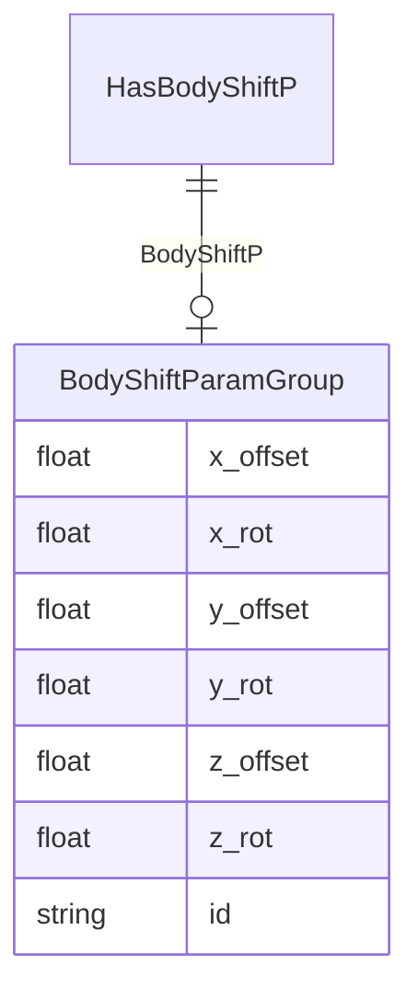

# Class: HasBodyShiftP 


URI: [pals_config:class/HasBodyShiftP](https://w3id.org/pals-config/class/HasBodyShiftP)





<!-- no inheritance hierarchy -->

## Class Properties

| Property | Value |
| --- | --- |
| Mixin | Yes |


## Slots

| Name | Cardinality and Range | Description | Inheritance |
| ---  | --- | --- | --- |
| [BodyShiftP](../slots/BodyShiftP.md) | 0..1 <br/> [BodyShiftParamGroup](../classes/BodyShiftParamGroup.md) | A mixin for floor plan shift parameters that are aligned with PALS BodyShiftP (Floor Plan Shift Parameters) for interoperability with the Particle Accelerator Language Standard (PALS). | direct |


## Mixin Usage

| mixed into | description |
| --- | --- |
| [Magnet](../classes/Magnet.md) | An accelerator device that produces a magnetic field for beam control. |
| [BeamProfileMonitor](../classes/BeamProfileMonitor.md) | A diagnostic device used to measure transverse beam profile. |
| [BeamPositionMonitor](../classes/BeamPositionMonitor.md) | A diagnostic device used to measure transverse beam position. |
| [RadiationMonitor](../classes/RadiationMonitor.md) | A diagnostic device used to monitor radiation dose or dose rate. |
| [Cavity](../classes/Cavity.md) | A cavity used for beam acceleration or manipulation. |
| [SupportingFacilityComponent](../classes/SupportingFacilityComponent.md) | A physical component that supports accelerator operation  without a specific beam-pipe placement,  such as a power supply, control rack, or radiation detector. These can include Girders, Racks, Power Supplies,  and other physical infrastructure components that are important for understanding  the structure and function of the accelerator system but are not inline with the beamline. |
| [BookkeepingComponent](../classes/BookkeepingComponent.md) | A virtual component that represents a bookkeeping or organizational role in the accelerator system,  such as a BeamLineSection, Marker or a Fork. These can include BeamLineSections, Markers, Forks, and other virtual components that are important for understanding  the structure and function of the accelerator system but are not physical devices. |


## Identifier and Mapping Information


### Schema Source


* from schema: https://w3id.org/pals-config


## Mappings

| Mapping Type | Mapped Value |
| ---  | ---  |
| self | pals_config:HasBodyShiftP |
| native | pals_config:HasBodyShiftP |


## LinkML Source

<!-- TODO: investigate https://stackoverflow.com/questions/37606292/how-to-create-tabbed-code-blocks-in-mkdocs-or-sphinx -->

### Direct

<details>
```yaml
name: HasBodyShiftP
from_schema: https://w3id.org/pals-config
mixin: true
attributes:
  BodyShiftP:
    name: BodyShiftP
    description: A mixin for floor plan shift parameters that are aligned with PALS
      BodyShiftP (Floor Plan Shift Parameters) for interoperability with the Particle
      Accelerator Language Standard (PALS).
    from_schema: https://w3id.org/pals-config
    rank: 1000
    domain_of:
    - HasBodyShiftP
    range: BodyShiftParamGroup
    inlined: true

```
</details>

### Induced

<details>
```yaml
name: HasBodyShiftP
from_schema: https://w3id.org/pals-config
mixin: true
attributes:
  BodyShiftP:
    name: BodyShiftP
    description: A mixin for floor plan shift parameters that are aligned with PALS
      BodyShiftP (Floor Plan Shift Parameters) for interoperability with the Particle
      Accelerator Language Standard (PALS).
    from_schema: https://w3id.org/pals-config
    rank: 1000
    alias: BodyShiftP
    owner: HasBodyShiftP
    domain_of:
    - HasBodyShiftP
    range: BodyShiftParamGroup
    inlined: true

```
</details>