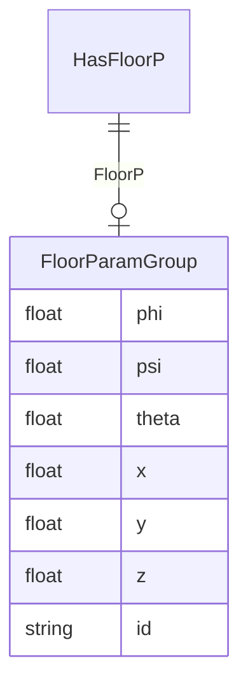

# Class: HasFloorP 


URI: [pals_config:class/HasFloorP](https://w3id.org/pals-config/class/HasFloorP)





<!-- no inheritance hierarchy -->

## Class Properties

| Property | Value |
| --- | --- |
| Mixin | Yes |


## Slots

| Name | Cardinality and Range | Description | Inheritance |
| ---  | --- | --- | --- |
| [FloorP](../slots/FloorP.md) | 0..1 <br/> [FloorParamGroup](../classes/FloorParamGroup.md) | A mixin for floor plan parameters that are aligned with PALS FloorP (Floor Plan Parameters) for interoperability with the Particle Accelerator Language Standard (PALS). | direct |


## Mixin Usage

| mixed into | description |
| --- | --- |
| [PhysicalComponent](../classes/PhysicalComponent.md) | A physical item that participates in or supports accelerator operation.  This can be used to capture physical components, such as magnets, cavities, diagnostics, vacuum devices, and racks that are important for understanding the structure and function of the accelerator system. |
| [VirtualComponent](../classes/VirtualComponent.md) | A virtual or logical component that represents a concept, function, or role in the accelerator  beamline operation but does not have a physical instantiation.  This can be used to capture abstract components, such as Markers, BeamLineSections, and FacilitySpaces that are important for understanding the structure and function of the accelerator system but are not physical devices. |
| [SupportingFacilityComponent](../classes/SupportingFacilityComponent.md) | A physical component that supports accelerator operation  without a specific beam-pipe placement,  such as a power supply, control rack, or radiation detector. These can include Girders, Racks, Power Supplies,  and other physical infrastructure components that are important for understanding  the structure and function of the accelerator system but are not inline with the beamline. |
| [BeamLineSection](../classes/BeamLineSection.md) | A virtual component used to represent a section of the BeamLine for organizational or functional grouping of components. |


## Identifier and Mapping Information


### Schema Source


* from schema: https://w3id.org/pals-config


## Mappings

| Mapping Type | Mapped Value |
| ---  | ---  |
| self | pals_config:HasFloorP |
| native | pals_config:HasFloorP |


## LinkML Source

<!-- TODO: investigate https://stackoverflow.com/questions/37606292/how-to-create-tabbed-code-blocks-in-mkdocs-or-sphinx -->

### Direct

<details>
```yaml
name: HasFloorP
from_schema: https://w3id.org/pals-config
mixin: true
attributes:
  FloorP:
    name: FloorP
    description: A mixin for floor plan parameters that are aligned with PALS FloorP
      (Floor Plan Parameters) for interoperability with the Particle Accelerator Language
      Standard (PALS).
    from_schema: https://w3id.org/pals-config
    rank: 1000
    domain_of:
    - HasFloorP
    range: FloorParamGroup
    inlined: true

```
</details>

### Induced

<details>
```yaml
name: HasFloorP
from_schema: https://w3id.org/pals-config
mixin: true
attributes:
  FloorP:
    name: FloorP
    description: A mixin for floor plan parameters that are aligned with PALS FloorP
      (Floor Plan Parameters) for interoperability with the Particle Accelerator Language
      Standard (PALS).
    from_schema: https://w3id.org/pals-config
    rank: 1000
    alias: FloorP
    owner: HasFloorP
    domain_of:
    - HasFloorP
    range: FloorParamGroup
    inlined: true

```
</details>