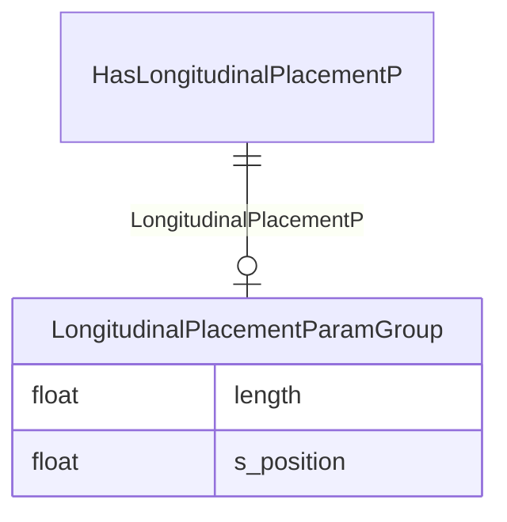

# Class: HasLongitudinalPlacementP 


URI: [pals:class/HasLongitudinalPlacementP](https://pals-project.readthedocs.io/class/HasLongitudinalPlacementP)





<!-- no inheritance hierarchy -->

## Class Properties

| Property | Value |
| --- | --- |
| Mixin | Yes |


## Slots

| Name | Cardinality and Range | Description | Inheritance |
| ---  | --- | --- | --- |
| [LongitudinalPlacementP](../slots/LongitudinalPlacementP.md) | 0..1 <br/> [LongitudinalPlacementParamGroup](../classes/LongitudinalPlacementParamGroup.md) | A mixin for an element's extent and position along the longitudinal (beam-direction, "s") axis that are aligned with PALS LongitudinalPlacementP (Longitudinal Placement Parameters) for interoperability with the Particle Accelerator Language Standard (PALS). | direct |


## Mixin Usage

| mixed into | description |
| --- | --- |
| [PhysicalComponent](../classes/PhysicalComponent.md) | A physical item that participates in or supports accelerator operation.  This can be used to capture physical components, such as magnets, cavities, diagnostics, vacuum devices, and racks that are important for understanding the structure and function of the accelerator system. |
| [SupportingFacilityComponent](../classes/SupportingFacilityComponent.md) | A physical component that supports accelerator operation  without a specific beam-pipe placement,  such as a power supply, control rack, or radiation detector. These can include Girders, Racks, Power Supplies,  and other physical infrastructure components that are important for understanding  the structure and function of the accelerator system but are not inline with the beamline. |


## Identifier and Mapping Information


### Schema Source


* from schema: https://w3id.org/accelerator-core


## Mappings

| Mapping Type | Mapped Value |
| ---  | ---  |
| self | pals:HasLongitudinalPlacementP |
| native | pals:HasLongitudinalPlacementP |


## LinkML Source

<!-- TODO: investigate https://stackoverflow.com/questions/37606292/how-to-create-tabbed-code-blocks-in-mkdocs-or-sphinx -->

### Direct

<details>
```yaml
name: HasLongitudinalPlacementP
from_schema: https://w3id.org/accelerator-core
mixin: true
attributes:
  LongitudinalPlacementP:
    name: LongitudinalPlacementP
    description: A mixin for an element's extent and position along the longitudinal
      (beam-direction, "s") axis that are aligned with PALS LongitudinalPlacementP
      (Longitudinal Placement Parameters) for interoperability with the Particle Accelerator
      Language Standard (PALS).
    from_schema: https://w3id.org/accelerator-core
    rank: 1000
    domain_of:
    - HasLongitudinalPlacementP
    range: LongitudinalPlacementParamGroup
    inlined: true

```
</details>

### Induced

<details>
```yaml
name: HasLongitudinalPlacementP
from_schema: https://w3id.org/accelerator-core
mixin: true
attributes:
  LongitudinalPlacementP:
    name: LongitudinalPlacementP
    description: A mixin for an element's extent and position along the longitudinal
      (beam-direction, "s") axis that are aligned with PALS LongitudinalPlacementP
      (Longitudinal Placement Parameters) for interoperability with the Particle Accelerator
      Language Standard (PALS).
    from_schema: https://w3id.org/accelerator-core
    rank: 1000
    alias: LongitudinalPlacementP
    owner: HasLongitudinalPlacementP
    domain_of:
    - HasLongitudinalPlacementP
    range: LongitudinalPlacementParamGroup
    inlined: true

```
</details>