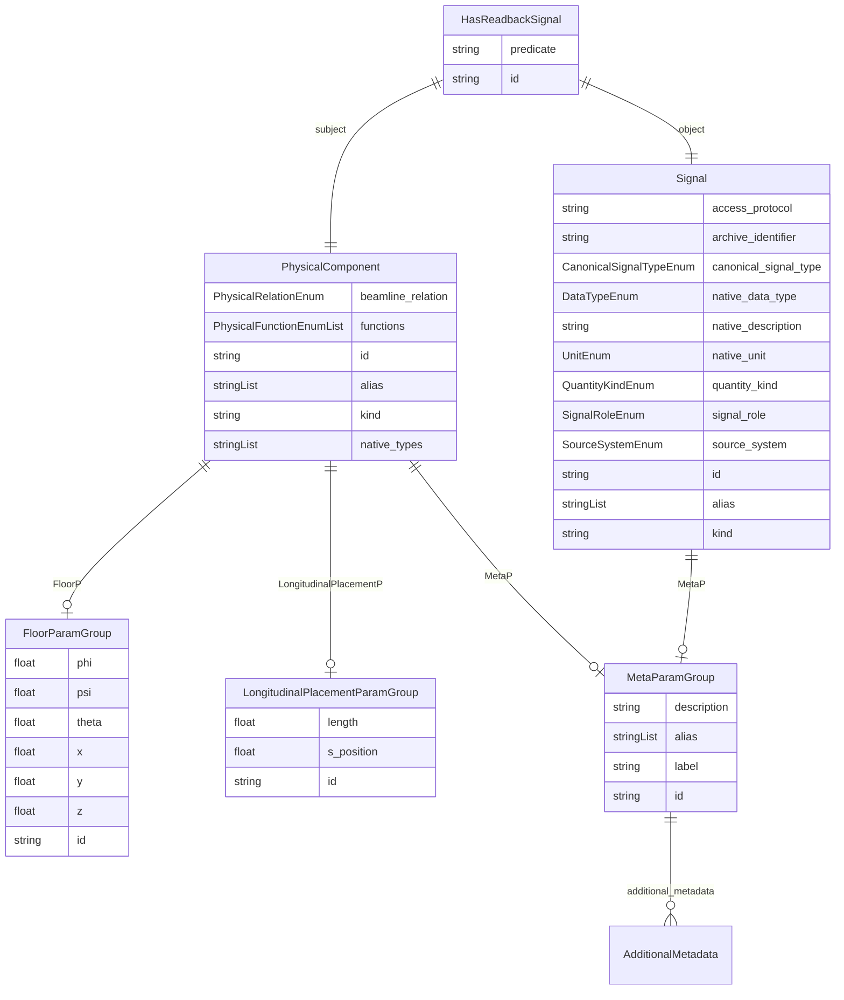

# Class: HasReadbackSignal 


URI: [pals_config:class/HasReadbackSignal](https://w3id.org/pals-config/class/HasReadbackSignal)





## Inheritance
* [Edge](../classes/Edge.md)
    * [SignalBinding](../classes/SignalBinding.md)
        * **HasReadbackSignal**


## Slots

| Name | Cardinality and Range | Description | Inheritance |
| ---  | --- | --- | --- |
| [id](../slots/id.md) | 1 <br/> [String](../types/String.md) | A unique identifier for the instance. | [Edge](../classes/Edge.md) |
| [subject](../slots/subject.md) | 1 <br/> [PhysicalComponent](../classes/PhysicalComponent.md) |  | [Edge](../classes/Edge.md) |
| [predicate](../slots/predicate.md) | 1 <br/> [String](../types/String.md) | The predicate of the relationship, which can be used to identify the relationship across different source systems. | [Edge](../classes/Edge.md) |
| [object](../slots/object.md) | 1 <br/> [Signal](../classes/Signal.md) |  | [Edge](../classes/Edge.md) |


## Identifier and Mapping Information


### Annotations

| property | value |
| --- | --- |
| rdf_predicate | pals_config:has_readback_signal |


### Schema Source


* from schema: https://w3id.org/pals-config


## Mappings

| Mapping Type | Mapped Value |
| ---  | ---  |
| self | pals_config:HasReadbackSignal |
| native | pals_config:HasReadbackSignal |
| close | pals:HasReadbackSignalRelation |


## LinkML Source

<!-- TODO: investigate https://stackoverflow.com/questions/37606292/how-to-create-tabbed-code-blocks-in-mkdocs-or-sphinx -->

### Direct

<details>
```yaml
name: HasReadbackSignal
annotations:
  rdf_predicate:
    tag: rdf_predicate
    value: pals_config:has_readback_signal
from_schema: https://w3id.org/pals-config
close_mappings:
- pals:HasReadbackSignalRelation
is_a: SignalBinding
slot_usage:
  predicate:
    name: predicate
    description: The predicate of the relationship, which can be used to identify
      the relationship across different source systems.
    required: true

```
</details>

### Induced

<details>
```yaml
name: HasReadbackSignal
annotations:
  rdf_predicate:
    tag: rdf_predicate
    value: pals_config:has_readback_signal
from_schema: https://w3id.org/pals-config
close_mappings:
- pals:HasReadbackSignalRelation
is_a: SignalBinding
slot_usage:
  predicate:
    name: predicate
    description: The predicate of the relationship, which can be used to identify
      the relationship across different source systems.
    required: true
attributes:
  id:
    name: id
    description: A unique identifier for the instance.
    from_schema: https://w3id.org/pals-config
    close_mappings:
    - pals:id
    rank: 1000
    identifier: true
    alias: id
    owner: HasReadbackSignal
    domain_of:
    - Node
    - Affiliation
    - ParamGroup
    - Edge
    range: string
    required: true
  subject:
    name: subject
    from_schema: https://w3id.org/pals-config
    rank: 1000
    slot_uri: rdf:subject
    alias: subject
    owner: HasReadbackSignal
    domain_of:
    - Edge
    range: PhysicalComponent
    required: true
  predicate:
    name: predicate
    description: The predicate of the relationship, which can be used to identify
      the relationship across different source systems.
    from_schema: https://w3id.org/pals-config
    rank: 1000
    slot_uri: rdf:predicate
    designates_type: true
    alias: predicate
    owner: HasReadbackSignal
    domain_of:
    - Edge
    range: string
    required: true
  object:
    name: object
    from_schema: https://w3id.org/pals-config
    rank: 1000
    slot_uri: rdf:object
    alias: object
    owner: HasReadbackSignal
    domain_of:
    - Edge
    range: Signal
    required: true

```
</details>