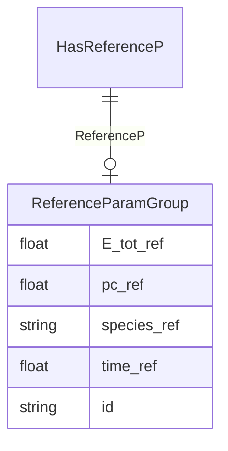

# Class: HasReferenceP 


URI: [pals_config:class/HasReferenceP](https://w3id.org/pals-config/class/HasReferenceP)





<!-- no inheritance hierarchy -->

## Class Properties

| Property | Value |
| --- | --- |
| Mixin | Yes |


## Slots

| Name | Cardinality and Range | Description | Inheritance |
| ---  | --- | --- | --- |
| [ReferenceP](../slots/ReferenceP.md) | 0..1 <br/> [ReferenceParamGroup](../classes/ReferenceParamGroup.md) | A mixin for reference parameters that are aligned with PALS ReferenceP (Reference Parameters) for interoperability with the Particle Accelerator Language Standard (PALS). | direct |


## Mixin Usage

| mixed into | description |
| --- | --- |
| [Magnet](../classes/Magnet.md) | An accelerator device that produces a magnetic field for beam control. |
| [BeamProfileMonitor](../classes/BeamProfileMonitor.md) | A diagnostic device used to measure transverse beam profile. |
| [BeamPositionMonitor](../classes/BeamPositionMonitor.md) | A diagnostic device used to measure transverse beam position. |
| [Aperture](../classes/Aperture.md) | A diagnostic or limiting aperture element used to constrain or characterize beam passage. |
| [Cavity](../classes/Cavity.md) | A cavity used for beam acceleration or manipulation. |
| [BeginningEle](../classes/BeginningEle.md) | Initial element at the start of a beamline branch. It holds the initial reference and Twiss parameters for the branch. A BeginningEle may be omitted when the branch is reached through a Fork that propagates its reference parameters; otherwise it is expected to be the first element in the branch. |


## Identifier and Mapping Information


### Schema Source


* from schema: https://w3id.org/pals-config


## Mappings

| Mapping Type | Mapped Value |
| ---  | ---  |
| self | pals_config:HasReferenceP |
| native | pals_config:HasReferenceP |


## LinkML Source

<!-- TODO: investigate https://stackoverflow.com/questions/37606292/how-to-create-tabbed-code-blocks-in-mkdocs-or-sphinx -->

### Direct

<details>
```yaml
name: HasReferenceP
from_schema: https://w3id.org/pals-config
mixin: true
attributes:
  ReferenceP:
    name: ReferenceP
    description: A mixin for reference parameters that are aligned with PALS ReferenceP
      (Reference Parameters) for interoperability with the Particle Accelerator Language
      Standard (PALS).
    from_schema: https://w3id.org/pals-config
    rank: 1000
    domain_of:
    - HasReferenceP
    range: ReferenceParamGroup
    inlined: true

```
</details>

### Induced

<details>
```yaml
name: HasReferenceP
from_schema: https://w3id.org/pals-config
mixin: true
attributes:
  ReferenceP:
    name: ReferenceP
    description: A mixin for reference parameters that are aligned with PALS ReferenceP
      (Reference Parameters) for interoperability with the Particle Accelerator Language
      Standard (PALS).
    from_schema: https://w3id.org/pals-config
    rank: 1000
    alias: ReferenceP
    owner: HasReferenceP
    domain_of:
    - HasReferenceP
    range: ReferenceParamGroup
    inlined: true

```
</details>