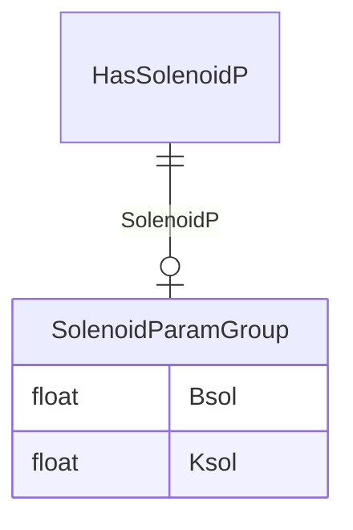

# Class: HasSolenoidP 


URI: [pals:class/HasSolenoidP](https://pals-project.readthedocs.io/class/HasSolenoidP)





<!-- no inheritance hierarchy -->

## Class Properties

| Property | Value |
| --- | --- |
| Mixin | Yes |


## Slots

| Name | Cardinality and Range | Description | Inheritance |
| ---  | --- | --- | --- |
| [SolenoidP](../slots/SolenoidP.md) | 0..1 <br/> [SolenoidParamGroup](../classes/SolenoidParamGroup.md) | A mixin for solenoid-specific parameters that are aligned with PALS SolenoidP (Solenoid Parameters) for interoperability with the Particle Accelerator Language Standard (PALS). | direct |


## Mixin Usage

| mixed into | description |
| --- | --- |
| [Solenoid](../classes/Solenoid.md) | A magnet with a primarily longitudinal magnetic field used for focusing.<br>A solenoid is an element whose magnetic field is dominated by a field whose direction is aligned with the magnetic axis. |


## Identifier and Mapping Information


### Schema Source


* from schema: https://w3id.org/accelerator-core


## Mappings

| Mapping Type | Mapped Value |
| ---  | ---  |
| self | pals:HasSolenoidP |
| native | pals:HasSolenoidP |


## LinkML Source

<!-- TODO: investigate https://stackoverflow.com/questions/37606292/how-to-create-tabbed-code-blocks-in-mkdocs-or-sphinx -->

### Direct

<details>
```yaml
name: HasSolenoidP
from_schema: https://w3id.org/accelerator-core
mixin: true
attributes:
  SolenoidP:
    name: SolenoidP
    description: A mixin for solenoid-specific parameters that are aligned with PALS
      SolenoidP (Solenoid Parameters) for interoperability with the Particle Accelerator
      Language Standard (PALS).
    from_schema: https://w3id.org/accelerator-core
    rank: 1000
    domain_of:
    - HasSolenoidP
    range: SolenoidParamGroup
    inlined: true

```
</details>

### Induced

<details>
```yaml
name: HasSolenoidP
from_schema: https://w3id.org/accelerator-core
mixin: true
attributes:
  SolenoidP:
    name: SolenoidP
    description: A mixin for solenoid-specific parameters that are aligned with PALS
      SolenoidP (Solenoid Parameters) for interoperability with the Particle Accelerator
      Language Standard (PALS).
    from_schema: https://w3id.org/accelerator-core
    rank: 1000
    alias: SolenoidP
    owner: HasSolenoidP
    domain_of:
    - HasSolenoidP
    range: SolenoidParamGroup
    inlined: true

```
</details>