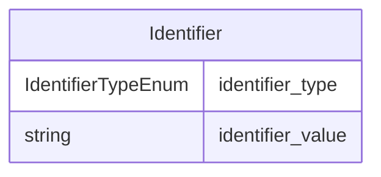

# Class: Identifier 


_A unique, and ideally persistent, identifier for a facility, such as a DOI or ROR._


URI: [pals_config:class/Identifier](https://w3id.org/pals-config/class/Identifier)





<!-- no inheritance hierarchy -->

## Slots

| Name | Cardinality and Range | Description | Inheritance |
| ---  | --- | --- | --- |
| [identifier_type](../slots/identifier_type.md) | 0..1 <br/> [IdentifierTypeEnum](../enums/IdentifierTypeEnum.md) | The type of identifier, such as DOI | PURL | ROR | LOCAL | URL | ARK. | direct |
| [identifier_value](../slots/identifier_value.md) | 0..1 <br/> [String](../types/String.md) | The value of the identifier. | direct |


## Usages

| used by | used in | type | used |
| ---  | --- | --- | --- |
| [Facility](../classes/Facility.md) | [identifiers](../slots/identifiers.md) | range | [Identifier](../classes/Identifier.md) |
| [Affiliation](../classes/Affiliation.md) | [identifiers](../slots/identifiers.md) | range | [Identifier](../classes/Identifier.md) |


## Identifier and Mapping Information


### Schema Source


* from schema: https://w3id.org/pals-config


## Mappings

| Mapping Type | Mapped Value |
| ---  | ---  |
| self | pals_config:Identifier |
| native | pals_config:Identifier |


## LinkML Source

<!-- TODO: investigate https://stackoverflow.com/questions/37606292/how-to-create-tabbed-code-blocks-in-mkdocs-or-sphinx -->

### Direct

<details>
```yaml
name: Identifier
description: A unique, and ideally persistent, identifier for a facility, such as
  a DOI or ROR.
from_schema: https://w3id.org/pals-config
attributes:
  identifier_type:
    name: identifier_type
    description: The type of identifier, such as DOI | PURL | ROR | LOCAL | URL |
      ARK.
    from_schema: https://w3id.org/pals-config
    rank: 1000
    domain_of:
    - Identifier
    range: IdentifierTypeEnum
  identifier_value:
    name: identifier_value
    description: The value of the identifier.
    from_schema: https://w3id.org/pals-config
    rank: 1000
    domain_of:
    - Identifier
    range: string

```
</details>

### Induced

<details>
```yaml
name: Identifier
description: A unique, and ideally persistent, identifier for a facility, such as
  a DOI or ROR.
from_schema: https://w3id.org/pals-config
attributes:
  identifier_type:
    name: identifier_type
    description: The type of identifier, such as DOI | PURL | ROR | LOCAL | URL |
      ARK.
    from_schema: https://w3id.org/pals-config
    rank: 1000
    alias: identifier_type
    owner: Identifier
    domain_of:
    - Identifier
    range: IdentifierTypeEnum
  identifier_value:
    name: identifier_value
    description: The value of the identifier.
    from_schema: https://w3id.org/pals-config
    rank: 1000
    alias: identifier_value
    owner: Identifier
    domain_of:
    - Identifier
    range: string

```
</details>