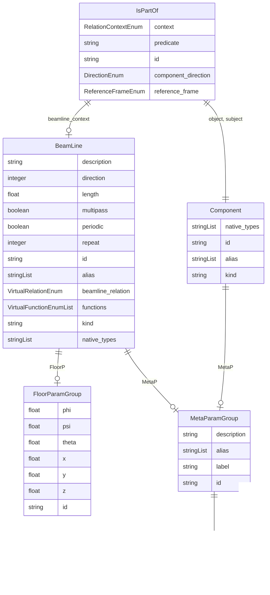

# Class: IsPartOf 


_A relationship indicating that the subject component is part of the object component in a specified context,  such as a magnet being part of a BeamLineSection._


URI: [pals_config:class/IsPartOf](https://w3id.org/pals-config/class/IsPartOf)





## Inheritance
* [Edge](../classes/Edge.md)
    * [ComponentRelation](../classes/ComponentRelation.md)
        * **IsPartOf**


## Slots

| Name | Cardinality and Range | Description | Inheritance |
| ---  | --- | --- | --- |
| [context](../slots/context.md) | 0..1 <br/> [RelationContextEnum](../enums/RelationContextEnum.md) | The frame of reference / domain in which this relationship is asserted to hold. | direct |
| [beamline_context](../slots/beamline_context.md) | 0..1 <br/> [BeamLine](../classes/BeamLine.md) | The specific BeamLine this relationship is defined with respect to (relevant when context=beamline_order). Only an edge-property slot for edges that are defined with respect to a specific BeamLine. | direct |
| [component_direction](../slots/component_direction.md) | 0..1 <br/> [DirectionEnum](../enums/DirectionEnum.md) |  | [ComponentRelation](../classes/ComponentRelation.md) |
| [reference_frame](../slots/reference_frame.md) | 0..1 _recommended_ <br/> [ReferenceFrameEnum](../enums/ReferenceFrameEnum.md) |  | [ComponentRelation](../classes/ComponentRelation.md) |
| [id](../slots/id.md) | 1 <br/> [String](../types/String.md) | A unique identifier for the instance. | [Edge](../classes/Edge.md) |
| [subject](../slots/subject.md) | 1 <br/> [Component](../classes/Component.md) |  | [Edge](../classes/Edge.md) |
| [predicate](../slots/predicate.md) | 1 <br/> [String](../types/String.md) | The predicate of the relationship, which can be used to identify the relationship across different source systems. | [Edge](../classes/Edge.md) |
| [object](../slots/object.md) | 1 <br/> [Component](../classes/Component.md) |  | [Edge](../classes/Edge.md) |


## Identifier and Mapping Information


### Annotations

| property | value |
| --- | --- |
| rdf_predicate | pals_config:is_part_of |


### Schema Source


* from schema: https://w3id.org/pals-config


## Mappings

| Mapping Type | Mapped Value |
| ---  | ---  |
| self | pals_config:IsPartOf |
| native | pals_config:IsPartOf |
| exact | BFO:0000050 |


## LinkML Source

<!-- TODO: investigate https://stackoverflow.com/questions/37606292/how-to-create-tabbed-code-blocks-in-mkdocs-or-sphinx -->

### Direct

<details>
```yaml
name: IsPartOf
annotations:
  rdf_predicate:
    tag: rdf_predicate
    value: pals_config:is_part_of
description: A relationship indicating that the subject component is part of the object
  component in a specified context,  such as a magnet being part of a BeamLineSection.
from_schema: https://w3id.org/pals-config
exact_mappings:
- BFO:0000050
is_a: ComponentRelation
slots:
- context
- beamline_context
slot_usage:
  predicate:
    name: predicate
    description: The predicate of the relationship, which can be used to identify
      the relationship across different source systems.
    required: true
    equals_string: IsPartOf
  context:
    name: context
    required: false
  beamline_context:
    name: beamline_context
    required: false

```
</details>

### Induced

<details>
```yaml
name: IsPartOf
annotations:
  rdf_predicate:
    tag: rdf_predicate
    value: pals_config:is_part_of
description: A relationship indicating that the subject component is part of the object
  component in a specified context,  such as a magnet being part of a BeamLineSection.
from_schema: https://w3id.org/pals-config
exact_mappings:
- BFO:0000050
is_a: ComponentRelation
slot_usage:
  predicate:
    name: predicate
    description: The predicate of the relationship, which can be used to identify
      the relationship across different source systems.
    required: true
    equals_string: IsPartOf
  context:
    name: context
    required: false
  beamline_context:
    name: beamline_context
    required: false
attributes:
  context:
    name: context
    description: The frame of reference / domain in which this relationship is asserted
      to hold.
    from_schema: https://w3id.org/pals-config
    rank: 1000
    alias: context
    owner: IsPartOf
    domain_of:
    - ComponentRelation
    - IsPartOf
    range: RelationContextEnum
    required: false
  beamline_context:
    name: beamline_context
    description: The specific BeamLine this relationship is defined with respect to
      (relevant when context=beamline_order). Only an edge-property slot for edges
      that are defined with respect to a specific BeamLine.
    from_schema: https://w3id.org/pals-config
    rank: 1000
    alias: beamline_context
    owner: IsPartOf
    domain_of:
    - Precedes
    - Contains
    - IsPartOf
    - HasConnectingBranch
    range: BeamLine
    required: false
  component_direction:
    name: component_direction
    from_schema: https://w3id.org/pals-config
    rank: 1000
    alias: component_direction
    owner: IsPartOf
    domain_of:
    - ComponentRelation
    range: DirectionEnum
  reference_frame:
    name: reference_frame
    from_schema: https://w3id.org/pals-config
    rank: 1000
    alias: reference_frame
    owner: IsPartOf
    domain_of:
    - ComponentRelation
    range: ReferenceFrameEnum
    recommended: true
  id:
    name: id
    description: A unique identifier for the instance.
    from_schema: https://w3id.org/pals-config
    close_mappings:
    - pals:id
    rank: 1000
    identifier: true
    alias: id
    owner: IsPartOf
    domain_of:
    - Node
    - Affiliation
    - ParamGroup
    - Edge
    range: string
    required: true
  subject:
    name: subject
    from_schema: https://w3id.org/pals-config
    rank: 1000
    slot_uri: rdf:subject
    alias: subject
    owner: IsPartOf
    domain_of:
    - Edge
    range: Component
    required: true
  predicate:
    name: predicate
    description: The predicate of the relationship, which can be used to identify
      the relationship across different source systems.
    from_schema: https://w3id.org/pals-config
    rank: 1000
    slot_uri: rdf:predicate
    designates_type: true
    alias: predicate
    owner: IsPartOf
    domain_of:
    - Edge
    range: string
    required: true
    equals_string: IsPartOf
  object:
    name: object
    from_schema: https://w3id.org/pals-config
    rank: 1000
    slot_uri: rdf:object
    alias: object
    owner: IsPartOf
    domain_of:
    - Edge
    range: Component
    required: true

```
</details>