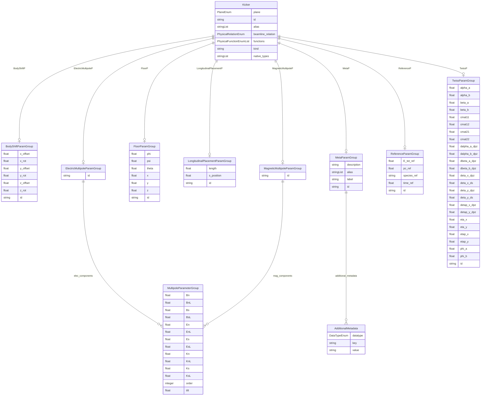

# Class: Kicker 


_A magnet primarily used to steer the beam._

_Can deflect the beam transversely in both planes, or a single plane, depending on the design and parameters of the kicker. _

_Only one of the electric or magnetic multipole components should be present, not both._


URI: [pals_config:class/Kicker](https://w3id.org/pals-config/class/Kicker)





## Inheritance
* [Node](../classes/Node.md)
    * [Component](../classes/Component.md) [ [HasMetaP](../classes/HasMetaP.md)]
        * [PhysicalComponent](../classes/PhysicalComponent.md) [ [HasFloorP](../classes/HasFloorP.md) [HasLongitudinalPlacementP](../classes/HasLongitudinalPlacementP.md)]
            * [Magnet](../classes/Magnet.md) [ [HasReferenceP](../classes/HasReferenceP.md) [HasBodyShiftP](../classes/HasBodyShiftP.md) [HasTwissP](../classes/HasTwissP.md)]
                * **Kicker** [ [HasElectricMultipoleP](../classes/HasElectricMultipoleP.md) [HasMagneticMultipoleP](../classes/HasMagneticMultipoleP.md)]
                    * [ACKicker](../classes/ACKicker.md)


## Slots

| Name | Cardinality and Range | Description | Inheritance |
| ---  | --- | --- | --- |
| [plane](../slots/plane.md) | 0..1 <br/> [PlaneEnum](../enums/PlaneEnum.md) | The transverse plane in which the kicker operates, either horizontal or vertical. | direct |
| [ElectricMultipoleP](../slots/ElectricMultipoleP.md) | 0..1 <br/> [ElectricMultipoleParamGroup](../classes/ElectricMultipoleParamGroup.md) | A mixin for electric multipole parameters that are aligned with PALS ElectricMultipoleP (Electric Multipole Parameters) for interoperability with the Particle Accelerator Language Standard (PALS). | [HasElectricMultipoleP](../classes/HasElectricMultipoleP.md) |
| [MagneticMultipoleP](../slots/MagneticMultipoleP.md) | 0..1 <br/> [MagneticMultipoleParamGroup](../classes/MagneticMultipoleParamGroup.md) | A mixin for magnetic multipole parameters that are aligned with PALS MagneticMultipoleP (Magnetic Multipole Parameters) for interoperability with the Particle Accelerator Language Standard (PALS). | [HasMagneticMultipoleP](../classes/HasMagneticMultipoleP.md) |
| [ReferenceP](../slots/ReferenceP.md) | 0..1 <br/> [ReferenceParamGroup](../classes/ReferenceParamGroup.md) | A mixin for reference parameters that are aligned with PALS ReferenceP (Reference Parameters) for interoperability with the Particle Accelerator Language Standard (PALS). | [HasReferenceP](../classes/HasReferenceP.md) |
| [BodyShiftP](../slots/BodyShiftP.md) | 0..1 <br/> [BodyShiftParamGroup](../classes/BodyShiftParamGroup.md) | A mixin for floor plan shift parameters that are aligned with PALS BodyShiftP (Floor Plan Shift Parameters) for interoperability with the Particle Accelerator Language Standard (PALS). | [HasBodyShiftP](../classes/HasBodyShiftP.md) |
| [TwissP](../slots/TwissP.md) | 0..1 <br/> [TwissParamGroup](../classes/TwissParamGroup.md) | A mixin for Twiss parameters that are aligned with PALS TwissP (Twiss Parameters) for interoperability with the Particle Accelerator Language Standard (PALS). | [HasTwissP](../classes/HasTwissP.md) |
| [functions](../slots/functions.md) | * <br/> [PhysicalFunctionEnum](../enums/PhysicalFunctionEnum.md) | The function of the physical component,  which can be used to identify the component across different source systems. | [PhysicalComponent](../classes/PhysicalComponent.md) |
| [beamline_relation](../slots/beamline_relation.md) | 1 <br/> [PhysicalRelationEnum](../enums/PhysicalRelationEnum.md) | The relationship of the physical component to the beamline,  which can be used to identify the component across different source systems. | [PhysicalComponent](../classes/PhysicalComponent.md) |
| [FloorP](../slots/FloorP.md) | 0..1 <br/> [FloorParamGroup](../classes/FloorParamGroup.md) | A mixin for floor plan parameters that are aligned with PALS FloorP (Floor Plan Parameters) for interoperability with the Particle Accelerator Language Standard (PALS). | [HasFloorP](../classes/HasFloorP.md) |
| [LongitudinalPlacementP](../slots/LongitudinalPlacementP.md) | 0..1 <br/> [LongitudinalPlacementParamGroup](../classes/LongitudinalPlacementParamGroup.md) | A mixin for an element's extent and position along the longitudinal (beam-direction, "s") axis that are aligned with PALS LongitudinalPlacementP (Longitudinal Placement Parameters) for interoperability with the Particle Accelerator Language Standard (PALS). | [HasLongitudinalPlacementP](../classes/HasLongitudinalPlacementP.md) |
| [native_types](../slots/native_types.md) | * <br/> [String](../types/String.md) | The native type of the component in the source system, which can be used to identify the component across different source systems. | [Component](../classes/Component.md) |
| [MetaP](../slots/MetaP.md) | 0..1 <br/> [MetaParamGroup](../classes/MetaParamGroup.md) | A mixin for metadata parameters that are aligned with PALS MetaP (Metadata Parameters) for interoperability with the Particle Accelerator Language Standard (PALS). | [HasMetaP](../classes/HasMetaP.md) |
| [id](../slots/id.md) | 1 <br/> [String](../types/String.md) | A unique identifier for the instance. | [Node](../classes/Node.md) |
| [kind](../slots/kind.md) | 1 <br/> [String](../types/String.md) | The LinkML class name of this instance, e.g. `Quadrupole` or `BeamProfileMonitor` (no prefix). | [Node](../classes/Node.md) |
| [alias](../slots/alias.md) | * <br/> [String](../types/String.md) | An alternative name or identifier for the instance. | [Node](../classes/Node.md) |


## Aliases


* Corrector
* HCorrector
* VCorrector
* VDiagKicker
* HDiagKicker


## Identifier and Mapping Information


### Schema Source


* from schema: https://w3id.org/pals-config


## Mappings

| Mapping Type | Mapped Value |
| ---  | ---  |
| self | pals_config:Kicker |
| native | pals_config:Kicker |
| broad | pals:Kicker |


## LinkML Source

<!-- TODO: investigate https://stackoverflow.com/questions/37606292/how-to-create-tabbed-code-blocks-in-mkdocs-or-sphinx -->

### Direct

<details>
```yaml
name: Kicker
description: "A magnet primarily used to steer the beam.\nCan deflect the beam transversely\
  \ in both planes, or a single plane, depending on the design and parameters of the\
  \ kicker. \nOnly one of the electric or magnetic multipole components should be\
  \ present, not both."
from_schema: https://w3id.org/pals-config
aliases:
- Corrector
- HCorrector
- VCorrector
- VDiagKicker
- HDiagKicker
broad_mappings:
- pals:Kicker
is_a: Magnet
mixins:
- HasElectricMultipoleP
- HasMagneticMultipoleP
attributes:
  plane:
    name: plane
    description: The transverse plane in which the kicker operates, either horizontal
      or vertical.
    from_schema: https://w3id.org/pals-config
    rank: 1000
    domain_of:
    - Kicker
    range: PlaneEnum

```
</details>

### Induced

<details>
```yaml
name: Kicker
description: "A magnet primarily used to steer the beam.\nCan deflect the beam transversely\
  \ in both planes, or a single plane, depending on the design and parameters of the\
  \ kicker. \nOnly one of the electric or magnetic multipole components should be\
  \ present, not both."
from_schema: https://w3id.org/pals-config
aliases:
- Corrector
- HCorrector
- VCorrector
- VDiagKicker
- HDiagKicker
broad_mappings:
- pals:Kicker
is_a: Magnet
mixins:
- HasElectricMultipoleP
- HasMagneticMultipoleP
attributes:
  plane:
    name: plane
    description: The transverse plane in which the kicker operates, either horizontal
      or vertical.
    from_schema: https://w3id.org/pals-config
    rank: 1000
    alias: plane
    owner: Kicker
    domain_of:
    - Kicker
    range: PlaneEnum
  ElectricMultipoleP:
    name: ElectricMultipoleP
    description: A mixin for electric multipole parameters that are aligned with PALS
      ElectricMultipoleP (Electric Multipole Parameters) for interoperability with
      the Particle Accelerator Language Standard (PALS).
    from_schema: https://w3id.org/pals-config
    rank: 1000
    alias: ElectricMultipoleP
    owner: Kicker
    domain_of:
    - HasElectricMultipoleP
    range: ElectricMultipoleParamGroup
    inlined: true
  MagneticMultipoleP:
    name: MagneticMultipoleP
    description: A mixin for magnetic multipole parameters that are aligned with PALS
      MagneticMultipoleP (Magnetic Multipole Parameters) for interoperability with
      the Particle Accelerator Language Standard (PALS).
    from_schema: https://w3id.org/pals-config
    rank: 1000
    alias: MagneticMultipoleP
    owner: Kicker
    domain_of:
    - HasMagneticMultipoleP
    range: MagneticMultipoleParamGroup
    inlined: true
  ReferenceP:
    name: ReferenceP
    description: A mixin for reference parameters that are aligned with PALS ReferenceP
      (Reference Parameters) for interoperability with the Particle Accelerator Language
      Standard (PALS).
    from_schema: https://w3id.org/pals-config
    rank: 1000
    alias: ReferenceP
    owner: Kicker
    domain_of:
    - HasReferenceP
    range: ReferenceParamGroup
    inlined: true
  BodyShiftP:
    name: BodyShiftP
    description: A mixin for floor plan shift parameters that are aligned with PALS
      BodyShiftP (Floor Plan Shift Parameters) for interoperability with the Particle
      Accelerator Language Standard (PALS).
    from_schema: https://w3id.org/pals-config
    rank: 1000
    alias: BodyShiftP
    owner: Kicker
    domain_of:
    - HasBodyShiftP
    range: BodyShiftParamGroup
    inlined: true
  TwissP:
    name: TwissP
    description: A mixin for Twiss parameters that are aligned with PALS TwissP (Twiss
      Parameters) for interoperability with the Particle Accelerator Language Standard
      (PALS).
    from_schema: https://w3id.org/pals-config
    rank: 1000
    alias: TwissP
    owner: Kicker
    domain_of:
    - HasTwissP
    range: TwissParamGroup
    inlined: true
  functions:
    name: functions
    description: The function of the physical component,  which can be used to identify
      the component across different source systems.
    from_schema: https://w3id.org/pals-config
    close_mappings:
    - pals:physical_function
    rank: 1000
    alias: functions
    owner: Kicker
    domain_of:
    - PhysicalComponent
    - VirtualComponent
    range: PhysicalFunctionEnum
    required: false
    multivalued: true
  beamline_relation:
    name: beamline_relation
    description: The relationship of the physical component to the beamline,  which
      can be used to identify the component across different source systems.
    from_schema: https://w3id.org/pals-config
    close_mappings:
    - pals:physical_beamline_relation
    rank: 1000
    alias: beamline_relation
    owner: Kicker
    domain_of:
    - PhysicalComponent
    - VirtualComponent
    range: PhysicalRelationEnum
    required: true
  FloorP:
    name: FloorP
    description: A mixin for floor plan parameters that are aligned with PALS FloorP
      (Floor Plan Parameters) for interoperability with the Particle Accelerator Language
      Standard (PALS).
    from_schema: https://w3id.org/pals-config
    rank: 1000
    alias: FloorP
    owner: Kicker
    domain_of:
    - HasFloorP
    range: FloorParamGroup
    inlined: true
  LongitudinalPlacementP:
    name: LongitudinalPlacementP
    description: A mixin for an element's extent and position along the longitudinal
      (beam-direction, "s") axis that are aligned with PALS LongitudinalPlacementP
      (Longitudinal Placement Parameters) for interoperability with the Particle Accelerator
      Language Standard (PALS).
    from_schema: https://w3id.org/pals-config
    rank: 1000
    alias: LongitudinalPlacementP
    owner: Kicker
    domain_of:
    - HasLongitudinalPlacementP
    range: LongitudinalPlacementParamGroup
    inlined: true
  native_types:
    name: native_types
    description: The native type of the component in the source system, which can
      be used to identify the component across different source systems.
    from_schema: https://w3id.org/pals-config
    rank: 1000
    alias: native_types
    owner: Kicker
    domain_of:
    - Component
    range: string
    multivalued: true
  MetaP:
    name: MetaP
    description: A mixin for metadata parameters that are aligned with PALS MetaP
      (Metadata Parameters) for interoperability with the Particle Accelerator Language
      Standard (PALS).
    from_schema: https://w3id.org/pals-config
    rank: 1000
    alias: MetaP
    owner: Kicker
    domain_of:
    - HasMetaP
    range: MetaParamGroup
    inlined: true
  id:
    name: id
    description: A unique identifier for the instance.
    from_schema: https://w3id.org/pals-config
    close_mappings:
    - pals:id
    rank: 1000
    identifier: true
    alias: id
    owner: Kicker
    domain_of:
    - Node
    - Affiliation
    - ParamGroup
    - Edge
    range: string
    required: true
  kind:
    name: kind
    description: The LinkML class name of this instance, e.g. `Quadrupole` or `BeamProfileMonitor`
      (no prefix).
    from_schema: https://w3id.org/pals-config
    related_mappings:
    - saref:DeviceKind
    rank: 1000
    slot_uri: rdf:type
    designates_type: true
    alias: kind
    owner: Kicker
    domain_of:
    - Node
    - PALSAccelerator
    range: string
    required: true
  alias:
    name: alias
    description: An alternative name or identifier for the instance.
    from_schema: https://w3id.org/pals-config
    close_mappings:
    - pals:alias
    rank: 1000
    alias: alias
    owner: Kicker
    domain_of:
    - Node
    - MetaParamGroup
    range: string
    multivalued: true

```
</details>