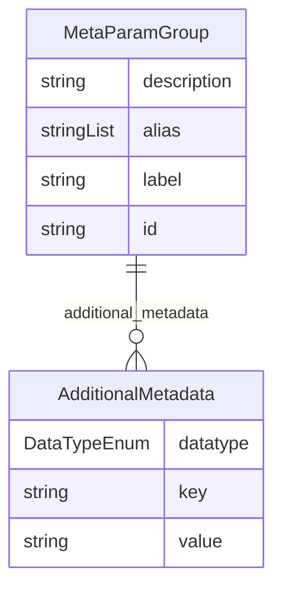

# Class: MetaParamGroup 


_Mixin class for metadata parameters that are aligned with PALS MetaP (Metadata Parameters) for interoperability with the Particle Accelerator Language Standard (PALS)._


URI: [pals_config:class/MetaParamGroup](https://w3id.org/pals-config/class/MetaParamGroup)





## Inheritance
* [ParamGroup](../classes/ParamGroup.md)
    * **MetaParamGroup**


## Slots

| Name | Cardinality and Range | Description | Inheritance |
| ---  | --- | --- | --- |
| [description](../slots/description.md) | 0..1 <br/> [String](../types/String.md) | A human-readable description of the instance. | direct |
| [alias](../slots/alias.md) | * <br/> [String](../types/String.md) | An alternative name or identifier for the instance. | direct |
| [label](../slots/label.md) | 0..1 <br/> [String](../types/String.md) | A label string. | direct |
| [additional_metadata](../slots/additional_metadata.md) | * <br/> [AdditionalMetadata](../classes/AdditionalMetadata.md) | Additional metadata or annotations for the instance. | direct |
| [id](../slots/id.md) | 1 <br/> [String](../types/String.md) | A unique identifier for the instance. | [ParamGroup](../classes/ParamGroup.md) |


## Usages

| used by | used in | type | used |
| ---  | --- | --- | --- |
| [HasMetaP](../classes/HasMetaP.md) | [MetaP](../slots/MetaP.md) | range | [MetaParamGroup](../classes/MetaParamGroup.md) |
| [Component](../classes/Component.md) | [MetaP](../slots/MetaP.md) | range | [MetaParamGroup](../classes/MetaParamGroup.md) |
| [PhysicalComponent](../classes/PhysicalComponent.md) | [MetaP](../slots/MetaP.md) | range | [MetaParamGroup](../classes/MetaParamGroup.md) |
| [VirtualComponent](../classes/VirtualComponent.md) | [MetaP](../slots/MetaP.md) | range | [MetaParamGroup](../classes/MetaParamGroup.md) |
| [BeamLine](../classes/BeamLine.md) | [MetaP](../slots/MetaP.md) | range | [MetaParamGroup](../classes/MetaParamGroup.md) |
| [Signal](../classes/Signal.md) | [MetaP](../slots/MetaP.md) | range | [MetaParamGroup](../classes/MetaParamGroup.md) |
| [Magnet](../classes/Magnet.md) | [MetaP](../slots/MetaP.md) | range | [MetaParamGroup](../classes/MetaParamGroup.md) |
| [Solenoid](../classes/Solenoid.md) | [MetaP](../slots/MetaP.md) | range | [MetaParamGroup](../classes/MetaParamGroup.md) |
| [Multipole](../classes/Multipole.md) | [MetaP](../slots/MetaP.md) | range | [MetaParamGroup](../classes/MetaParamGroup.md) |
| [Bend](../classes/Bend.md) | [MetaP](../slots/MetaP.md) | range | [MetaParamGroup](../classes/MetaParamGroup.md) |
| [Quadrupole](../classes/Quadrupole.md) | [MetaP](../slots/MetaP.md) | range | [MetaParamGroup](../classes/MetaParamGroup.md) |
| [Octupole](../classes/Octupole.md) | [MetaP](../slots/MetaP.md) | range | [MetaParamGroup](../classes/MetaParamGroup.md) |
| [Sextupole](../classes/Sextupole.md) | [MetaP](../slots/MetaP.md) | range | [MetaParamGroup](../classes/MetaParamGroup.md) |
| [Kicker](../classes/Kicker.md) | [MetaP](../slots/MetaP.md) | range | [MetaParamGroup](../classes/MetaParamGroup.md) |
| [ACKicker](../classes/ACKicker.md) | [MetaP](../slots/MetaP.md) | range | [MetaParamGroup](../classes/MetaParamGroup.md) |
| [DiagnosticDevice](../classes/DiagnosticDevice.md) | [MetaP](../slots/MetaP.md) | range | [MetaParamGroup](../classes/MetaParamGroup.md) |
| [BeamProfileMonitor](../classes/BeamProfileMonitor.md) | [MetaP](../slots/MetaP.md) | range | [MetaParamGroup](../classes/MetaParamGroup.md) |
| [BeamPositionMonitor](../classes/BeamPositionMonitor.md) | [MetaP](../slots/MetaP.md) | range | [MetaParamGroup](../classes/MetaParamGroup.md) |
| [Aperture](../classes/Aperture.md) | [MetaP](../slots/MetaP.md) | range | [MetaParamGroup](../classes/MetaParamGroup.md) |
| [RadiationMonitor](../classes/RadiationMonitor.md) | [MetaP](../slots/MetaP.md) | range | [MetaParamGroup](../classes/MetaParamGroup.md) |
| [Cavity](../classes/Cavity.md) | [MetaP](../slots/MetaP.md) | range | [MetaParamGroup](../classes/MetaParamGroup.md) |
| [CrabCavity](../classes/CrabCavity.md) | [MetaP](../slots/MetaP.md) | range | [MetaParamGroup](../classes/MetaParamGroup.md) |
| [RFCavity](../classes/RFCavity.md) | [MetaP](../slots/MetaP.md) | range | [MetaParamGroup](../classes/MetaParamGroup.md) |
| [NormalConductingRFCavity](../classes/NormalConductingRFCavity.md) | [MetaP](../slots/MetaP.md) | range | [MetaParamGroup](../classes/MetaParamGroup.md) |
| [SuperConductingRFCavity](../classes/SuperConductingRFCavity.md) | [MetaP](../slots/MetaP.md) | range | [MetaParamGroup](../classes/MetaParamGroup.md) |
| [SupportingFacilityComponent](../classes/SupportingFacilityComponent.md) | [MetaP](../slots/MetaP.md) | range | [MetaParamGroup](../classes/MetaParamGroup.md) |
| [BookkeepingComponent](../classes/BookkeepingComponent.md) | [MetaP](../slots/MetaP.md) | range | [MetaParamGroup](../classes/MetaParamGroup.md) |
| [Marker](../classes/Marker.md) | [MetaP](../slots/MetaP.md) | range | [MetaParamGroup](../classes/MetaParamGroup.md) |
| [BeginningEle](../classes/BeginningEle.md) | [MetaP](../slots/MetaP.md) | range | [MetaParamGroup](../classes/MetaParamGroup.md) |
| [Drift](../classes/Drift.md) | [MetaP](../slots/MetaP.md) | range | [MetaParamGroup](../classes/MetaParamGroup.md) |
| [BeamLineSection](../classes/BeamLineSection.md) | [MetaP](../slots/MetaP.md) | range | [MetaParamGroup](../classes/MetaParamGroup.md) |


## Identifier and Mapping Information


### Schema Source


* from schema: https://w3id.org/pals-config


## Mappings

| Mapping Type | Mapped Value |
| ---  | ---  |
| self | pals_config:MetaParamGroup |
| native | pals_config:MetaParamGroup |
| broad | pals:MetaP |


## LinkML Source

<!-- TODO: investigate https://stackoverflow.com/questions/37606292/how-to-create-tabbed-code-blocks-in-mkdocs-or-sphinx -->

### Direct

<details>
```yaml
name: MetaParamGroup
description: Mixin class for metadata parameters that are aligned with PALS MetaP
  (Metadata Parameters) for interoperability with the Particle Accelerator Language
  Standard (PALS).
from_schema: https://w3id.org/pals-config
broad_mappings:
- pals:MetaP
is_a: ParamGroup
slots:
- description
- alias
attributes:
  label:
    name: label
    description: A label string.
    from_schema: https://w3id.org/pals-config
    close_mappings:
    - pals:label
    rank: 1000
    domain_of:
    - MetaParamGroup
    range: string
  additional_metadata:
    name: additional_metadata
    description: Additional metadata or annotations for the instance.
    from_schema: https://w3id.org/pals-config
    rank: 1000
    domain_of:
    - MetaParamGroup
    range: AdditionalMetadata
    multivalued: true
    inlined: true
    inlined_as_list: true

```
</details>

### Induced

<details>
```yaml
name: MetaParamGroup
description: Mixin class for metadata parameters that are aligned with PALS MetaP
  (Metadata Parameters) for interoperability with the Particle Accelerator Language
  Standard (PALS).
from_schema: https://w3id.org/pals-config
broad_mappings:
- pals:MetaP
is_a: ParamGroup
attributes:
  label:
    name: label
    description: A label string.
    from_schema: https://w3id.org/pals-config
    close_mappings:
    - pals:label
    rank: 1000
    alias: label
    owner: MetaParamGroup
    domain_of:
    - MetaParamGroup
    range: string
  additional_metadata:
    name: additional_metadata
    description: Additional metadata or annotations for the instance.
    from_schema: https://w3id.org/pals-config
    rank: 1000
    alias: additional_metadata
    owner: MetaParamGroup
    domain_of:
    - MetaParamGroup
    range: AdditionalMetadata
    multivalued: true
    inlined: true
    inlined_as_list: true
  description:
    name: description
    description: A human-readable description of the instance.
    from_schema: https://w3id.org/pals-config
    rank: 1000
    alias: description
    owner: MetaParamGroup
    domain_of:
    - PALSAccelerator
    - MetaParamGroup
    - BeamLine
    range: string
  alias:
    name: alias
    description: An alternative name or identifier for the instance.
    from_schema: https://w3id.org/pals-config
    close_mappings:
    - pals:alias
    rank: 1000
    alias: alias
    owner: MetaParamGroup
    domain_of:
    - Node
    - MetaParamGroup
    range: string
    multivalued: true
  id:
    name: id
    description: A unique identifier for the instance.
    from_schema: https://w3id.org/pals-config
    close_mappings:
    - pals:id
    rank: 1000
    identifier: true
    alias: id
    owner: MetaParamGroup
    domain_of:
    - Node
    - Affiliation
    - ParamGroup
    - Edge
    range: string
    required: true

```
</details>