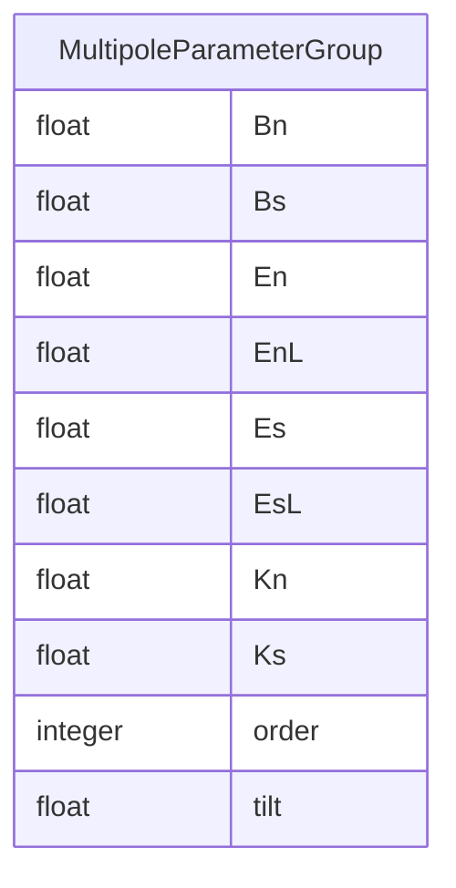

# Class: MultipoleParameterGroup 


_A single order's electric (or magnetic) multipole component._

_Only the fields supporting Electric Multipoles  OR the fields for Magnetic Multipoles should be present, not both._

_Not a mixin, but a class used in the ElectricMultipoleP and MagneticMultipoleP mixins to represent individual multipole components._


URI: [pals:class/MultipoleParameterGroup](https://pals-project.readthedocs.io/class/MultipoleParameterGroup)





<!-- no inheritance hierarchy -->

## Slots

| Name | Cardinality and Range | Description | Inheritance |
| ---  | --- | --- | --- |
| [order](../slots/order.md) | 1 <br/> [Integer](../types/Integer.md) | Multipole order N (0 = dipole, 1 = quadrupole, etc.) | direct |
| [tilt](../slots/tilt.md) | 0..1 <br/> [Float](../types/Float.md) | Tilt of the Nth multipole. | direct |
| [En](../slots/En.md) | 0..1 <br/> [Float](../types/Float.md) | Normal component of the field. | direct |
| [Es](../slots/Es.md) | 0..1 <br/> [Float](../types/Float.md) | Skew component of the field. | direct |
| [EnL](../slots/EnL.md) | 0..1 <br/> [Float](../types/Float.md) | Length-integrated normal component. | direct |
| [EsL](../slots/EsL.md) | 0..1 <br/> [Float](../types/Float.md) | Length-integrated skew component. | direct |
| [Bn](../slots/Bn.md) | 0..1 <br/> [Float](../types/Float.md) | Normal component of the magnetic field. | direct |
| [Bs](../slots/Bs.md) | 0..1 <br/> [Float](../types/Float.md) | Skew component of the magnetic field. | direct |
| [Kn](../slots/Kn.md) | 0..1 <br/> [Float](../types/Float.md) | Normalized normal component. | direct |
| [Ks](../slots/Ks.md) | 0..1 <br/> [Float](../types/Float.md) | Normalized skew component. | direct |


## Usages

| used by | used in | type | used |
| ---  | --- | --- | --- |
| [ElectricMultipoleParamGroup](../classes/ElectricMultipoleParamGroup.md) | [elec_components](../slots/elec_components.md) | range | [MultipoleParameterGroup](../classes/MultipoleParameterGroup.md) |
| [MagneticMultipoleParamGroup](../classes/MagneticMultipoleParamGroup.md) | [mag_components](../slots/mag_components.md) | range | [MultipoleParameterGroup](../classes/MultipoleParameterGroup.md) |


## Rules


### 

| Rule Applied | Preconditions | Postconditions | Elseconditions |
|--------------|---------------|----------------|----------------|
| slot_conditions |```{'Es': {'value_presence': 'PRESENT'}}``` |```{'Bn': {'value_presence': 'ABSENT'}, 'Bs': {'value_presence': 'ABSENT'}, 'Kn': {'value_presence': 'ABSENT'}, 'Ks': {'value_presence': 'ABSENT'}}``` | |


### 

| Rule Applied | Preconditions | Postconditions | Elseconditions |
|--------------|---------------|----------------|----------------|
| slot_conditions |```{'En': {'value_presence': 'PRESENT'}}``` |```{'Bn': {'value_presence': 'ABSENT'}, 'Bs': {'value_presence': 'ABSENT'}, 'Kn': {'value_presence': 'ABSENT'}, 'Ks': {'value_presence': 'ABSENT'}}``` | |


### 

| Rule Applied | Preconditions | Postconditions | Elseconditions |
|--------------|---------------|----------------|----------------|
| slot_conditions |```{'EnL': {'value_presence': 'PRESENT'}}``` |```{'Bn': {'value_presence': 'ABSENT'}, 'Bs': {'value_presence': 'ABSENT'}, 'Kn': {'value_presence': 'ABSENT'}, 'Ks': {'value_presence': 'ABSENT'}}``` | |


### 

| Rule Applied | Preconditions | Postconditions | Elseconditions |
|--------------|---------------|----------------|----------------|
| slot_conditions |```{'EsL': {'value_presence': 'PRESENT'}}``` |```{'Bn': {'value_presence': 'ABSENT'}, 'Bs': {'value_presence': 'ABSENT'}, 'Kn': {'value_presence': 'ABSENT'}, 'Ks': {'value_presence': 'ABSENT'}}``` | |


### 

| Rule Applied | Preconditions | Postconditions | Elseconditions |
|--------------|---------------|----------------|----------------|
| slot_conditions |```{'Bn': {'value_presence': 'PRESENT'}}``` |```{'En': {'value_presence': 'ABSENT'}, 'Es': {'value_presence': 'ABSENT'}, 'EnL': {'value_presence': 'ABSENT'}, 'EsL': {'value_presence': 'ABSENT'}}``` | |


### 

| Rule Applied | Preconditions | Postconditions | Elseconditions |
|--------------|---------------|----------------|----------------|
| slot_conditions |```{'Bs': {'value_presence': 'PRESENT'}}``` |```{'En': {'value_presence': 'ABSENT'}, 'Es': {'value_presence': 'ABSENT'}, 'EnL': {'value_presence': 'ABSENT'}, 'EsL': {'value_presence': 'ABSENT'}}``` | |


### 

| Rule Applied | Preconditions | Postconditions | Elseconditions |
|--------------|---------------|----------------|----------------|
| slot_conditions |```{'Kn': {'value_presence': 'PRESENT'}}``` |```{'En': {'value_presence': 'ABSENT'}, 'Es': {'value_presence': 'ABSENT'}, 'EnL': {'value_presence': 'ABSENT'}, 'EsL': {'value_presence': 'ABSENT'}}``` | |


### 

| Rule Applied | Preconditions | Postconditions | Elseconditions |
|--------------|---------------|----------------|----------------|
| slot_conditions |```{'Ks': {'value_presence': 'PRESENT'}}``` |```{'En': {'value_presence': 'ABSENT'}, 'Es': {'value_presence': 'ABSENT'}, 'EnL': {'value_presence': 'ABSENT'}, 'EsL': {'value_presence': 'ABSENT'}}``` | |


## Identifier and Mapping Information


### Schema Source


* from schema: https://w3id.org/accelerator-core


## Mappings

| Mapping Type | Mapped Value |
| ---  | ---  |
| self | pals:MultipoleParameterGroup |
| native | pals:MultipoleParameterGroup |


## LinkML Source

<!-- TODO: investigate https://stackoverflow.com/questions/37606292/how-to-create-tabbed-code-blocks-in-mkdocs-or-sphinx -->

### Direct

<details>
```yaml
name: MultipoleParameterGroup
description: 'A single order''s electric (or magnetic) multipole component.

  Only the fields supporting Electric Multipoles  OR the fields for Magnetic Multipoles
  should be present, not both.

  Not a mixin, but a class used in the ElectricMultipoleP and MagneticMultipoleP mixins
  to represent individual multipole components.'
from_schema: https://w3id.org/accelerator-core
attributes:
  order:
    name: order
    description: Multipole order N (0 = dipole, 1 = quadrupole, etc.)
    from_schema: https://w3id.org/accelerator-core
    rank: 1000
    domain_of:
    - MultipoleParameterGroup
    range: integer
    required: true
  tilt:
    name: tilt
    description: Tilt of the Nth multipole.
    from_schema: https://w3id.org/accelerator-core
    broad_mappings:
    - pals:tilt
    rank: 1000
    domain_of:
    - MultipoleParameterGroup
    range: float
  En:
    name: En
    description: Normal component of the field.
    from_schema: https://w3id.org/accelerator-core
    broad_mappings:
    - pals:EnN
    rank: 1000
    domain_of:
    - MultipoleParameterGroup
    range: float
  Es:
    name: Es
    description: Skew component of the field.
    from_schema: https://w3id.org/accelerator-core
    broad_mappings:
    - pals:EsN
    rank: 1000
    domain_of:
    - MultipoleParameterGroup
    range: float
  EnL:
    name: EnL
    description: Length-integrated normal component.
    from_schema: https://w3id.org/accelerator-core
    broad_mappings:
    - pals:EnNL
    rank: 1000
    domain_of:
    - MultipoleParameterGroup
    range: float
  EsL:
    name: EsL
    description: Length-integrated skew component.
    from_schema: https://w3id.org/accelerator-core
    broad_mappings:
    - pals:EsNL
    rank: 1000
    domain_of:
    - MultipoleParameterGroup
    range: float
  Bn:
    name: Bn
    description: Normal component of the magnetic field.
    from_schema: https://w3id.org/accelerator-core
    broad_mappings:
    - pals:BnN
    rank: 1000
    domain_of:
    - MultipoleParameterGroup
    range: float
  Bs:
    name: Bs
    description: Skew component of the magnetic field.
    from_schema: https://w3id.org/accelerator-core
    broad_mappings:
    - pals:BsN
    rank: 1000
    domain_of:
    - MultipoleParameterGroup
    range: float
  Kn:
    name: Kn
    description: Normalized normal component.
    from_schema: https://w3id.org/accelerator-core
    broad_mappings:
    - pals:KnN
    rank: 1000
    domain_of:
    - MultipoleParameterGroup
    range: float
  Ks:
    name: Ks
    description: Normalized skew component.
    from_schema: https://w3id.org/accelerator-core
    broad_mappings:
    - pals:KsN
    rank: 1000
    domain_of:
    - MultipoleParameterGroup
    range: float
rules:
- preconditions:
    slot_conditions:
      Es:
        name: Es
        value_presence: PRESENT
  postconditions:
    slot_conditions:
      Bn:
        name: Bn
        value_presence: ABSENT
      Bs:
        name: Bs
        value_presence: ABSENT
      Kn:
        name: Kn
        value_presence: ABSENT
      Ks:
        name: Ks
        value_presence: ABSENT
  description: If Es is present, then Bn, Bs, Kn, Ks should NOT be present
- preconditions:
    slot_conditions:
      En:
        name: En
        value_presence: PRESENT
  postconditions:
    slot_conditions:
      Bn:
        name: Bn
        value_presence: ABSENT
      Bs:
        name: Bs
        value_presence: ABSENT
      Kn:
        name: Kn
        value_presence: ABSENT
      Ks:
        name: Ks
        value_presence: ABSENT
  description: If En is present, then Bn, Bs, Kn, Ks should NOT be present
- preconditions:
    slot_conditions:
      EnL:
        name: EnL
        value_presence: PRESENT
  postconditions:
    slot_conditions:
      Bn:
        name: Bn
        value_presence: ABSENT
      Bs:
        name: Bs
        value_presence: ABSENT
      Kn:
        name: Kn
        value_presence: ABSENT
      Ks:
        name: Ks
        value_presence: ABSENT
  description: If EnL is present, then Bn, Bs, Kn, Ks should NOT be present
- preconditions:
    slot_conditions:
      EsL:
        name: EsL
        value_presence: PRESENT
  postconditions:
    slot_conditions:
      Bn:
        name: Bn
        value_presence: ABSENT
      Bs:
        name: Bs
        value_presence: ABSENT
      Kn:
        name: Kn
        value_presence: ABSENT
      Ks:
        name: Ks
        value_presence: ABSENT
  description: If EsL is present, then Bn, Bs, Kn, Ks should NOT be present
- preconditions:
    slot_conditions:
      Bn:
        name: Bn
        value_presence: PRESENT
  postconditions:
    slot_conditions:
      En:
        name: En
        value_presence: ABSENT
      Es:
        name: Es
        value_presence: ABSENT
      EnL:
        name: EnL
        value_presence: ABSENT
      EsL:
        name: EsL
        value_presence: ABSENT
  description: If Bn is present, then En, Es, EnL, EsL should NOT be present
- preconditions:
    slot_conditions:
      Bs:
        name: Bs
        value_presence: PRESENT
  postconditions:
    slot_conditions:
      En:
        name: En
        value_presence: ABSENT
      Es:
        name: Es
        value_presence: ABSENT
      EnL:
        name: EnL
        value_presence: ABSENT
      EsL:
        name: EsL
        value_presence: ABSENT
  description: If Bs is present, then En, Es, EnL, EsL should NOT be present
- preconditions:
    slot_conditions:
      Kn:
        name: Kn
        value_presence: PRESENT
  postconditions:
    slot_conditions:
      En:
        name: En
        value_presence: ABSENT
      Es:
        name: Es
        value_presence: ABSENT
      EnL:
        name: EnL
        value_presence: ABSENT
      EsL:
        name: EsL
        value_presence: ABSENT
  description: If Kn is present, then En, Es, EnL, EsL should NOT be present
- preconditions:
    slot_conditions:
      Ks:
        name: Ks
        value_presence: PRESENT
  postconditions:
    slot_conditions:
      En:
        name: En
        value_presence: ABSENT
      Es:
        name: Es
        value_presence: ABSENT
      EnL:
        name: EnL
        value_presence: ABSENT
      EsL:
        name: EsL
        value_presence: ABSENT
  description: If Ks is present, then En, Es, EnL, EsL should NOT be present

```
</details>

### Induced

<details>
```yaml
name: MultipoleParameterGroup
description: 'A single order''s electric (or magnetic) multipole component.

  Only the fields supporting Electric Multipoles  OR the fields for Magnetic Multipoles
  should be present, not both.

  Not a mixin, but a class used in the ElectricMultipoleP and MagneticMultipoleP mixins
  to represent individual multipole components.'
from_schema: https://w3id.org/accelerator-core
attributes:
  order:
    name: order
    description: Multipole order N (0 = dipole, 1 = quadrupole, etc.)
    from_schema: https://w3id.org/accelerator-core
    rank: 1000
    alias: order
    owner: MultipoleParameterGroup
    domain_of:
    - MultipoleParameterGroup
    range: integer
    required: true
  tilt:
    name: tilt
    description: Tilt of the Nth multipole.
    from_schema: https://w3id.org/accelerator-core
    broad_mappings:
    - pals:tilt
    rank: 1000
    alias: tilt
    owner: MultipoleParameterGroup
    domain_of:
    - MultipoleParameterGroup
    range: float
  En:
    name: En
    description: Normal component of the field.
    from_schema: https://w3id.org/accelerator-core
    broad_mappings:
    - pals:EnN
    rank: 1000
    alias: En
    owner: MultipoleParameterGroup
    domain_of:
    - MultipoleParameterGroup
    range: float
  Es:
    name: Es
    description: Skew component of the field.
    from_schema: https://w3id.org/accelerator-core
    broad_mappings:
    - pals:EsN
    rank: 1000
    alias: Es
    owner: MultipoleParameterGroup
    domain_of:
    - MultipoleParameterGroup
    range: float
  EnL:
    name: EnL
    description: Length-integrated normal component.
    from_schema: https://w3id.org/accelerator-core
    broad_mappings:
    - pals:EnNL
    rank: 1000
    alias: EnL
    owner: MultipoleParameterGroup
    domain_of:
    - MultipoleParameterGroup
    range: float
  EsL:
    name: EsL
    description: Length-integrated skew component.
    from_schema: https://w3id.org/accelerator-core
    broad_mappings:
    - pals:EsNL
    rank: 1000
    alias: EsL
    owner: MultipoleParameterGroup
    domain_of:
    - MultipoleParameterGroup
    range: float
  Bn:
    name: Bn
    description: Normal component of the magnetic field.
    from_schema: https://w3id.org/accelerator-core
    broad_mappings:
    - pals:BnN
    rank: 1000
    alias: Bn
    owner: MultipoleParameterGroup
    domain_of:
    - MultipoleParameterGroup
    range: float
  Bs:
    name: Bs
    description: Skew component of the magnetic field.
    from_schema: https://w3id.org/accelerator-core
    broad_mappings:
    - pals:BsN
    rank: 1000
    alias: Bs
    owner: MultipoleParameterGroup
    domain_of:
    - MultipoleParameterGroup
    range: float
  Kn:
    name: Kn
    description: Normalized normal component.
    from_schema: https://w3id.org/accelerator-core
    broad_mappings:
    - pals:KnN
    rank: 1000
    alias: Kn
    owner: MultipoleParameterGroup
    domain_of:
    - MultipoleParameterGroup
    range: float
  Ks:
    name: Ks
    description: Normalized skew component.
    from_schema: https://w3id.org/accelerator-core
    broad_mappings:
    - pals:KsN
    rank: 1000
    alias: Ks
    owner: MultipoleParameterGroup
    domain_of:
    - MultipoleParameterGroup
    range: float
rules:
- preconditions:
    slot_conditions:
      Es:
        name: Es
        value_presence: PRESENT
  postconditions:
    slot_conditions:
      Bn:
        name: Bn
        value_presence: ABSENT
      Bs:
        name: Bs
        value_presence: ABSENT
      Kn:
        name: Kn
        value_presence: ABSENT
      Ks:
        name: Ks
        value_presence: ABSENT
  description: If Es is present, then Bn, Bs, Kn, Ks should NOT be present
- preconditions:
    slot_conditions:
      En:
        name: En
        value_presence: PRESENT
  postconditions:
    slot_conditions:
      Bn:
        name: Bn
        value_presence: ABSENT
      Bs:
        name: Bs
        value_presence: ABSENT
      Kn:
        name: Kn
        value_presence: ABSENT
      Ks:
        name: Ks
        value_presence: ABSENT
  description: If En is present, then Bn, Bs, Kn, Ks should NOT be present
- preconditions:
    slot_conditions:
      EnL:
        name: EnL
        value_presence: PRESENT
  postconditions:
    slot_conditions:
      Bn:
        name: Bn
        value_presence: ABSENT
      Bs:
        name: Bs
        value_presence: ABSENT
      Kn:
        name: Kn
        value_presence: ABSENT
      Ks:
        name: Ks
        value_presence: ABSENT
  description: If EnL is present, then Bn, Bs, Kn, Ks should NOT be present
- preconditions:
    slot_conditions:
      EsL:
        name: EsL
        value_presence: PRESENT
  postconditions:
    slot_conditions:
      Bn:
        name: Bn
        value_presence: ABSENT
      Bs:
        name: Bs
        value_presence: ABSENT
      Kn:
        name: Kn
        value_presence: ABSENT
      Ks:
        name: Ks
        value_presence: ABSENT
  description: If EsL is present, then Bn, Bs, Kn, Ks should NOT be present
- preconditions:
    slot_conditions:
      Bn:
        name: Bn
        value_presence: PRESENT
  postconditions:
    slot_conditions:
      En:
        name: En
        value_presence: ABSENT
      Es:
        name: Es
        value_presence: ABSENT
      EnL:
        name: EnL
        value_presence: ABSENT
      EsL:
        name: EsL
        value_presence: ABSENT
  description: If Bn is present, then En, Es, EnL, EsL should NOT be present
- preconditions:
    slot_conditions:
      Bs:
        name: Bs
        value_presence: PRESENT
  postconditions:
    slot_conditions:
      En:
        name: En
        value_presence: ABSENT
      Es:
        name: Es
        value_presence: ABSENT
      EnL:
        name: EnL
        value_presence: ABSENT
      EsL:
        name: EsL
        value_presence: ABSENT
  description: If Bs is present, then En, Es, EnL, EsL should NOT be present
- preconditions:
    slot_conditions:
      Kn:
        name: Kn
        value_presence: PRESENT
  postconditions:
    slot_conditions:
      En:
        name: En
        value_presence: ABSENT
      Es:
        name: Es
        value_presence: ABSENT
      EnL:
        name: EnL
        value_presence: ABSENT
      EsL:
        name: EsL
        value_presence: ABSENT
  description: If Kn is present, then En, Es, EnL, EsL should NOT be present
- preconditions:
    slot_conditions:
      Ks:
        name: Ks
        value_presence: PRESENT
  postconditions:
    slot_conditions:
      En:
        name: En
        value_presence: ABSENT
      Es:
        name: Es
        value_presence: ABSENT
      EnL:
        name: EnL
        value_presence: ABSENT
      EsL:
        name: EsL
        value_presence: ABSENT
  description: If Ks is present, then En, Es, EnL, EsL should NOT be present

```
</details>