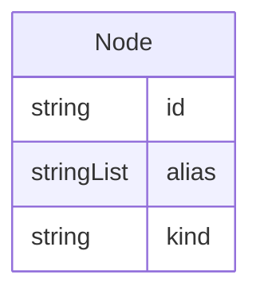

# Class: Node 


_Abstract base class for all node entities in the accelerator core ontology. This differentiates nodes from edges (relationships) in the ontology. This class is not intended to be instantiated directly, but serves as a common ancestor for all other classes. Allows for the use of kind: as a discriminator for the type of node in the ontology._


* __NOTE__: this is an abstract class and should not be instantiated directly


URI: [pals_config:class/Node](https://w3id.org/pals-config/class/Node)





## Inheritance
* **Node**
    * [Component](../classes/Component.md) [ [HasMetaP](../classes/HasMetaP.md)]
    * [Signal](../classes/Signal.md) [ [HasMetaP](../classes/HasMetaP.md)]


## Slots

| Name | Cardinality and Range | Description | Inheritance |
| ---  | --- | --- | --- |
| [id](../slots/id.md) | 1 <br/> [String](../types/String.md) | A unique identifier for the instance. | direct |
| [kind](../slots/kind.md) | 1 <br/> [String](../types/String.md) | The LinkML class name of this instance, e.g. `Quadrupole` or `BeamProfileMonitor` (no prefix). | direct |
| [alias](../slots/alias.md) | * <br/> [String](../types/String.md) | An alternative name or identifier for the instance. | direct |


## Identifier and Mapping Information


### Schema Source


* from schema: https://w3id.org/pals-config


## Mappings

| Mapping Type | Mapped Value |
| ---  | ---  |
| self | pals_config:Node |
| native | pals_config:Node |


## LinkML Source

<!-- TODO: investigate https://stackoverflow.com/questions/37606292/how-to-create-tabbed-code-blocks-in-mkdocs-or-sphinx -->

### Direct

<details>
```yaml
name: Node
description: 'Abstract base class for all node entities in the accelerator core ontology.
  This differentiates nodes from edges (relationships) in the ontology. This class
  is not intended to be instantiated directly, but serves as a common ancestor for
  all other classes. Allows for the use of kind: as a discriminator for the type of
  node in the ontology.'
from_schema: https://w3id.org/pals-config
abstract: true
slots:
- id
- kind
- alias

```
</details>

### Induced

<details>
```yaml
name: Node
description: 'Abstract base class for all node entities in the accelerator core ontology.
  This differentiates nodes from edges (relationships) in the ontology. This class
  is not intended to be instantiated directly, but serves as a common ancestor for
  all other classes. Allows for the use of kind: as a discriminator for the type of
  node in the ontology.'
from_schema: https://w3id.org/pals-config
abstract: true
attributes:
  id:
    name: id
    description: A unique identifier for the instance.
    from_schema: https://w3id.org/pals-config
    close_mappings:
    - pals:id
    rank: 1000
    identifier: true
    alias: id
    owner: Node
    domain_of:
    - Node
    - Affiliation
    - ParamGroup
    - Edge
    range: string
    required: true
  kind:
    name: kind
    description: The LinkML class name of this instance, e.g. `Quadrupole` or `BeamProfileMonitor`
      (no prefix).
    from_schema: https://w3id.org/pals-config
    related_mappings:
    - rdf:type
    - saref:DeviceKind
    rank: 1000
    slot_uri: rdf:type
    designates_type: true
    alias: kind
    owner: Node
    domain_of:
    - Node
    - PALSAccelerator
    range: string
    required: true
  alias:
    name: alias
    description: An alternative name or identifier for the instance.
    from_schema: https://w3id.org/pals-config
    close_mappings:
    - pals:alias
    rank: 1000
    alias: alias
    owner: Node
    domain_of:
    - Node
    - MetaParamGroup
    range: string
    multivalued: true

```
</details>