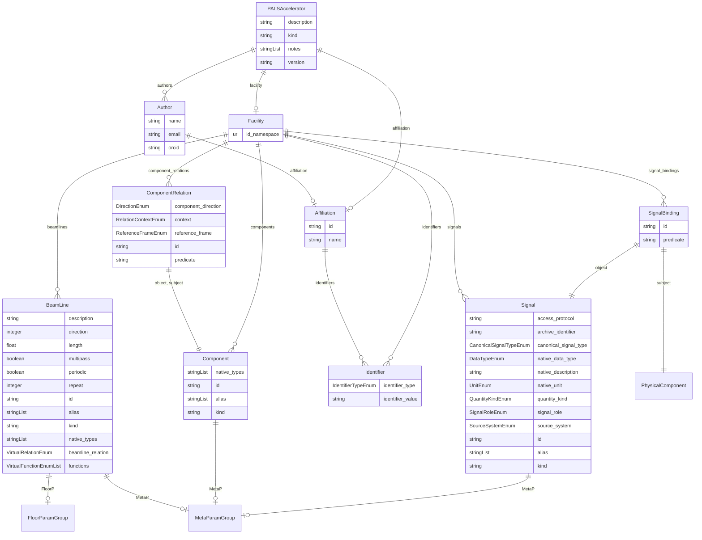

# Class: PALSAccelerator 


_Root container for accelerator core components, semantic signals, and local bindings._


URI: [acc:class/PALSAccelerator](https://example.org/accelerator-core/class/PALSAccelerator)





<!-- no inheritance hierarchy -->

## Class Properties

| Property | Value |
| --- | --- |
| Tree Root | Yes |


## Slots

| Name | Cardinality and Range | Description | Inheritance |
| ---  | --- | --- | --- |
| [kind](../slots/kind.md) | 1 <br/> [String](../types/String.md) | The LinkML class name of this instance, e.g. `Quadrupole` or `BeamProfileMonitor` (no prefix). | direct |
| [description](../slots/description.md) | 0..1 <br/> [String](../types/String.md) | A human-readable description of the instance. | direct |
| [affiliation](../slots/affiliation.md) | 0..1 <br/> [Affiliation](../classes/Affiliation.md) | The affiliation of the author or component, as a ROR. | direct |
| [version](../slots/version.md) | 0..1 <br/> [String](../types/String.md) | Version of the representation of a particle accelerator and its operations. | direct |
| [authors](../slots/authors.md) | * <br/> [Author](../classes/Author.md) | Contains the authorship information for this representation of an accelerator facility and its operations. | direct |
| [notes](../slots/notes.md) | * <br/> [String](../types/String.md) | Additional notes or comments about the representation of a particle accelerator and its operations. | direct |
| [facility](../slots/facility.md) | 0..1 <br/> [Facility](../classes/Facility.md) | A facility that contains lattice elements (physical and virtual), beamlines, parameter set commands, signals, etc. | direct |


## Identifier and Mapping Information


### Schema Source


* from schema: https://w3id.org/accelerator-core


## Mappings

| Mapping Type | Mapped Value |
| ---  | ---  |
| self | acc:PALSAccelerator |
| native | acc:PALSAccelerator |


## LinkML Source

<!-- TODO: investigate https://stackoverflow.com/questions/37606292/how-to-create-tabbed-code-blocks-in-mkdocs-or-sphinx -->

### Direct

<details>
```yaml
name: PALSAccelerator
description: Root container for accelerator core components, semantic signals, and
  local bindings.
from_schema: https://w3id.org/accelerator-core
slots:
- kind
- description
- affiliation
attributes:
  version:
    name: version
    description: Version of the representation of a particle accelerator and its operations.
    from_schema: https://w3id.org/accelerator-core
    rank: 1000
    domain_of:
    - PALSAccelerator
    range: string
    pattern: ^(0|[1-9][0-9]*)\.(0|[1-9][0-9]*)\.(0|[1-9][0-9]*)$
  authors:
    name: authors
    description: Contains the authorship information for this representation of an
      accelerator facility and its operations.
    from_schema: https://w3id.org/accelerator-core
    rank: 1000
    domain_of:
    - PALSAccelerator
    range: Author
    multivalued: true
    inlined: true
    inlined_as_list: true
  notes:
    name: notes
    description: Additional notes or comments about the representation of a particle
      accelerator and its operations.
    from_schema: https://w3id.org/accelerator-core
    rank: 1000
    domain_of:
    - PALSAccelerator
    range: string
    multivalued: true
    inlined: true
    inlined_as_list: true
  facility:
    name: facility
    description: A facility that contains lattice elements (physical and virtual),
      beamlines, parameter set commands, signals, etc.
    from_schema: https://w3id.org/accelerator-core
    rank: 1000
    domain_of:
    - PALSAccelerator
    range: Facility
tree_root: true

```
</details>

### Induced

<details>
```yaml
name: PALSAccelerator
description: Root container for accelerator core components, semantic signals, and
  local bindings.
from_schema: https://w3id.org/accelerator-core
attributes:
  version:
    name: version
    description: Version of the representation of a particle accelerator and its operations.
    from_schema: https://w3id.org/accelerator-core
    rank: 1000
    alias: version
    owner: PALSAccelerator
    domain_of:
    - PALSAccelerator
    range: string
    pattern: ^(0|[1-9][0-9]*)\.(0|[1-9][0-9]*)\.(0|[1-9][0-9]*)$
  authors:
    name: authors
    description: Contains the authorship information for this representation of an
      accelerator facility and its operations.
    from_schema: https://w3id.org/accelerator-core
    rank: 1000
    alias: authors
    owner: PALSAccelerator
    domain_of:
    - PALSAccelerator
    range: Author
    multivalued: true
    inlined: true
    inlined_as_list: true
  notes:
    name: notes
    description: Additional notes or comments about the representation of a particle
      accelerator and its operations.
    from_schema: https://w3id.org/accelerator-core
    rank: 1000
    alias: notes
    owner: PALSAccelerator
    domain_of:
    - PALSAccelerator
    range: string
    multivalued: true
    inlined: true
    inlined_as_list: true
  facility:
    name: facility
    description: A facility that contains lattice elements (physical and virtual),
      beamlines, parameter set commands, signals, etc.
    from_schema: https://w3id.org/accelerator-core
    rank: 1000
    alias: facility
    owner: PALSAccelerator
    domain_of:
    - PALSAccelerator
    range: Facility
  kind:
    name: kind
    description: The LinkML class name of this instance, e.g. `Quadrupole` or `BeamProfileMonitor`
      (no prefix).
    from_schema: https://w3id.org/accelerator-core
    rank: 1000
    slot_uri: rdf:type
    designates_type: true
    alias: kind
    owner: PALSAccelerator
    domain_of:
    - Node
    - PALSAccelerator
    range: string
    required: true
  description:
    name: description
    description: A human-readable description of the instance.
    from_schema: https://w3id.org/accelerator-core
    rank: 1000
    alias: description
    owner: PALSAccelerator
    domain_of:
    - PALSAccelerator
    - MetaParamGroup
    - BeamLine
    range: string
  affiliation:
    name: affiliation
    description: The affiliation of the author or component, as a ROR.
    from_schema: https://w3id.org/accelerator-core
    rank: 1000
    alias: affiliation
    owner: PALSAccelerator
    domain_of:
    - PALSAccelerator
    - Author
    range: Affiliation
    inlined: true
tree_root: true

```
</details>