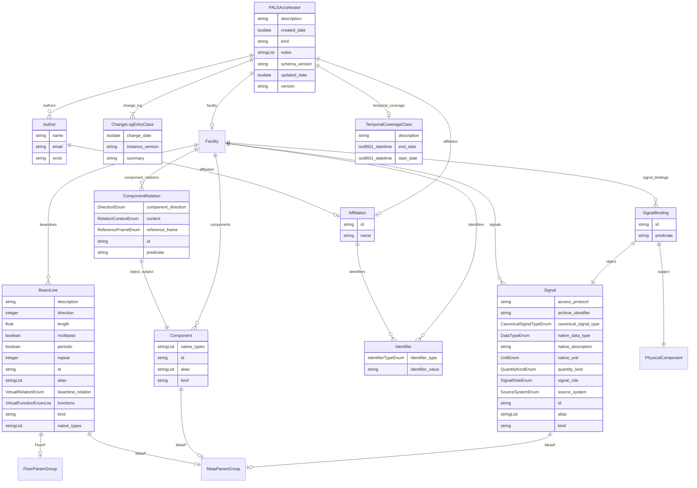

# Class: PALSAccelerator 


_Root container for accelerator core components, semantic signals, and local bindings._


URI: [pals_config:class/PALSAccelerator](https://w3id.org/pals-config/class/PALSAccelerator)





<!-- no inheritance hierarchy -->

## Class Properties

| Property | Value |
| --- | --- |
| Tree Root | Yes |


## Slots

| Name | Cardinality and Range | Description | Inheritance |
| ---  | --- | --- | --- |
| [kind](../slots/kind.md) | 1 <br/> [String](../types/String.md) | The LinkML class name of this instance, e.g. `Quadrupole` or `BeamProfileMonitor` (no prefix). | direct |
| [description](../slots/description.md) | 0..1 <br/> [String](../types/String.md) | A human-readable description of the instance. | direct |
| [affiliation](../slots/affiliation.md) | 0..1 <br/> [Affiliation](../classes/Affiliation.md) | The affiliation of the author or component, as a ROR. | direct |
| [version](../slots/version.md) | 0..1 <br/> [String](../types/String.md) | Version of the representation of a particle accelerator and its operations. | direct |
| [schema_version](../slots/schema_version.md) | 0..1 <br/> [String](../types/String.md) | Version of the schema used for this representation of a particle accelerator and its operations. Should follow the semantic versioning convention (MAJOR.MINOR.PATCH). Should match the schema version of the NARAD/PALS instance configuration schema being used. | direct |
| [temporal_coverage](../slots/temporal_coverage.md) | 0..1 <br/> [TemporalCoverageClass](../classes/TemporalCoverageClass.md) | Temporal coverage for time-based datasets, if applicable. Container for elements describing the start_date and end_date of the data instance's temporal coverage  in ISO 8601 datetime format YYYY-MM-DDTHH:MM:SSZ±hh:mm (e.g., 2024-06-05T14:30:00-05:00). Use temporal_coverage when the dataset describes a specific historical or projected time period. This may not apply to simulations where temporal coverage of a specific facility during a specific time is not relevant. | direct |
| [authors](../slots/authors.md) | * <br/> [Author](../classes/Author.md) | Contains the authorship information for this representation of an accelerator facility and its operations. | direct |
| [created_date](../slots/created_date.md) | 1 <br/> [Isodate](../types/Isodate.md) | The date the PALS/NARAD data instance of the facility configuration was first created, in ISO 8601 format (YYYY-MM-DD).  Provides temporal context for the data instance and can be used for tracking its age and relevance. | direct |
| [updated_date](../slots/updated_date.md) | 0..1 <br/> [Isodate](../types/Isodate.md) | The date the data instance for the facility configuration was last updated, in ISO 8601 format (YYYY-MM-DD). Date of most recent update; revise on every change/version to the data instance, including minor edits and version updates.  This provides temporal context for the data instance and can be used for tracking its currency and maintenance. | direct |
| [change_log](../slots/change_log.md) | 1..* <br/> [ChangeLogEntryClass](../classes/ChangeLogEntryClass.md) | Running history of meaningful changes to a data instance of a facility's configuration. Add a new entry every time the instance is updated. Do not overwrite or delete prior entries. If there have been no changes since creation, include a single entry with the creation date and the summary 'Initial creation'. | direct |
| [notes](../slots/notes.md) | * <br/> [String](../types/String.md) | Additional notes or comments about the representation of a particle accelerator and its operations. | direct |
| [facility](../slots/facility.md) | 0..1 <br/> [Facility](../classes/Facility.md) | A facility that contains lattice elements (physical and virtual), beamlines, parameter set commands, signals, etc. | direct |


## Identifier and Mapping Information


### Schema Source


* from schema: https://w3id.org/pals-config


## Mappings

| Mapping Type | Mapped Value |
| ---  | ---  |
| self | pals_config:PALSAccelerator |
| native | pals_config:PALSAccelerator |


## LinkML Source

<!-- TODO: investigate https://stackoverflow.com/questions/37606292/how-to-create-tabbed-code-blocks-in-mkdocs-or-sphinx -->

### Direct

<details>
```yaml
name: PALSAccelerator
description: Root container for accelerator core components, semantic signals, and
  local bindings.
from_schema: https://w3id.org/pals-config
slots:
- kind
- description
- affiliation
attributes:
  version:
    name: version
    description: Version of the representation of a particle accelerator and its operations.
    from_schema: https://w3id.org/pals-config
    rank: 1000
    ifabsent: string(0.0.0)
    domain_of:
    - PALSAccelerator
    range: string
    required: false
    pattern: ^(0|[1-9][0-9]*)\.(0|[1-9][0-9]*)\.(0|[1-9][0-9]*)$
  schema_version:
    name: schema_version
    description: Version of the schema used for this representation of a particle
      accelerator and its operations. Should follow the semantic versioning convention
      (MAJOR.MINOR.PATCH). Should match the schema version of the NARAD/PALS instance
      configuration schema being used.
    from_schema: https://w3id.org/pals-config
    rank: 1000
    ifabsent: string(0.0.1)
    domain_of:
    - PALSAccelerator
    range: string
    required: false
    pattern: ^(0|[1-9][0-9]*)\.(0|[1-9][0-9]*)\.(0|[1-9][0-9]*)$
  temporal_coverage:
    name: temporal_coverage
    description: Temporal coverage for time-based datasets, if applicable. Container
      for elements describing the start_date and end_date of the data instance's temporal
      coverage  in ISO 8601 datetime format YYYY-MM-DDTHH:MM:SSZ±hh:mm (e.g., 2024-06-05T14:30:00-05:00).
      Use temporal_coverage when the dataset describes a specific historical or projected
      time period. This may not apply to simulations where temporal coverage of a
      specific facility during a specific time is not relevant.
    from_schema: https://w3id.org/pals-config
    related_mappings:
    - dcterms:temporal
    - schema:temporalCoverage
    rank: 1000
    domain_of:
    - PALSAccelerator
    range: TemporalCoverageClass
    required: false
  authors:
    name: authors
    description: Contains the authorship information for this representation of an
      accelerator facility and its operations.
    from_schema: https://w3id.org/pals-config
    rank: 1000
    domain_of:
    - PALSAccelerator
    range: Author
    multivalued: true
    inlined: true
    inlined_as_list: true
  created_date:
    name: created_date
    description: The date the PALS/NARAD data instance of the facility configuration
      was first created, in ISO 8601 format (YYYY-MM-DD).  Provides temporal context
      for the data instance and can be used for tracking its age and relevance.
    from_schema: https://w3id.org/pals-config
    rank: 1000
    domain_of:
    - PALSAccelerator
    range: isodate
    required: true
  updated_date:
    name: updated_date
    description: The date the data instance for the facility configuration was last
      updated, in ISO 8601 format (YYYY-MM-DD). Date of most recent update; revise
      on every change/version to the data instance, including minor edits and version
      updates.  This provides temporal context for the data instance and can be used
      for tracking its currency and maintenance.
    from_schema: https://w3id.org/pals-config
    rank: 1000
    domain_of:
    - PALSAccelerator
    range: isodate
  change_log:
    name: change_log
    description: Running history of meaningful changes to a data instance of a facility's
      configuration. Add a new entry every time the instance is updated. Do not overwrite
      or delete prior entries. If there have been no changes since creation, include
      a single entry with the creation date and the summary 'Initial creation'.
    from_schema: https://w3id.org/pals-config
    rank: 1000
    domain_of:
    - PALSAccelerator
    range: ChangeLogEntryClass
    required: true
    multivalued: true
    inlined: true
    inlined_as_list: true
  notes:
    name: notes
    description: Additional notes or comments about the representation of a particle
      accelerator and its operations.
    from_schema: https://w3id.org/pals-config
    rank: 1000
    domain_of:
    - PALSAccelerator
    range: string
    multivalued: true
    inlined: true
    inlined_as_list: true
  facility:
    name: facility
    description: A facility that contains lattice elements (physical and virtual),
      beamlines, parameter set commands, signals, etc.
    from_schema: https://w3id.org/pals-config
    rank: 1000
    domain_of:
    - PALSAccelerator
    range: Facility
tree_root: true

```
</details>

### Induced

<details>
```yaml
name: PALSAccelerator
description: Root container for accelerator core components, semantic signals, and
  local bindings.
from_schema: https://w3id.org/pals-config
attributes:
  version:
    name: version
    description: Version of the representation of a particle accelerator and its operations.
    from_schema: https://w3id.org/pals-config
    rank: 1000
    ifabsent: string(0.0.0)
    alias: version
    owner: PALSAccelerator
    domain_of:
    - PALSAccelerator
    range: string
    required: false
    pattern: ^(0|[1-9][0-9]*)\.(0|[1-9][0-9]*)\.(0|[1-9][0-9]*)$
  schema_version:
    name: schema_version
    description: Version of the schema used for this representation of a particle
      accelerator and its operations. Should follow the semantic versioning convention
      (MAJOR.MINOR.PATCH). Should match the schema version of the NARAD/PALS instance
      configuration schema being used.
    from_schema: https://w3id.org/pals-config
    rank: 1000
    ifabsent: string(0.0.1)
    alias: schema_version
    owner: PALSAccelerator
    domain_of:
    - PALSAccelerator
    range: string
    required: false
    pattern: ^(0|[1-9][0-9]*)\.(0|[1-9][0-9]*)\.(0|[1-9][0-9]*)$
  temporal_coverage:
    name: temporal_coverage
    description: Temporal coverage for time-based datasets, if applicable. Container
      for elements describing the start_date and end_date of the data instance's temporal
      coverage  in ISO 8601 datetime format YYYY-MM-DDTHH:MM:SSZ±hh:mm (e.g., 2024-06-05T14:30:00-05:00).
      Use temporal_coverage when the dataset describes a specific historical or projected
      time period. This may not apply to simulations where temporal coverage of a
      specific facility during a specific time is not relevant.
    from_schema: https://w3id.org/pals-config
    related_mappings:
    - dcterms:temporal
    - schema:temporalCoverage
    rank: 1000
    alias: temporal_coverage
    owner: PALSAccelerator
    domain_of:
    - PALSAccelerator
    range: TemporalCoverageClass
    required: false
  authors:
    name: authors
    description: Contains the authorship information for this representation of an
      accelerator facility and its operations.
    from_schema: https://w3id.org/pals-config
    rank: 1000
    alias: authors
    owner: PALSAccelerator
    domain_of:
    - PALSAccelerator
    range: Author
    multivalued: true
    inlined: true
    inlined_as_list: true
  created_date:
    name: created_date
    description: The date the PALS/NARAD data instance of the facility configuration
      was first created, in ISO 8601 format (YYYY-MM-DD).  Provides temporal context
      for the data instance and can be used for tracking its age and relevance.
    from_schema: https://w3id.org/pals-config
    rank: 1000
    alias: created_date
    owner: PALSAccelerator
    domain_of:
    - PALSAccelerator
    range: isodate
    required: true
  updated_date:
    name: updated_date
    description: The date the data instance for the facility configuration was last
      updated, in ISO 8601 format (YYYY-MM-DD). Date of most recent update; revise
      on every change/version to the data instance, including minor edits and version
      updates.  This provides temporal context for the data instance and can be used
      for tracking its currency and maintenance.
    from_schema: https://w3id.org/pals-config
    rank: 1000
    alias: updated_date
    owner: PALSAccelerator
    domain_of:
    - PALSAccelerator
    range: isodate
  change_log:
    name: change_log
    description: Running history of meaningful changes to a data instance of a facility's
      configuration. Add a new entry every time the instance is updated. Do not overwrite
      or delete prior entries. If there have been no changes since creation, include
      a single entry with the creation date and the summary 'Initial creation'.
    from_schema: https://w3id.org/pals-config
    rank: 1000
    alias: change_log
    owner: PALSAccelerator
    domain_of:
    - PALSAccelerator
    range: ChangeLogEntryClass
    required: true
    multivalued: true
    inlined: true
    inlined_as_list: true
  notes:
    name: notes
    description: Additional notes or comments about the representation of a particle
      accelerator and its operations.
    from_schema: https://w3id.org/pals-config
    rank: 1000
    alias: notes
    owner: PALSAccelerator
    domain_of:
    - PALSAccelerator
    range: string
    multivalued: true
    inlined: true
    inlined_as_list: true
  facility:
    name: facility
    description: A facility that contains lattice elements (physical and virtual),
      beamlines, parameter set commands, signals, etc.
    from_schema: https://w3id.org/pals-config
    rank: 1000
    alias: facility
    owner: PALSAccelerator
    domain_of:
    - PALSAccelerator
    range: Facility
  kind:
    name: kind
    description: The LinkML class name of this instance, e.g. `Quadrupole` or `BeamProfileMonitor`
      (no prefix).
    from_schema: https://w3id.org/pals-config
    related_mappings:
    - saref:DeviceKind
    rank: 1000
    slot_uri: rdf:type
    designates_type: true
    alias: kind
    owner: PALSAccelerator
    domain_of:
    - Node
    - PALSAccelerator
    range: string
    required: true
  description:
    name: description
    description: A human-readable description of the instance.
    from_schema: https://w3id.org/pals-config
    rank: 1000
    alias: description
    owner: PALSAccelerator
    domain_of:
    - PALSAccelerator
    - TemporalCoverageClass
    - MetaParamGroup
    - BeamLine
    range: string
  affiliation:
    name: affiliation
    description: The affiliation of the author or component, as a ROR.
    from_schema: https://w3id.org/pals-config
    rank: 1000
    alias: affiliation
    owner: PALSAccelerator
    domain_of:
    - PALSAccelerator
    - Author
    range: Affiliation
    inlined: true
tree_root: true

```
</details>