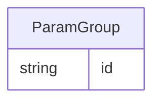

# Class: ParamGroup 


_Abstract base for inlined PALS parameter-group objects, giving each an identifier so it resolves to a stable node/IRI rather than a blank node when exported to RDF._


* __NOTE__: this is an abstract class and should not be instantiated directly


URI: [pals_config:class/ParamGroup](https://w3id.org/pals-config/class/ParamGroup)





## Inheritance
* **ParamGroup**
    * [MetaParamGroup](../classes/MetaParamGroup.md)
    * [FloorParamGroup](../classes/FloorParamGroup.md)
    * [BodyShiftParamGroup](../classes/BodyShiftParamGroup.md)
    * [LongitudinalPlacementParamGroup](../classes/LongitudinalPlacementParamGroup.md)
    * [ReferenceParamGroup](../classes/ReferenceParamGroup.md)
    * [SolenoidParamGroup](../classes/SolenoidParamGroup.md)
    * [TwissParamGroup](../classes/TwissParamGroup.md)
    * [RFParamGroup](../classes/RFParamGroup.md)
    * [ElectricMultipoleParamGroup](../classes/ElectricMultipoleParamGroup.md)
    * [MagneticMultipoleParamGroup](../classes/MagneticMultipoleParamGroup.md)
    * [BendParamGroup](../classes/BendParamGroup.md)


## Slots

| Name | Cardinality and Range | Description | Inheritance |
| ---  | --- | --- | --- |
| [id](../slots/id.md) | 1 <br/> [String](../types/String.md) | A unique identifier for the instance. | direct |


## Identifier and Mapping Information


### Schema Source


* from schema: https://w3id.org/pals-config


## Mappings

| Mapping Type | Mapped Value |
| ---  | ---  |
| self | pals_config:ParamGroup |
| native | pals_config:ParamGroup |


## LinkML Source

<!-- TODO: investigate https://stackoverflow.com/questions/37606292/how-to-create-tabbed-code-blocks-in-mkdocs-or-sphinx -->

### Direct

<details>
```yaml
name: ParamGroup
description: Abstract base for inlined PALS parameter-group objects, giving each an
  identifier so it resolves to a stable node/IRI rather than a blank node when exported
  to RDF.
from_schema: https://w3id.org/pals-config
abstract: true
slots:
- id

```
</details>

### Induced

<details>
```yaml
name: ParamGroup
description: Abstract base for inlined PALS parameter-group objects, giving each an
  identifier so it resolves to a stable node/IRI rather than a blank node when exported
  to RDF.
from_schema: https://w3id.org/pals-config
abstract: true
attributes:
  id:
    name: id
    description: A unique identifier for the instance.
    from_schema: https://w3id.org/pals-config
    close_mappings:
    - pals:id
    rank: 1000
    identifier: true
    alias: id
    owner: ParamGroup
    domain_of:
    - Node
    - Affiliation
    - ParamGroup
    - Edge
    range: string
    required: true

```
</details>