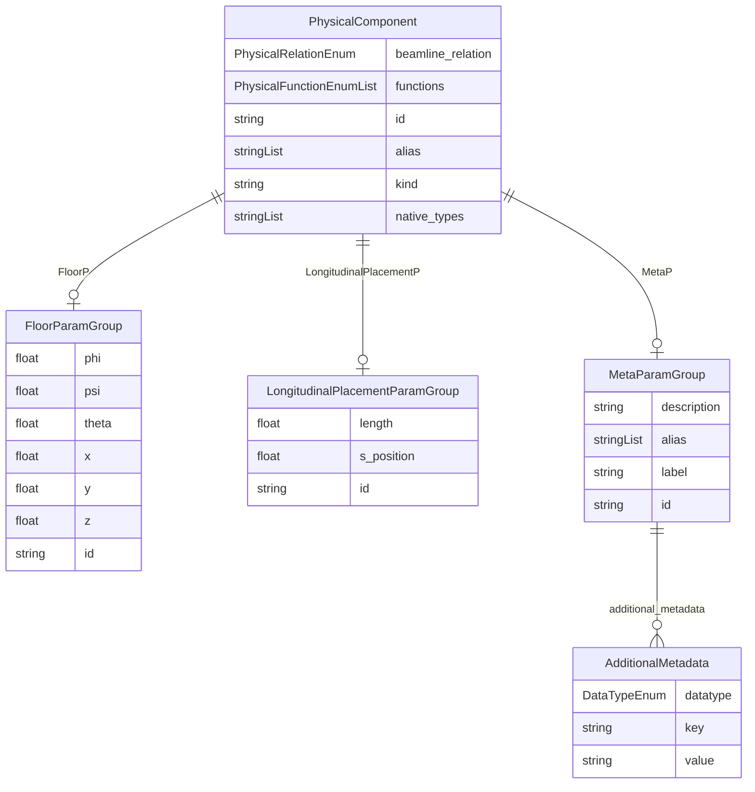

# Class: PhysicalComponent 


_A physical item that participates in or supports accelerator operation.  This can be used to capture physical components, such as magnets, cavities, diagnostics, vacuum devices, and racks that are important for understanding the structure and function of the accelerator system._


URI: [pals_config:class/PhysicalComponent](https://w3id.org/pals-config/class/PhysicalComponent)





## Inheritance
* [Node](../classes/Node.md)
    * [Component](../classes/Component.md) [ [HasMetaP](../classes/HasMetaP.md)]
        * **PhysicalComponent** [ [HasFloorP](../classes/HasFloorP.md) [HasLongitudinalPlacementP](../classes/HasLongitudinalPlacementP.md)]
            * [Magnet](../classes/Magnet.md) [ [HasReferenceP](../classes/HasReferenceP.md) [HasBodyShiftP](../classes/HasBodyShiftP.md) [HasTwissP](../classes/HasTwissP.md)]
            * [DiagnosticDevice](../classes/DiagnosticDevice.md)
            * [Cavity](../classes/Cavity.md) [ [HasReferenceP](../classes/HasReferenceP.md) [HasElectricMultipoleP](../classes/HasElectricMultipoleP.md) [HasMagneticMultipoleP](../classes/HasMagneticMultipoleP.md) [HasBodyShiftP](../classes/HasBodyShiftP.md) [HasTwissP](../classes/HasTwissP.md)]
            * [SupportingFacilityComponent](../classes/SupportingFacilityComponent.md) [ [HasFloorP](../classes/HasFloorP.md) [HasLongitudinalPlacementP](../classes/HasLongitudinalPlacementP.md) [HasBodyShiftP](../classes/HasBodyShiftP.md)]


## Slots

| Name | Cardinality and Range | Description | Inheritance |
| ---  | --- | --- | --- |
| [functions](../slots/functions.md) | * <br/> [PhysicalFunctionEnum](../enums/PhysicalFunctionEnum.md) | The function of the physical component,  which can be used to identify the component across different source systems. | direct |
| [beamline_relation](../slots/beamline_relation.md) | 1 <br/> [PhysicalRelationEnum](../enums/PhysicalRelationEnum.md) | The relationship of the physical component to the beamline,  which can be used to identify the component across different source systems. | direct |
| [FloorP](../slots/FloorP.md) | 0..1 <br/> [FloorParamGroup](../classes/FloorParamGroup.md) | A mixin for floor plan parameters that are aligned with PALS FloorP (Floor Plan Parameters) for interoperability with the Particle Accelerator Language Standard (PALS). | [HasFloorP](../classes/HasFloorP.md) |
| [LongitudinalPlacementP](../slots/LongitudinalPlacementP.md) | 0..1 <br/> [LongitudinalPlacementParamGroup](../classes/LongitudinalPlacementParamGroup.md) | A mixin for an element's extent and position along the longitudinal (beam-direction, "s") axis that are aligned with PALS LongitudinalPlacementP (Longitudinal Placement Parameters) for interoperability with the Particle Accelerator Language Standard (PALS). | [HasLongitudinalPlacementP](../classes/HasLongitudinalPlacementP.md) |
| [native_types](../slots/native_types.md) | * <br/> [String](../types/String.md) | The native type of the component in the source system, which can be used to identify the component across different source systems. | [Component](../classes/Component.md) |
| [MetaP](../slots/MetaP.md) | 0..1 <br/> [MetaParamGroup](../classes/MetaParamGroup.md) | A mixin for metadata parameters that are aligned with PALS MetaP (Metadata Parameters) for interoperability with the Particle Accelerator Language Standard (PALS). | [HasMetaP](../classes/HasMetaP.md) |
| [id](../slots/id.md) | 1 <br/> [String](../types/String.md) | A unique identifier for the instance. | [Node](../classes/Node.md) |
| [kind](../slots/kind.md) | 1 <br/> [String](../types/String.md) | The LinkML class name of this instance, e.g. `Quadrupole` or `BeamProfileMonitor` (no prefix). | [Node](../classes/Node.md) |
| [alias](../slots/alias.md) | * <br/> [String](../types/String.md) | An alternative name or identifier for the instance. | [Node](../classes/Node.md) |


## Usages

| used by | used in | type | used |
| ---  | --- | --- | --- |
| [SignalBinding](../classes/SignalBinding.md) | [subject](../slots/subject.md) | range | [PhysicalComponent](../classes/PhysicalComponent.md) |
| [HasSignal](../classes/HasSignal.md) | [subject](../slots/subject.md) | range | [PhysicalComponent](../classes/PhysicalComponent.md) |
| [HasSetpointSignal](../classes/HasSetpointSignal.md) | [subject](../slots/subject.md) | range | [PhysicalComponent](../classes/PhysicalComponent.md) |
| [HasReadbackSignal](../classes/HasReadbackSignal.md) | [subject](../slots/subject.md) | range | [PhysicalComponent](../classes/PhysicalComponent.md) |
| [HasCommandSignal](../classes/HasCommandSignal.md) | [subject](../slots/subject.md) | range | [PhysicalComponent](../classes/PhysicalComponent.md) |
| [HasLimitSignal](../classes/HasLimitSignal.md) | [subject](../slots/subject.md) | range | [PhysicalComponent](../classes/PhysicalComponent.md) |


## Identifier and Mapping Information


### Schema Source


* from schema: https://w3id.org/pals-config


## Mappings

| Mapping Type | Mapped Value |
| ---  | ---  |
| self | pals_config:PhysicalComponent |
| native | pals_config:PhysicalComponent |
| broad | pals:Element |


## LinkML Source

<!-- TODO: investigate https://stackoverflow.com/questions/37606292/how-to-create-tabbed-code-blocks-in-mkdocs-or-sphinx -->

### Direct

<details>
```yaml
name: PhysicalComponent
description: A physical item that participates in or supports accelerator operation.  This
  can be used to capture physical components, such as magnets, cavities, diagnostics,
  vacuum devices, and racks that are important for understanding the structure and
  function of the accelerator system.
from_schema: https://w3id.org/pals-config
broad_mappings:
- pals:Element
is_a: Component
mixins:
- HasFloorP
- HasLongitudinalPlacementP
slots:
- functions
- beamline_relation
slot_usage:
  functions:
    name: functions
    description: The function of the physical component,  which can be used to identify
      the component across different source systems.
    close_mappings:
    - pals:physical_function
    range: PhysicalFunctionEnum
    required: false
    multivalued: true
  beamline_relation:
    name: beamline_relation
    description: The relationship of the physical component to the beamline,  which
      can be used to identify the component across different source systems.
    close_mappings:
    - pals:physical_beamline_relation
    range: PhysicalRelationEnum
    required: true

```
</details>

### Induced

<details>
```yaml
name: PhysicalComponent
description: A physical item that participates in or supports accelerator operation.  This
  can be used to capture physical components, such as magnets, cavities, diagnostics,
  vacuum devices, and racks that are important for understanding the structure and
  function of the accelerator system.
from_schema: https://w3id.org/pals-config
broad_mappings:
- pals:Element
is_a: Component
mixins:
- HasFloorP
- HasLongitudinalPlacementP
slot_usage:
  functions:
    name: functions
    description: The function of the physical component,  which can be used to identify
      the component across different source systems.
    close_mappings:
    - pals:physical_function
    range: PhysicalFunctionEnum
    required: false
    multivalued: true
  beamline_relation:
    name: beamline_relation
    description: The relationship of the physical component to the beamline,  which
      can be used to identify the component across different source systems.
    close_mappings:
    - pals:physical_beamline_relation
    range: PhysicalRelationEnum
    required: true
attributes:
  functions:
    name: functions
    description: The function of the physical component,  which can be used to identify
      the component across different source systems.
    from_schema: https://w3id.org/pals-config
    close_mappings:
    - pals:physical_function
    rank: 1000
    alias: functions
    owner: PhysicalComponent
    domain_of:
    - PhysicalComponent
    - VirtualComponent
    range: PhysicalFunctionEnum
    required: false
    multivalued: true
  beamline_relation:
    name: beamline_relation
    description: The relationship of the physical component to the beamline,  which
      can be used to identify the component across different source systems.
    from_schema: https://w3id.org/pals-config
    close_mappings:
    - pals:physical_beamline_relation
    rank: 1000
    alias: beamline_relation
    owner: PhysicalComponent
    domain_of:
    - PhysicalComponent
    - VirtualComponent
    range: PhysicalRelationEnum
    required: true
  FloorP:
    name: FloorP
    description: A mixin for floor plan parameters that are aligned with PALS FloorP
      (Floor Plan Parameters) for interoperability with the Particle Accelerator Language
      Standard (PALS).
    from_schema: https://w3id.org/pals-config
    rank: 1000
    alias: FloorP
    owner: PhysicalComponent
    domain_of:
    - HasFloorP
    range: FloorParamGroup
    inlined: true
  LongitudinalPlacementP:
    name: LongitudinalPlacementP
    description: A mixin for an element's extent and position along the longitudinal
      (beam-direction, "s") axis that are aligned with PALS LongitudinalPlacementP
      (Longitudinal Placement Parameters) for interoperability with the Particle Accelerator
      Language Standard (PALS).
    from_schema: https://w3id.org/pals-config
    rank: 1000
    alias: LongitudinalPlacementP
    owner: PhysicalComponent
    domain_of:
    - HasLongitudinalPlacementP
    range: LongitudinalPlacementParamGroup
    inlined: true
  native_types:
    name: native_types
    description: The native type of the component in the source system, which can
      be used to identify the component across different source systems.
    from_schema: https://w3id.org/pals-config
    rank: 1000
    alias: native_types
    owner: PhysicalComponent
    domain_of:
    - Component
    range: string
    multivalued: true
  MetaP:
    name: MetaP
    description: A mixin for metadata parameters that are aligned with PALS MetaP
      (Metadata Parameters) for interoperability with the Particle Accelerator Language
      Standard (PALS).
    from_schema: https://w3id.org/pals-config
    rank: 1000
    alias: MetaP
    owner: PhysicalComponent
    domain_of:
    - HasMetaP
    range: MetaParamGroup
    inlined: true
  id:
    name: id
    description: A unique identifier for the instance.
    from_schema: https://w3id.org/pals-config
    close_mappings:
    - pals:id
    rank: 1000
    identifier: true
    alias: id
    owner: PhysicalComponent
    domain_of:
    - Node
    - Affiliation
    - ParamGroup
    - Edge
    range: string
    required: true
  kind:
    name: kind
    description: The LinkML class name of this instance, e.g. `Quadrupole` or `BeamProfileMonitor`
      (no prefix).
    from_schema: https://w3id.org/pals-config
    related_mappings:
    - saref:DeviceKind
    rank: 1000
    slot_uri: rdf:type
    designates_type: true
    alias: kind
    owner: PhysicalComponent
    domain_of:
    - Node
    - PALSAccelerator
    range: string
    required: true
  alias:
    name: alias
    description: An alternative name or identifier for the instance.
    from_schema: https://w3id.org/pals-config
    close_mappings:
    - pals:alias
    rank: 1000
    alias: alias
    owner: PhysicalComponent
    domain_of:
    - Node
    - MetaParamGroup
    range: string
    multivalued: true

```
</details>