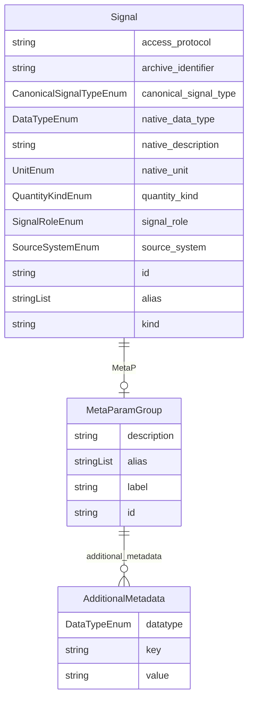

# Class: Signal 


_Semantic meaning of a control-system signal associated with a component._


URI: [pals_config:class/Signal](https://w3id.org/pals-config/class/Signal)





## Inheritance
* [Node](../classes/Node.md)
    * **Signal** [ [HasMetaP](../classes/HasMetaP.md)]


## Slots

| Name | Cardinality and Range | Description | Inheritance |
| ---  | --- | --- | --- |
| [signal_role](../slots/signal_role.md) | 1 <br/> [SignalRoleEnum](../enums/SignalRoleEnum.md) | The role of the signal in the control system, such as setpoint, readback, status, command, or limit. | direct |
| [source_system](../slots/source_system.md) | 1 <br/> [SourceSystemEnum](../enums/SourceSystemEnum.md) | The source system from which the signal originates, such as EPICS, PALS-Ext, MYA, an element database, a channel database, or a simulation service. | direct |
| [native_description](../slots/native_description.md) | 0..1 <br/> [String](../types/String.md) | A human-readable description of the signal in the source system. | direct |
| [canonical_signal_type](../slots/canonical_signal_type.md) | 1 <br/> [CanonicalSignalTypeEnum](../enums/CanonicalSignalTypeEnum.md) | The canonical semantic meaning of the signal. | direct |
| [quantity_kind](../slots/quantity_kind.md) | 1 <br/> [QuantityKindEnum](../enums/QuantityKindEnum.md) | The physical quantity kind of the signal. | direct |
| [native_data_type](../slots/native_data_type.md) | 1 <br/> [DataTypeEnum](../enums/DataTypeEnum.md) | The native data type of the signal in the source system,  such as String, Integer, Float, or Boolean. | direct |
| [native_unit](../slots/native_unit.md) | 1 <br/> [UnitEnum](../enums/UnitEnum.md) | The native unit of the signal in the source system. | direct |
| [access_protocol](../slots/access_protocol.md) | 0..1 <br/> [String](../types/String.md) | The protocol used to access the signal in the source system,  such as EPICS Channel Access, PALS-Ext, MYA, or a simulation service. | direct |
| [archive_identifier](../slots/archive_identifier.md) | 0..1 <br/> [String](../types/String.md) | The identifier used to reference the signal in an archival system. | direct |
| [MetaP](../slots/MetaP.md) | 0..1 <br/> [MetaParamGroup](../classes/MetaParamGroup.md) | A mixin for metadata parameters that are aligned with PALS MetaP (Metadata Parameters) for interoperability with the Particle Accelerator Language Standard (PALS). | [HasMetaP](../classes/HasMetaP.md) |
| [id](../slots/id.md) | 1 <br/> [String](../types/String.md) | A unique identifier for the instance. | [Node](../classes/Node.md) |
| [kind](../slots/kind.md) | 1 <br/> [String](../types/String.md) | The LinkML class name of this instance, e.g. `Quadrupole` or `BeamProfileMonitor` (no prefix). | [Node](../classes/Node.md) |
| [alias](../slots/alias.md) | * <br/> [String](../types/String.md) | An alternative name or identifier for the instance. | [Node](../classes/Node.md) |


## Usages

| used by | used in | type | used |
| ---  | --- | --- | --- |
| [Facility](../classes/Facility.md) | [signals](../slots/signals.md) | range | [Signal](../classes/Signal.md) |
| [SignalBinding](../classes/SignalBinding.md) | [object](../slots/object.md) | range | [Signal](../classes/Signal.md) |
| [HasSignal](../classes/HasSignal.md) | [object](../slots/object.md) | range | [Signal](../classes/Signal.md) |
| [HasSetpointSignal](../classes/HasSetpointSignal.md) | [object](../slots/object.md) | range | [Signal](../classes/Signal.md) |
| [HasReadbackSignal](../classes/HasReadbackSignal.md) | [object](../slots/object.md) | range | [Signal](../classes/Signal.md) |
| [HasCommandSignal](../classes/HasCommandSignal.md) | [object](../slots/object.md) | range | [Signal](../classes/Signal.md) |
| [HasLimitSignal](../classes/HasLimitSignal.md) | [object](../slots/object.md) | range | [Signal](../classes/Signal.md) |


## Identifier and Mapping Information


### Schema Source


* from schema: https://w3id.org/pals-config


## Mappings

| Mapping Type | Mapped Value |
| ---  | ---  |
| self | pals_config:Signal |
| native | pals_config:Signal |
| related | saref:Property |


## LinkML Source

<!-- TODO: investigate https://stackoverflow.com/questions/37606292/how-to-create-tabbed-code-blocks-in-mkdocs-or-sphinx -->

### Direct

<details>
```yaml
name: Signal
description: Semantic meaning of a control-system signal associated with a component.
from_schema: https://w3id.org/pals-config
related_mappings:
- saref:Property
is_a: Node
mixins:
- HasMetaP
attributes:
  signal_role:
    name: signal_role
    description: The role of the signal in the control system, such as setpoint, readback,
      status, command, or limit.
    from_schema: https://w3id.org/pals-config
    rank: 1000
    domain_of:
    - Signal
    range: SignalRoleEnum
    required: true
  source_system:
    name: source_system
    description: The source system from which the signal originates, such as EPICS,
      PALS-Ext, MYA, an element database, a channel database, or a simulation service.
    from_schema: https://w3id.org/pals-config
    rank: 1000
    domain_of:
    - Signal
    range: SourceSystemEnum
    required: true
  native_description:
    name: native_description
    description: A human-readable description of the signal in the source system.
    from_schema: https://w3id.org/pals-config
    rank: 1000
    domain_of:
    - Signal
    range: string
  canonical_signal_type:
    name: canonical_signal_type
    description: The canonical semantic meaning of the signal.
    from_schema: https://w3id.org/pals-config
    rank: 1000
    domain_of:
    - Signal
    range: CanonicalSignalTypeEnum
    required: true
  quantity_kind:
    name: quantity_kind
    description: The physical quantity kind of the signal.
    from_schema: https://w3id.org/pals-config
    rank: 1000
    domain_of:
    - Signal
    range: QuantityKindEnum
    required: true
  native_data_type:
    name: native_data_type
    description: The native data type of the signal in the source system,  such as
      String, Integer, Float, or Boolean.
    from_schema: https://w3id.org/pals-config
    rank: 1000
    domain_of:
    - Signal
    range: DataTypeEnum
    required: true
  native_unit:
    name: native_unit
    description: The native unit of the signal in the source system.
    from_schema: https://w3id.org/pals-config
    rank: 1000
    domain_of:
    - Signal
    range: UnitEnum
    required: true
  access_protocol:
    name: access_protocol
    description: The protocol used to access the signal in the source system,  such
      as EPICS Channel Access, PALS-Ext, MYA, or a simulation service.
    from_schema: https://w3id.org/pals-config
    rank: 1000
    domain_of:
    - Signal
    range: string
  archive_identifier:
    name: archive_identifier
    description: The identifier used to reference the signal in an archival system.
    from_schema: https://w3id.org/pals-config
    rank: 1000
    domain_of:
    - Signal
    range: string

```
</details>

### Induced

<details>
```yaml
name: Signal
description: Semantic meaning of a control-system signal associated with a component.
from_schema: https://w3id.org/pals-config
related_mappings:
- saref:Property
is_a: Node
mixins:
- HasMetaP
attributes:
  signal_role:
    name: signal_role
    description: The role of the signal in the control system, such as setpoint, readback,
      status, command, or limit.
    from_schema: https://w3id.org/pals-config
    rank: 1000
    alias: signal_role
    owner: Signal
    domain_of:
    - Signal
    range: SignalRoleEnum
    required: true
  source_system:
    name: source_system
    description: The source system from which the signal originates, such as EPICS,
      PALS-Ext, MYA, an element database, a channel database, or a simulation service.
    from_schema: https://w3id.org/pals-config
    rank: 1000
    alias: source_system
    owner: Signal
    domain_of:
    - Signal
    range: SourceSystemEnum
    required: true
  native_description:
    name: native_description
    description: A human-readable description of the signal in the source system.
    from_schema: https://w3id.org/pals-config
    rank: 1000
    alias: native_description
    owner: Signal
    domain_of:
    - Signal
    range: string
  canonical_signal_type:
    name: canonical_signal_type
    description: The canonical semantic meaning of the signal.
    from_schema: https://w3id.org/pals-config
    rank: 1000
    alias: canonical_signal_type
    owner: Signal
    domain_of:
    - Signal
    range: CanonicalSignalTypeEnum
    required: true
  quantity_kind:
    name: quantity_kind
    description: The physical quantity kind of the signal.
    from_schema: https://w3id.org/pals-config
    rank: 1000
    alias: quantity_kind
    owner: Signal
    domain_of:
    - Signal
    range: QuantityKindEnum
    required: true
  native_data_type:
    name: native_data_type
    description: The native data type of the signal in the source system,  such as
      String, Integer, Float, or Boolean.
    from_schema: https://w3id.org/pals-config
    rank: 1000
    alias: native_data_type
    owner: Signal
    domain_of:
    - Signal
    range: DataTypeEnum
    required: true
  native_unit:
    name: native_unit
    description: The native unit of the signal in the source system.
    from_schema: https://w3id.org/pals-config
    rank: 1000
    alias: native_unit
    owner: Signal
    domain_of:
    - Signal
    range: UnitEnum
    required: true
  access_protocol:
    name: access_protocol
    description: The protocol used to access the signal in the source system,  such
      as EPICS Channel Access, PALS-Ext, MYA, or a simulation service.
    from_schema: https://w3id.org/pals-config
    rank: 1000
    alias: access_protocol
    owner: Signal
    domain_of:
    - Signal
    range: string
  archive_identifier:
    name: archive_identifier
    description: The identifier used to reference the signal in an archival system.
    from_schema: https://w3id.org/pals-config
    rank: 1000
    alias: archive_identifier
    owner: Signal
    domain_of:
    - Signal
    range: string
  MetaP:
    name: MetaP
    description: A mixin for metadata parameters that are aligned with PALS MetaP
      (Metadata Parameters) for interoperability with the Particle Accelerator Language
      Standard (PALS).
    from_schema: https://w3id.org/pals-config
    rank: 1000
    alias: MetaP
    owner: Signal
    domain_of:
    - HasMetaP
    range: MetaParamGroup
    inlined: true
  id:
    name: id
    description: A unique identifier for the instance.
    from_schema: https://w3id.org/pals-config
    close_mappings:
    - pals:id
    rank: 1000
    identifier: true
    alias: id
    owner: Signal
    domain_of:
    - Node
    - Affiliation
    - ParamGroup
    - Edge
    range: string
    required: true
  kind:
    name: kind
    description: The LinkML class name of this instance, e.g. `Quadrupole` or `BeamProfileMonitor`
      (no prefix).
    from_schema: https://w3id.org/pals-config
    related_mappings:
    - saref:DeviceKind
    rank: 1000
    slot_uri: rdf:type
    designates_type: true
    alias: kind
    owner: Signal
    domain_of:
    - Node
    - PALSAccelerator
    range: string
    required: true
  alias:
    name: alias
    description: An alternative name or identifier for the instance.
    from_schema: https://w3id.org/pals-config
    close_mappings:
    - pals:alias
    rank: 1000
    alias: alias
    owner: Signal
    domain_of:
    - Node
    - MetaParamGroup
    range: string
    multivalued: true

```
</details>