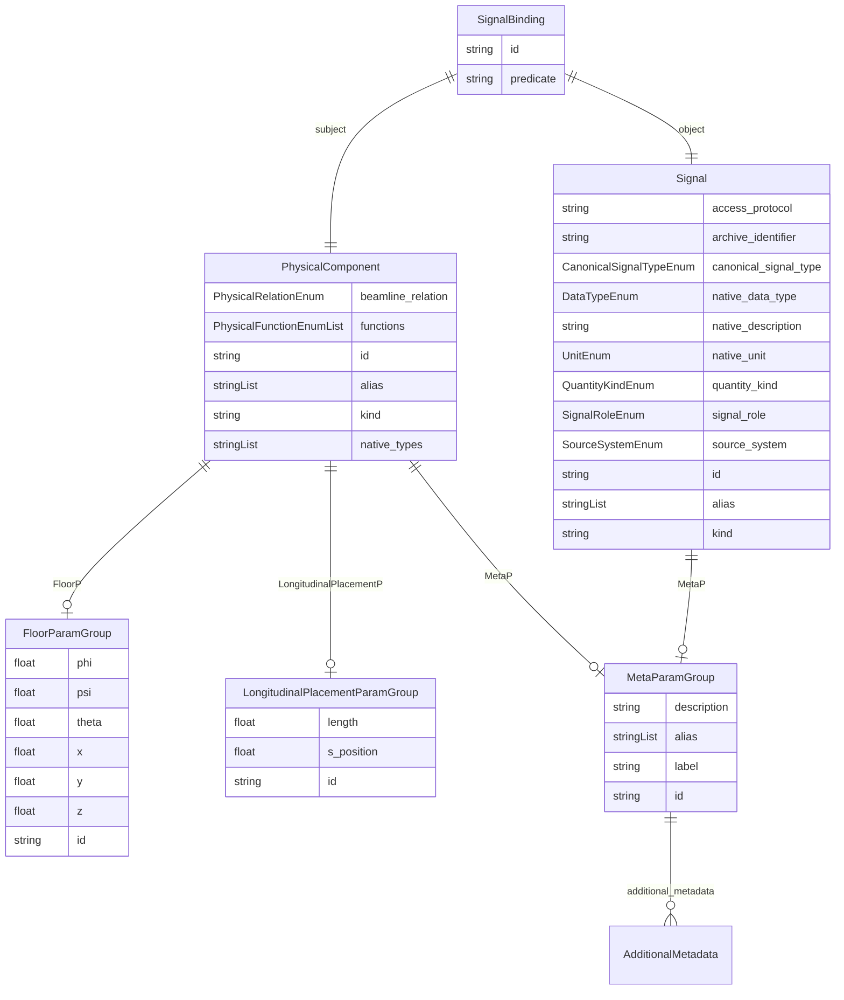

# Class: SignalBinding 


_Association between a PhysicalComponent and one of its Signals, e.g. QUAD1 component to QUAD1.STATUS signal._


* __NOTE__: this is an abstract class and should not be instantiated directly


URI: [pals_config:class/SignalBinding](https://w3id.org/pals-config/class/SignalBinding)





## Inheritance
* [Edge](../classes/Edge.md)
    * **SignalBinding**
        * [HasSignal](../classes/HasSignal.md)
        * [HasSetpointSignal](../classes/HasSetpointSignal.md)
        * [HasReadbackSignal](../classes/HasReadbackSignal.md)
        * [HasCommandSignal](../classes/HasCommandSignal.md)
        * [HasLimitSignal](../classes/HasLimitSignal.md)


## Slots

| Name | Cardinality and Range | Description | Inheritance |
| ---  | --- | --- | --- |
| [id](../slots/id.md) | 1 <br/> [String](../types/String.md) | A unique identifier for the instance. | [Edge](../classes/Edge.md) |
| [subject](../slots/subject.md) | 1 <br/> [PhysicalComponent](../classes/PhysicalComponent.md) |  | [Edge](../classes/Edge.md) |
| [predicate](../slots/predicate.md) | 1 <br/> [String](../types/String.md) |  | [Edge](../classes/Edge.md) |
| [object](../slots/object.md) | 1 <br/> [Signal](../classes/Signal.md) |  | [Edge](../classes/Edge.md) |


## Usages

| used by | used in | type | used |
| ---  | --- | --- | --- |
| [Facility](../classes/Facility.md) | [signal_bindings](../slots/signal_bindings.md) | range | [SignalBinding](../classes/SignalBinding.md) |


## Identifier and Mapping Information


### Schema Source


* from schema: https://w3id.org/pals-config


## Mappings

| Mapping Type | Mapped Value |
| ---  | ---  |
| self | pals_config:SignalBinding |
| native | pals_config:SignalBinding |


## LinkML Source

<!-- TODO: investigate https://stackoverflow.com/questions/37606292/how-to-create-tabbed-code-blocks-in-mkdocs-or-sphinx -->

### Direct

<details>
```yaml
name: SignalBinding
description: Association between a PhysicalComponent and one of its Signals, e.g.
  QUAD1 component to QUAD1.STATUS signal.
from_schema: https://w3id.org/pals-config
is_a: Edge
abstract: true
slot_usage:
  subject:
    name: subject
    range: PhysicalComponent
  object:
    name: object
    range: Signal

```
</details>

### Induced

<details>
```yaml
name: SignalBinding
description: Association between a PhysicalComponent and one of its Signals, e.g.
  QUAD1 component to QUAD1.STATUS signal.
from_schema: https://w3id.org/pals-config
is_a: Edge
abstract: true
slot_usage:
  subject:
    name: subject
    range: PhysicalComponent
  object:
    name: object
    range: Signal
attributes:
  id:
    name: id
    description: A unique identifier for the instance.
    from_schema: https://w3id.org/pals-config
    close_mappings:
    - pals:id
    rank: 1000
    identifier: true
    alias: id
    owner: SignalBinding
    domain_of:
    - Node
    - Affiliation
    - ParamGroup
    - Edge
    range: string
    required: true
  subject:
    name: subject
    from_schema: https://w3id.org/pals-config
    rank: 1000
    slot_uri: rdf:subject
    alias: subject
    owner: SignalBinding
    domain_of:
    - Edge
    range: PhysicalComponent
    required: true
  predicate:
    name: predicate
    from_schema: https://w3id.org/pals-config
    rank: 1000
    slot_uri: rdf:predicate
    designates_type: true
    alias: predicate
    owner: SignalBinding
    domain_of:
    - Edge
    range: string
    required: true
  object:
    name: object
    from_schema: https://w3id.org/pals-config
    rank: 1000
    slot_uri: rdf:object
    alias: object
    owner: SignalBinding
    domain_of:
    - Edge
    range: Signal
    required: true

```
</details>