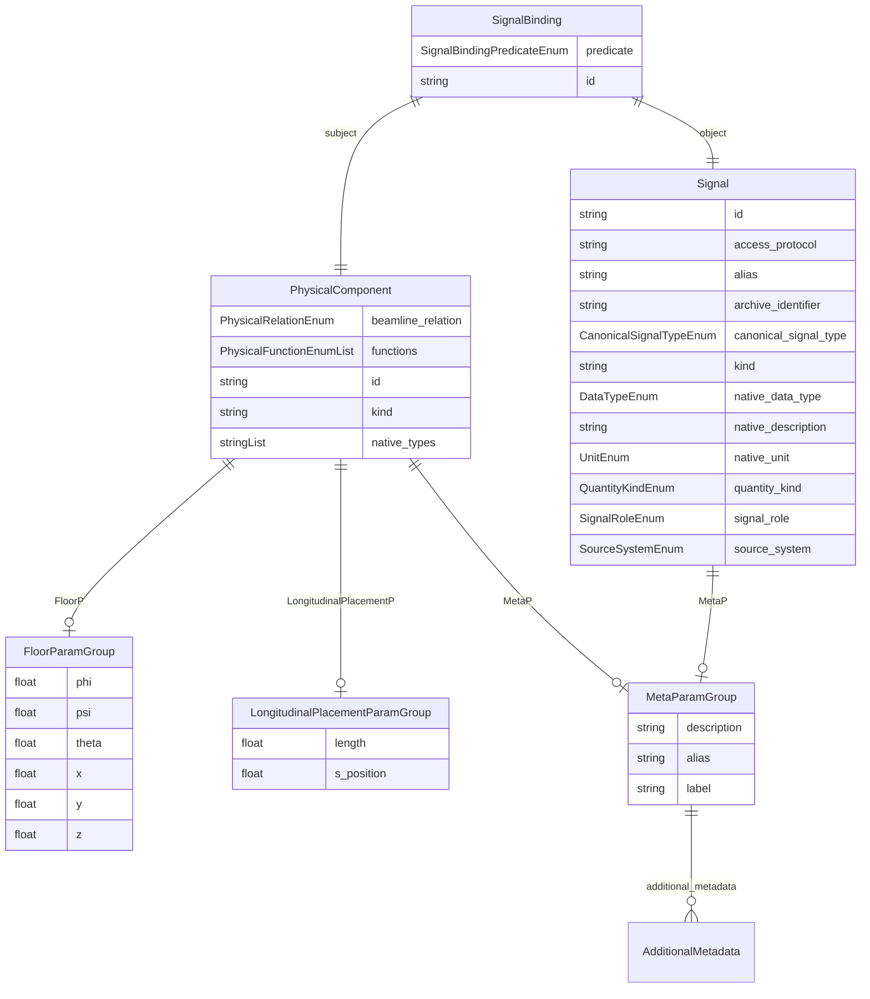

# Class: SignalBinding 


_Association between a PhysicalComponent and one of its Signals, e.g. QUAD1.QUAD1_STATUS_binding._


URI: [pals:class/SignalBinding](https://pals-project.readthedocs.io/class/SignalBinding)





## Inheritance
* [Relationship](../classes/Relationship.md)
    * **SignalBinding**


## Slots

| Name | Cardinality and Range | Description | Inheritance |
| ---  | --- | --- | --- |
| [id](../slots/id.md) | 1 <br/> [String](../types/String.md) | A unique identifier for the instance. | [Relationship](../classes/Relationship.md) |
| [subject](../slots/subject.md) | 1 <br/> [PhysicalComponent](../classes/PhysicalComponent.md) |  | [Relationship](../classes/Relationship.md) |
| [predicate](../slots/predicate.md) | 1 <br/> [SignalBindingPredicateEnum](../enums/SignalBindingPredicateEnum.md) |  | [Relationship](../classes/Relationship.md) |
| [object](../slots/object.md) | 1 <br/> [Signal](../classes/Signal.md) |  | [Relationship](../classes/Relationship.md) |


## Usages

| used by | used in | type | used |
| ---  | --- | --- | --- |
| [Facility](../classes/Facility.md) | [signal_bindings](../slots/signal_bindings.md) | range | [SignalBinding](../classes/SignalBinding.md) |


## Identifier and Mapping Information


### Schema Source


* from schema: https://w3id.org/accelerator-core


## Mappings

| Mapping Type | Mapped Value |
| ---  | ---  |
| self | pals:SignalBinding |
| native | pals:SignalBinding |


## LinkML Source

<!-- TODO: investigate https://stackoverflow.com/questions/37606292/how-to-create-tabbed-code-blocks-in-mkdocs-or-sphinx -->

### Direct

<details>
```yaml
name: SignalBinding
description: Association between a PhysicalComponent and one of its Signals, e.g.
  QUAD1.QUAD1_STATUS_binding.
from_schema: https://w3id.org/accelerator-core
is_a: Relationship
slot_usage:
  subject:
    name: subject
    range: PhysicalComponent
  predicate:
    name: predicate
    range: SignalBindingPredicateEnum
  object:
    name: object
    range: Signal

```
</details>

### Induced

<details>
```yaml
name: SignalBinding
description: Association between a PhysicalComponent and one of its Signals, e.g.
  QUAD1.QUAD1_STATUS_binding.
from_schema: https://w3id.org/accelerator-core
is_a: Relationship
slot_usage:
  subject:
    name: subject
    range: PhysicalComponent
  predicate:
    name: predicate
    range: SignalBindingPredicateEnum
  object:
    name: object
    range: Signal
attributes:
  id:
    name: id
    description: A unique identifier for the instance.
    from_schema: https://w3id.org/accelerator-core
    rank: 1000
    slot_uri: pals:id
    identifier: true
    alias: id
    owner: SignalBinding
    domain_of:
    - Affiliation
    - Component
    - Signal
    - Relationship
    range: string
    required: true
  subject:
    name: subject
    from_schema: https://w3id.org/accelerator-core
    rank: 1000
    slot_uri: rdf:subject
    alias: subject
    owner: SignalBinding
    domain_of:
    - Relationship
    relational_role: SUBJECT
    range: PhysicalComponent
    required: true
  predicate:
    name: predicate
    from_schema: https://w3id.org/accelerator-core
    rank: 1000
    slot_uri: rdf:predicate
    alias: predicate
    owner: SignalBinding
    domain_of:
    - Relationship
    relational_role: PREDICATE
    range: SignalBindingPredicateEnum
    required: true
  object:
    name: object
    from_schema: https://w3id.org/accelerator-core
    rank: 1000
    slot_uri: rdf:object
    alias: object
    owner: SignalBinding
    domain_of:
    - Relationship
    relational_role: OBJECT
    range: Signal
    required: true

```
</details>