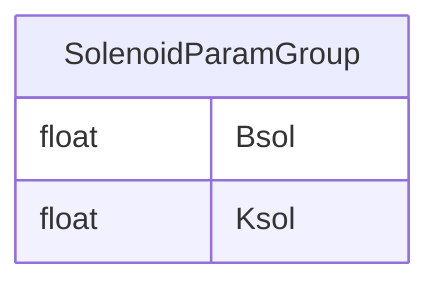

# Class: SolenoidParamGroup 


_Mixin for solenoid-specific parameters._


URI: [pals:class/SolenoidParamGroup](https://pals-project.readthedocs.io/class/SolenoidParamGroup)





<!-- no inheritance hierarchy -->

## Slots

| Name | Cardinality and Range | Description | Inheritance |
| ---  | --- | --- | --- |
| [Ksol](../slots/Ksol.md) | 0..1 <br/> [Float](../types/Float.md) | Normalized solenoid strength. | direct |
| [Bsol](../slots/Bsol.md) | 0..1 <br/> [Float](../types/Float.md) | Solenoid field. | direct |


## Usages

| used by | used in | type | used |
| ---  | --- | --- | --- |
| [HasSolenoidP](../classes/HasSolenoidP.md) | [SolenoidP](../slots/SolenoidP.md) | range | [SolenoidParamGroup](../classes/SolenoidParamGroup.md) |
| [Solenoid](../classes/Solenoid.md) | [SolenoidP](../slots/SolenoidP.md) | range | [SolenoidParamGroup](../classes/SolenoidParamGroup.md) |


## Rules


### 

| Rule Applied | Preconditions | Postconditions | Elseconditions |
|--------------|---------------|----------------|----------------|
| slot_conditions |```{'id': {'value_presence': 'PRESENT'}}``` | | |


## Identifier and Mapping Information


### Schema Source


* from schema: https://w3id.org/accelerator-core


## Mappings

| Mapping Type | Mapped Value |
| ---  | ---  |
| self | pals:SolenoidParamGroup |
| native | pals:SolenoidParamGroup |
| exact | pals:SolenoidP |


## LinkML Source

<!-- TODO: investigate https://stackoverflow.com/questions/37606292/how-to-create-tabbed-code-blocks-in-mkdocs-or-sphinx -->

### Direct

<details>
```yaml
name: SolenoidParamGroup
description: Mixin for solenoid-specific parameters.
from_schema: https://w3id.org/accelerator-core
exact_mappings:
- pals:SolenoidP
attributes:
  Ksol:
    name: Ksol
    description: Normalized solenoid strength.
    from_schema: https://w3id.org/accelerator-core
    rank: 1000
    slot_uri: pals:Ksol
    domain_of:
    - SolenoidParamGroup
    range: float
  Bsol:
    name: Bsol
    description: Solenoid field.
    from_schema: https://w3id.org/accelerator-core
    rank: 1000
    slot_uri: pals:Bsol
    domain_of:
    - SolenoidParamGroup
    range: float
rules:
- preconditions:
    slot_conditions:
      id:
        name: id
        value_presence: PRESENT
  postconditions:
    exactly_one_of:
    - slot_conditions:
        Ksol:
          name: Ksol
          value_presence: PRESENT
    - slot_conditions:
        Bsol:
          name: Bsol
          value_presence: PRESENT
  description: A solenoid must have one of, and exactly one of, Ksol or Bsol.

```
</details>

### Induced

<details>
```yaml
name: SolenoidParamGroup
description: Mixin for solenoid-specific parameters.
from_schema: https://w3id.org/accelerator-core
exact_mappings:
- pals:SolenoidP
attributes:
  Ksol:
    name: Ksol
    description: Normalized solenoid strength.
    from_schema: https://w3id.org/accelerator-core
    rank: 1000
    slot_uri: pals:Ksol
    alias: Ksol
    owner: SolenoidParamGroup
    domain_of:
    - SolenoidParamGroup
    range: float
  Bsol:
    name: Bsol
    description: Solenoid field.
    from_schema: https://w3id.org/accelerator-core
    rank: 1000
    slot_uri: pals:Bsol
    alias: Bsol
    owner: SolenoidParamGroup
    domain_of:
    - SolenoidParamGroup
    range: float
rules:
- preconditions:
    slot_conditions:
      id:
        name: id
        value_presence: PRESENT
  postconditions:
    exactly_one_of:
    - slot_conditions:
        Ksol:
          name: Ksol
          value_presence: PRESENT
    - slot_conditions:
        Bsol:
          name: Bsol
          value_presence: PRESENT
  description: A solenoid must have one of, and exactly one of, Ksol or Bsol.

```
</details>