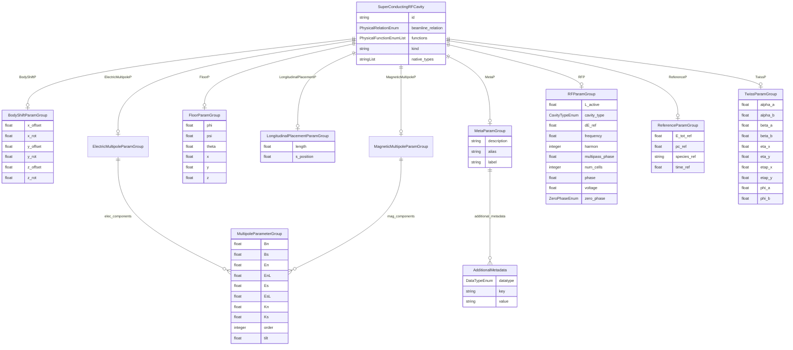

# Class: SuperConductingRFCavity 


_A cavity used for RF acceleration or longitudinal manipulation, which is superconducting._


URI: [pals:class/SuperConductingRFCavity](https://pals-project.readthedocs.io/class/SuperConductingRFCavity)





## Inheritance
* [Component](../classes/Component.md) [ [HasMetaP](../classes/HasMetaP.md)]
    * [PhysicalComponent](../classes/PhysicalComponent.md) [ [HasFloorP](../classes/HasFloorP.md) [HasLongitudinalPlacementP](../classes/HasLongitudinalPlacementP.md)]
        * [Cavity](../classes/Cavity.md) [ [HasReferenceP](../classes/HasReferenceP.md) [HasElectricMultipoleP](../classes/HasElectricMultipoleP.md) [HasMagneticMultipoleP](../classes/HasMagneticMultipoleP.md) [HasBodyShiftP](../classes/HasBodyShiftP.md) [HasTwissP](../classes/HasTwissP.md)]
            * [RFCavity](../classes/RFCavity.md) [ [HasRFP](../classes/HasRFP.md)]
                * **SuperConductingRFCavity**


## Slots

| Name | Cardinality and Range | Description | Inheritance |
| ---  | --- | --- | --- |
| [RFP](../slots/RFP.md) | 0..1 <br/> [RFParamGroup](../classes/RFParamGroup.md) | A mixin for RF parameters that are aligned with PALS RFP (RF Parameters) for interoperability with the Particle Accelerator Language Standard (PALS). | [HasRFP](../classes/HasRFP.md) |
| [ReferenceP](../slots/ReferenceP.md) | 0..1 <br/> [ReferenceParamGroup](../classes/ReferenceParamGroup.md) | A mixin for reference parameters that are aligned with PALS ReferenceP (Reference Parameters) for interoperability with the Particle Accelerator Language Standard (PALS). | [HasReferenceP](../classes/HasReferenceP.md) |
| [ElectricMultipoleP](../slots/ElectricMultipoleP.md) | 0..1 <br/> [ElectricMultipoleParamGroup](../classes/ElectricMultipoleParamGroup.md) | A mixin for electric multipole parameters that are aligned with PALS ElectricMultipoleP (Electric Multipole Parameters) for interoperability with the Particle Accelerator Language Standard (PALS). | [HasElectricMultipoleP](../classes/HasElectricMultipoleP.md) |
| [MagneticMultipoleP](../slots/MagneticMultipoleP.md) | 0..1 <br/> [MagneticMultipoleParamGroup](../classes/MagneticMultipoleParamGroup.md) | A mixin for magnetic multipole parameters that are aligned with PALS MagneticMultipoleP (Magnetic Multipole Parameters) for interoperability with the Particle Accelerator Language Standard (PALS). | [HasMagneticMultipoleP](../classes/HasMagneticMultipoleP.md) |
| [BodyShiftP](../slots/BodyShiftP.md) | 0..1 <br/> [BodyShiftParamGroup](../classes/BodyShiftParamGroup.md) | A mixin for floor plan shift parameters that are aligned with PALS BodyShiftP (Floor Plan Shift Parameters) for interoperability with the Particle Accelerator Language Standard (PALS). | [HasBodyShiftP](../classes/HasBodyShiftP.md) |
| [TwissP](../slots/TwissP.md) | 0..1 <br/> [TwissParamGroup](../classes/TwissParamGroup.md) | A mixin for Twiss parameters that are aligned with PALS TwissP (Twiss Parameters) for interoperability with the Particle Accelerator Language Standard (PALS). | [HasTwissP](../classes/HasTwissP.md) |
| [functions](../slots/functions.md) | 1..* <br/> [PhysicalFunctionEnum](../enums/PhysicalFunctionEnum.md) | The function of the physical component,  which can be used to identify the component across different source systems. | [PhysicalComponent](../classes/PhysicalComponent.md) |
| [beamline_relation](../slots/beamline_relation.md) | 1 <br/> [PhysicalRelationEnum](../enums/PhysicalRelationEnum.md) | The relationship of the physical component to the beamline,  which can be used to identify the component across different source systems. | [PhysicalComponent](../classes/PhysicalComponent.md) |
| [FloorP](../slots/FloorP.md) | 0..1 <br/> [FloorParamGroup](../classes/FloorParamGroup.md) | A mixin for floor plan parameters that are aligned with PALS FloorP (Floor Plan Parameters) for interoperability with the Particle Accelerator Language Standard (PALS). | [HasFloorP](../classes/HasFloorP.md) |
| [LongitudinalPlacementP](../slots/LongitudinalPlacementP.md) | 0..1 <br/> [LongitudinalPlacementParamGroup](../classes/LongitudinalPlacementParamGroup.md) | A mixin for an element's extent and position along the longitudinal (beam-direction, "s") axis that are aligned with PALS LongitudinalPlacementP (Longitudinal Placement Parameters) for interoperability with the Particle Accelerator Language Standard (PALS). | [HasLongitudinalPlacementP](../classes/HasLongitudinalPlacementP.md) |
| [id](../slots/id.md) | 1 <br/> [String](../types/String.md) | A unique identifier for the instance. | [Component](../classes/Component.md) |
| [kind](../slots/kind.md) | 1 <br/> [String](../types/String.md) | The LinkML class name of this instance. | [Component](../classes/Component.md) |
| [native_types](../slots/native_types.md) | * <br/> [String](../types/String.md) | The native type of the component in the source system, which can be used to identify the component across different source systems. | [Component](../classes/Component.md) |
| [MetaP](../slots/MetaP.md) | 0..1 <br/> [MetaParamGroup](../classes/MetaParamGroup.md) | A mixin for metadata parameters that are aligned with PALS MetaP (Metadata Parameters) for interoperability with the Particle Accelerator Language Standard (PALS). | [HasMetaP](../classes/HasMetaP.md) |


## Identifier and Mapping Information


### Schema Source


* from schema: https://w3id.org/accelerator-core


## Mappings

| Mapping Type | Mapped Value |
| ---  | ---  |
| self | pals:SuperConductingRFCavity |
| native | pals:SuperConductingRFCavity |
| broad | pals:RFCavity |


## LinkML Source

<!-- TODO: investigate https://stackoverflow.com/questions/37606292/how-to-create-tabbed-code-blocks-in-mkdocs-or-sphinx -->

### Direct

<details>
```yaml
name: SuperConductingRFCavity
description: A cavity used for RF acceleration or longitudinal manipulation, which
  is superconducting.
from_schema: https://w3id.org/accelerator-core
broad_mappings:
- pals:RFCavity
is_a: RFCavity

```
</details>

### Induced

<details>
```yaml
name: SuperConductingRFCavity
description: A cavity used for RF acceleration or longitudinal manipulation, which
  is superconducting.
from_schema: https://w3id.org/accelerator-core
broad_mappings:
- pals:RFCavity
is_a: RFCavity
attributes:
  RFP:
    name: RFP
    description: A mixin for RF parameters that are aligned with PALS RFP (RF Parameters)
      for interoperability with the Particle Accelerator Language Standard (PALS).
    from_schema: https://w3id.org/accelerator-core
    rank: 1000
    alias: RFP
    owner: SuperConductingRFCavity
    domain_of:
    - HasRFP
    range: RFParamGroup
    inlined: true
  ReferenceP:
    name: ReferenceP
    description: A mixin for reference parameters that are aligned with PALS ReferenceP
      (Reference Parameters) for interoperability with the Particle Accelerator Language
      Standard (PALS).
    from_schema: https://w3id.org/accelerator-core
    rank: 1000
    alias: ReferenceP
    owner: SuperConductingRFCavity
    domain_of:
    - HasReferenceP
    range: ReferenceParamGroup
    inlined: true
  ElectricMultipoleP:
    name: ElectricMultipoleP
    description: A mixin for electric multipole parameters that are aligned with PALS
      ElectricMultipoleP (Electric Multipole Parameters) for interoperability with
      the Particle Accelerator Language Standard (PALS).
    from_schema: https://w3id.org/accelerator-core
    rank: 1000
    alias: ElectricMultipoleP
    owner: SuperConductingRFCavity
    domain_of:
    - HasElectricMultipoleP
    range: ElectricMultipoleParamGroup
    inlined: true
  MagneticMultipoleP:
    name: MagneticMultipoleP
    description: A mixin for magnetic multipole parameters that are aligned with PALS
      MagneticMultipoleP (Magnetic Multipole Parameters) for interoperability with
      the Particle Accelerator Language Standard (PALS).
    from_schema: https://w3id.org/accelerator-core
    rank: 1000
    alias: MagneticMultipoleP
    owner: SuperConductingRFCavity
    domain_of:
    - HasMagneticMultipoleP
    range: MagneticMultipoleParamGroup
    inlined: true
  BodyShiftP:
    name: BodyShiftP
    description: A mixin for floor plan shift parameters that are aligned with PALS
      BodyShiftP (Floor Plan Shift Parameters) for interoperability with the Particle
      Accelerator Language Standard (PALS).
    from_schema: https://w3id.org/accelerator-core
    rank: 1000
    alias: BodyShiftP
    owner: SuperConductingRFCavity
    domain_of:
    - HasBodyShiftP
    range: BodyShiftParamGroup
    inlined: true
  TwissP:
    name: TwissP
    description: A mixin for Twiss parameters that are aligned with PALS TwissP (Twiss
      Parameters) for interoperability with the Particle Accelerator Language Standard
      (PALS).
    from_schema: https://w3id.org/accelerator-core
    rank: 1000
    alias: TwissP
    owner: SuperConductingRFCavity
    domain_of:
    - HasTwissP
    range: TwissParamGroup
    inlined: true
  functions:
    name: functions
    description: The function of the physical component,  which can be used to identify
      the component across different source systems.
    from_schema: https://w3id.org/accelerator-core
    rank: 1000
    slot_uri: pals:physical_function
    alias: functions
    owner: SuperConductingRFCavity
    domain_of:
    - PhysicalComponent
    - VirtualComponent
    - SupportingFacilityComponent
    range: PhysicalFunctionEnum
    required: true
    multivalued: true
  beamline_relation:
    name: beamline_relation
    description: The relationship of the physical component to the beamline,  which
      can be used to identify the component across different source systems.
    from_schema: https://w3id.org/accelerator-core
    rank: 1000
    slot_uri: pals:physical_beamline_relation
    alias: beamline_relation
    owner: SuperConductingRFCavity
    domain_of:
    - PhysicalComponent
    - VirtualComponent
    range: PhysicalRelationEnum
    required: true
  FloorP:
    name: FloorP
    description: A mixin for floor plan parameters that are aligned with PALS FloorP
      (Floor Plan Parameters) for interoperability with the Particle Accelerator Language
      Standard (PALS).
    from_schema: https://w3id.org/accelerator-core
    rank: 1000
    alias: FloorP
    owner: SuperConductingRFCavity
    domain_of:
    - HasFloorP
    range: FloorParamGroup
    inlined: true
  LongitudinalPlacementP:
    name: LongitudinalPlacementP
    description: A mixin for an element's extent and position along the longitudinal
      (beam-direction, "s") axis that are aligned with PALS LongitudinalPlacementP
      (Longitudinal Placement Parameters) for interoperability with the Particle Accelerator
      Language Standard (PALS).
    from_schema: https://w3id.org/accelerator-core
    rank: 1000
    alias: LongitudinalPlacementP
    owner: SuperConductingRFCavity
    domain_of:
    - HasLongitudinalPlacementP
    range: LongitudinalPlacementParamGroup
    inlined: true
  id:
    name: id
    description: A unique identifier for the instance.
    from_schema: https://w3id.org/accelerator-core
    rank: 1000
    slot_uri: pals:id
    identifier: true
    alias: id
    owner: SuperConductingRFCavity
    domain_of:
    - Affiliation
    - Component
    - Signal
    - Relationship
    range: string
    required: true
  kind:
    name: kind
    description: The LinkML class name of this instance.
    from_schema: https://w3id.org/accelerator-core
    rank: 1000
    slot_uri: pals:kind
    designates_type: true
    alias: kind
    owner: SuperConductingRFCavity
    domain_of:
    - PALSAccelerator
    - Component
    - Signal
    range: string
    required: true
  native_types:
    name: native_types
    description: The native type of the component in the source system, which can
      be used to identify the component across different source systems.
    from_schema: https://w3id.org/accelerator-core
    rank: 1000
    alias: native_types
    owner: SuperConductingRFCavity
    domain_of:
    - Component
    range: string
    multivalued: true
  MetaP:
    name: MetaP
    description: A mixin for metadata parameters that are aligned with PALS MetaP
      (Metadata Parameters) for interoperability with the Particle Accelerator Language
      Standard (PALS).
    from_schema: https://w3id.org/accelerator-core
    rank: 1000
    alias: MetaP
    owner: SuperConductingRFCavity
    domain_of:
    - HasMetaP
    range: MetaParamGroup
    inlined: true

```
</details>