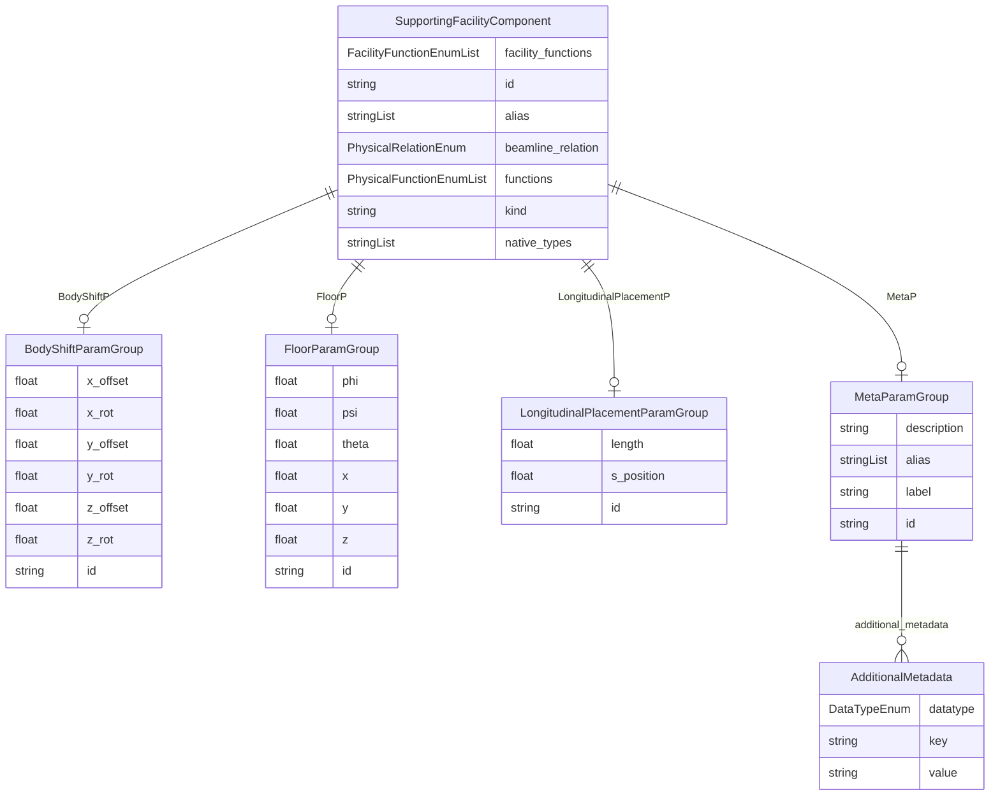

# Class: SupportingFacilityComponent 


_A physical component that supports accelerator operation  without a specific beam-pipe placement,  such as a power supply, control rack, or radiation detector. These can include Girders, Racks, Power Supplies,  and other physical infrastructure components that are important for understanding  the structure and function of the accelerator system but are not inline with the beamline._


URI: [acc:class/SupportingFacilityComponent](https://example.org/accelerator-core/class/SupportingFacilityComponent)





## Inheritance
* [Node](../classes/Node.md)
    * [Component](../classes/Component.md) [ [HasMetaP](../classes/HasMetaP.md)]
        * [PhysicalComponent](../classes/PhysicalComponent.md) [ [HasFloorP](../classes/HasFloorP.md) [HasLongitudinalPlacementP](../classes/HasLongitudinalPlacementP.md)]
            * **SupportingFacilityComponent** [ [HasFloorP](../classes/HasFloorP.md) [HasLongitudinalPlacementP](../classes/HasLongitudinalPlacementP.md) [HasBodyShiftP](../classes/HasBodyShiftP.md)]


## Slots

| Name | Cardinality and Range | Description | Inheritance |
| ---  | --- | --- | --- |
| [facility_functions](../slots/facility_functions.md) | 1..* <br/> [FacilityFunctionEnum](../enums/FacilityFunctionEnum.md) | The function of the supporting facility component,  which can be used to identify the component across different source systems. | direct |
| [FloorP](../slots/FloorP.md) | 0..1 <br/> [FloorParamGroup](../classes/FloorParamGroup.md) | A mixin for floor plan parameters that are aligned with PALS FloorP (Floor Plan Parameters) for interoperability with the Particle Accelerator Language Standard (PALS). | [HasFloorP](../classes/HasFloorP.md) |
| [LongitudinalPlacementP](../slots/LongitudinalPlacementP.md) | 0..1 <br/> [LongitudinalPlacementParamGroup](../classes/LongitudinalPlacementParamGroup.md) | A mixin for an element's extent and position along the longitudinal (beam-direction, "s") axis that are aligned with PALS LongitudinalPlacementP (Longitudinal Placement Parameters) for interoperability with the Particle Accelerator Language Standard (PALS). | [HasLongitudinalPlacementP](../classes/HasLongitudinalPlacementP.md) |
| [BodyShiftP](../slots/BodyShiftP.md) | 0..1 <br/> [BodyShiftParamGroup](../classes/BodyShiftParamGroup.md) | A mixin for floor plan shift parameters that are aligned with PALS BodyShiftP (Floor Plan Shift Parameters) for interoperability with the Particle Accelerator Language Standard (PALS). | [HasBodyShiftP](../classes/HasBodyShiftP.md) |
| [functions](../slots/functions.md) | * <br/> [PhysicalFunctionEnum](../enums/PhysicalFunctionEnum.md) | The function of the physical component,  which can be used to identify the component across different source systems. | [PhysicalComponent](../classes/PhysicalComponent.md) |
| [beamline_relation](../slots/beamline_relation.md) | 1 <br/> [PhysicalRelationEnum](../enums/PhysicalRelationEnum.md) | The relationship of the physical component to the beamline,  which can be used to identify the component across different source systems. | [PhysicalComponent](../classes/PhysicalComponent.md) |
| [native_types](../slots/native_types.md) | * <br/> [String](../types/String.md) | The native type of the component in the source system, which can be used to identify the component across different source systems. | [Component](../classes/Component.md) |
| [MetaP](../slots/MetaP.md) | 0..1 <br/> [MetaParamGroup](../classes/MetaParamGroup.md) | A mixin for metadata parameters that are aligned with PALS MetaP (Metadata Parameters) for interoperability with the Particle Accelerator Language Standard (PALS). | [HasMetaP](../classes/HasMetaP.md) |
| [id](../slots/id.md) | 1 <br/> [String](../types/String.md) | A unique identifier for the instance. | [Node](../classes/Node.md) |
| [kind](../slots/kind.md) | 1 <br/> [String](../types/String.md) | The LinkML class name of this instance, e.g. `Quadrupole` or `BeamProfileMonitor` (no prefix). | [Node](../classes/Node.md) |
| [alias](../slots/alias.md) | * <br/> [String](../types/String.md) | An alternative name or identifier for the instance. | [Node](../classes/Node.md) |


## Identifier and Mapping Information


### Schema Source


* from schema: https://w3id.org/accelerator-core


## Mappings

| Mapping Type | Mapped Value |
| ---  | ---  |
| self | acc:SupportingFacilityComponent |
| native | acc:SupportingFacilityComponent |
| broad | pals:StructuralElement |


## LinkML Source

<!-- TODO: investigate https://stackoverflow.com/questions/37606292/how-to-create-tabbed-code-blocks-in-mkdocs-or-sphinx -->

### Direct

<details>
```yaml
name: SupportingFacilityComponent
description: A physical component that supports accelerator operation  without a specific
  beam-pipe placement,  such as a power supply, control rack, or radiation detector.
  These can include Girders, Racks, Power Supplies,  and other physical infrastructure
  components that are important for understanding  the structure and function of the
  accelerator system but are not inline with the beamline.
from_schema: https://w3id.org/accelerator-core
broad_mappings:
- pals:StructuralElement
is_a: PhysicalComponent
mixins:
- HasFloorP
- HasLongitudinalPlacementP
- HasBodyShiftP
attributes:
  facility_functions:
    name: facility_functions
    description: The function of the supporting facility component,  which can be
      used to identify the component across different source systems.
    from_schema: https://w3id.org/accelerator-core
    close_mappings:
    - pals:supporting_facility_function
    rank: 1000
    domain_of:
    - SupportingFacilityComponent
    range: FacilityFunctionEnum
    required: true
    multivalued: true

```
</details>

### Induced

<details>
```yaml
name: SupportingFacilityComponent
description: A physical component that supports accelerator operation  without a specific
  beam-pipe placement,  such as a power supply, control rack, or radiation detector.
  These can include Girders, Racks, Power Supplies,  and other physical infrastructure
  components that are important for understanding  the structure and function of the
  accelerator system but are not inline with the beamline.
from_schema: https://w3id.org/accelerator-core
broad_mappings:
- pals:StructuralElement
is_a: PhysicalComponent
mixins:
- HasFloorP
- HasLongitudinalPlacementP
- HasBodyShiftP
attributes:
  facility_functions:
    name: facility_functions
    description: The function of the supporting facility component,  which can be
      used to identify the component across different source systems.
    from_schema: https://w3id.org/accelerator-core
    close_mappings:
    - pals:supporting_facility_function
    rank: 1000
    alias: facility_functions
    owner: SupportingFacilityComponent
    domain_of:
    - SupportingFacilityComponent
    range: FacilityFunctionEnum
    required: true
    multivalued: true
  FloorP:
    name: FloorP
    description: A mixin for floor plan parameters that are aligned with PALS FloorP
      (Floor Plan Parameters) for interoperability with the Particle Accelerator Language
      Standard (PALS).
    from_schema: https://w3id.org/accelerator-core
    rank: 1000
    alias: FloorP
    owner: SupportingFacilityComponent
    domain_of:
    - HasFloorP
    range: FloorParamGroup
    inlined: true
  LongitudinalPlacementP:
    name: LongitudinalPlacementP
    description: A mixin for an element's extent and position along the longitudinal
      (beam-direction, "s") axis that are aligned with PALS LongitudinalPlacementP
      (Longitudinal Placement Parameters) for interoperability with the Particle Accelerator
      Language Standard (PALS).
    from_schema: https://w3id.org/accelerator-core
    rank: 1000
    alias: LongitudinalPlacementP
    owner: SupportingFacilityComponent
    domain_of:
    - HasLongitudinalPlacementP
    range: LongitudinalPlacementParamGroup
    inlined: true
  BodyShiftP:
    name: BodyShiftP
    description: A mixin for floor plan shift parameters that are aligned with PALS
      BodyShiftP (Floor Plan Shift Parameters) for interoperability with the Particle
      Accelerator Language Standard (PALS).
    from_schema: https://w3id.org/accelerator-core
    rank: 1000
    alias: BodyShiftP
    owner: SupportingFacilityComponent
    domain_of:
    - HasBodyShiftP
    range: BodyShiftParamGroup
    inlined: true
  functions:
    name: functions
    description: The function of the physical component,  which can be used to identify
      the component across different source systems.
    from_schema: https://w3id.org/accelerator-core
    close_mappings:
    - pals:physical_function
    rank: 1000
    alias: functions
    owner: SupportingFacilityComponent
    domain_of:
    - PhysicalComponent
    - VirtualComponent
    range: PhysicalFunctionEnum
    required: false
    multivalued: true
  beamline_relation:
    name: beamline_relation
    description: The relationship of the physical component to the beamline,  which
      can be used to identify the component across different source systems.
    from_schema: https://w3id.org/accelerator-core
    close_mappings:
    - pals:physical_beamline_relation
    rank: 1000
    alias: beamline_relation
    owner: SupportingFacilityComponent
    domain_of:
    - PhysicalComponent
    - VirtualComponent
    range: PhysicalRelationEnum
    required: true
  native_types:
    name: native_types
    description: The native type of the component in the source system, which can
      be used to identify the component across different source systems.
    from_schema: https://w3id.org/accelerator-core
    rank: 1000
    alias: native_types
    owner: SupportingFacilityComponent
    domain_of:
    - Component
    range: string
    multivalued: true
  MetaP:
    name: MetaP
    description: A mixin for metadata parameters that are aligned with PALS MetaP
      (Metadata Parameters) for interoperability with the Particle Accelerator Language
      Standard (PALS).
    from_schema: https://w3id.org/accelerator-core
    rank: 1000
    alias: MetaP
    owner: SupportingFacilityComponent
    domain_of:
    - HasMetaP
    range: MetaParamGroup
    inlined: true
  id:
    name: id
    description: A unique identifier for the instance.
    from_schema: https://w3id.org/accelerator-core
    close_mappings:
    - pals:id
    rank: 1000
    identifier: true
    alias: id
    owner: SupportingFacilityComponent
    domain_of:
    - Node
    - Affiliation
    - ParamGroup
    - Edge
    range: string
    required: true
  kind:
    name: kind
    description: The LinkML class name of this instance, e.g. `Quadrupole` or `BeamProfileMonitor`
      (no prefix).
    from_schema: https://w3id.org/accelerator-core
    rank: 1000
    slot_uri: rdf:type
    designates_type: true
    alias: kind
    owner: SupportingFacilityComponent
    domain_of:
    - Node
    - PALSAccelerator
    range: string
    required: true
  alias:
    name: alias
    description: An alternative name or identifier for the instance.
    from_schema: https://w3id.org/accelerator-core
    close_mappings:
    - pals:alias
    rank: 1000
    alias: alias
    owner: SupportingFacilityComponent
    domain_of:
    - Node
    - MetaParamGroup
    range: string
    multivalued: true

```
</details>