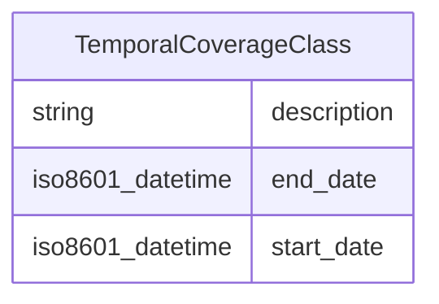

# Class: TemporalCoverageClass 


_Temporal coverage for time-based datasets, if applicable._

_  Container for elements describing the start_date and end_date of the data instance's temporal coverage _

_  in ISO 8601 datetime format YYYY-MM-DDTHH:MM:SS±hh:mm for offset (e.g., 2024-06-05T14:30:00-04:00) or YYYY-MM-DDTHH:MM:SSZ for UTC (e.g., 2024-06-05T14:30:00Z)._

_  Use temporal_coverage when the dataset describes a specific historical or projected time period._

_  This may not apply to simulations where temporal coverage of a specific facility during a specific time is not relevant._


URI: [pals_config:class/TemporalCoverageClass](https://w3id.org/pals-config/class/TemporalCoverageClass)





<!-- no inheritance hierarchy -->

## Slots

| Name | Cardinality and Range | Description | Inheritance |
| ---  | --- | --- | --- |
| [description](../slots/description.md) | 0..1 <br/> [String](../types/String.md) | Detailed description of the temporal coverage. | direct |
| [start_date](../slots/start_date.md) | 0..1 <br/> [Iso8601Datetime](../types/Iso8601Datetime.md) | Start date of the dataset's temporal coverage in ISO 8601 format (YYYY-MM-DDTHH:MM:SS±hh:mm for offset or YYYY-MM-DDTHH:MM:SSZ for UTC). | direct |
| [end_date](../slots/end_date.md) | 0..1 <br/> [Iso8601Datetime](../types/Iso8601Datetime.md) | End date of the dataset's temporal coverage in ISO 8601 format (YYYY-MM-DDTHH:MM:SS±hh:mm for offset or YYYY-MM-DDTHH:MM:SSZ for UTC). | direct |


## Usages

| used by | used in | type | used |
| ---  | --- | --- | --- |
| [PALSAccelerator](../classes/PALSAccelerator.md) | [temporal_coverage](../slots/temporal_coverage.md) | range | [TemporalCoverageClass](../classes/TemporalCoverageClass.md) |


## Identifier and Mapping Information


### Schema Source


* from schema: https://w3id.org/pals-config


## Mappings

| Mapping Type | Mapped Value |
| ---  | ---  |
| self | pals_config:TemporalCoverageClass |
| native | pals_config:TemporalCoverageClass |


## LinkML Source

<!-- TODO: investigate https://stackoverflow.com/questions/37606292/how-to-create-tabbed-code-blocks-in-mkdocs-or-sphinx -->

### Direct

<details>
```yaml
name: TemporalCoverageClass
description: "Temporal coverage for time-based datasets, if applicable.\n  Container\
  \ for elements describing the start_date and end_date of the data instance's temporal\
  \ coverage \n  in ISO 8601 datetime format YYYY-MM-DDTHH:MM:SS±hh:mm for offset\
  \ (e.g., 2024-06-05T14:30:00-04:00) or YYYY-MM-DDTHH:MM:SSZ for UTC (e.g., 2024-06-05T14:30:00Z).\n\
  \  Use temporal_coverage when the dataset describes a specific historical or projected\
  \ time period.\n  This may not apply to simulations where temporal coverage of a\
  \ specific facility during a specific time is not relevant."
from_schema: https://w3id.org/pals-config
slots:
- description
slot_usage:
  description:
    name: description
    description: Detailed description of the temporal coverage.
attributes:
  start_date:
    name: start_date
    description: Start date of the dataset's temporal coverage in ISO 8601 format
      (YYYY-MM-DDTHH:MM:SS±hh:mm for offset or YYYY-MM-DDTHH:MM:SSZ for UTC).
    from_schema: https://w3id.org/pals-config
    related_mappings:
    - schema:temporalCoverage
    narrow_mappings:
    - dcterms:date
    rank: 1000
    domain_of:
    - TemporalCoverageClass
    range: iso8601_datetime
  end_date:
    name: end_date
    description: End date of the dataset's temporal coverage in ISO 8601 format (YYYY-MM-DDTHH:MM:SS±hh:mm
      for offset or YYYY-MM-DDTHH:MM:SSZ for UTC).
    from_schema: https://w3id.org/pals-config
    related_mappings:
    - schema:temporalCoverage
    narrow_mappings:
    - dcterms:date
    rank: 1000
    domain_of:
    - TemporalCoverageClass
    range: iso8601_datetime

```
</details>

### Induced

<details>
```yaml
name: TemporalCoverageClass
description: "Temporal coverage for time-based datasets, if applicable.\n  Container\
  \ for elements describing the start_date and end_date of the data instance's temporal\
  \ coverage \n  in ISO 8601 datetime format YYYY-MM-DDTHH:MM:SS±hh:mm for offset\
  \ (e.g., 2024-06-05T14:30:00-04:00) or YYYY-MM-DDTHH:MM:SSZ for UTC (e.g., 2024-06-05T14:30:00Z).\n\
  \  Use temporal_coverage when the dataset describes a specific historical or projected\
  \ time period.\n  This may not apply to simulations where temporal coverage of a\
  \ specific facility during a specific time is not relevant."
from_schema: https://w3id.org/pals-config
slot_usage:
  description:
    name: description
    description: Detailed description of the temporal coverage.
attributes:
  start_date:
    name: start_date
    description: Start date of the dataset's temporal coverage in ISO 8601 format
      (YYYY-MM-DDTHH:MM:SS±hh:mm for offset or YYYY-MM-DDTHH:MM:SSZ for UTC).
    from_schema: https://w3id.org/pals-config
    related_mappings:
    - schema:temporalCoverage
    narrow_mappings:
    - dcterms:date
    rank: 1000
    alias: start_date
    owner: TemporalCoverageClass
    domain_of:
    - TemporalCoverageClass
    range: iso8601_datetime
  end_date:
    name: end_date
    description: End date of the dataset's temporal coverage in ISO 8601 format (YYYY-MM-DDTHH:MM:SS±hh:mm
      for offset or YYYY-MM-DDTHH:MM:SSZ for UTC).
    from_schema: https://w3id.org/pals-config
    related_mappings:
    - schema:temporalCoverage
    narrow_mappings:
    - dcterms:date
    rank: 1000
    alias: end_date
    owner: TemporalCoverageClass
    domain_of:
    - TemporalCoverageClass
    range: iso8601_datetime
  description:
    name: description
    description: Detailed description of the temporal coverage.
    from_schema: https://w3id.org/pals-config
    rank: 1000
    alias: description
    owner: TemporalCoverageClass
    domain_of:
    - PALSAccelerator
    - TemporalCoverageClass
    - MetaParamGroup
    - BeamLine
    range: string

```
</details>