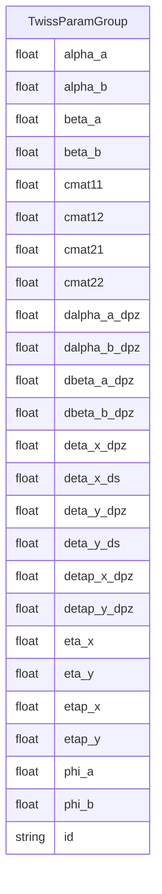

# Class: TwissParamGroup 


_Mixin for Twiss parameters, which can be used to describe the beam optics of an accelerator element._


URI: [pals_config:class/TwissParamGroup](https://w3id.org/pals-config/class/TwissParamGroup)





## Inheritance
* [ParamGroup](../classes/ParamGroup.md)
    * **TwissParamGroup**


## Slots

| Name | Cardinality and Range | Description | Inheritance |
| ---  | --- | --- | --- |
| [alpha_a](../slots/alpha_a.md) | 0..1 <br/> [Float](../types/Float.md) | Twiss alpha parameter in the horizontal plane. | direct |
| [alpha_b](../slots/alpha_b.md) | 0..1 <br/> [Float](../types/Float.md) | Twiss alpha parameter in the vertical plane. | direct |
| [beta_a](../slots/beta_a.md) | 0..1 <br/> [Float](../types/Float.md) | Twiss beta parameter in the horizontal plane. Must be strictly positive (> 0). | direct |
| [beta_b](../slots/beta_b.md) | 0..1 <br/> [Float](../types/Float.md) | Twiss beta parameter in the vertical plane. Must be strictly positive (> 0). | direct |
| [cmat11](../slots/cmat11.md) | 0..1 <br/> [Float](../types/Float.md) | c[1,1] coupling matrix component. | direct |
| [cmat12](../slots/cmat12.md) | 0..1 <br/> [Float](../types/Float.md) | c[1,2] coupling matrix component. | direct |
| [cmat21](../slots/cmat21.md) | 0..1 <br/> [Float](../types/Float.md) | c[2,1] coupling matrix component. | direct |
| [cmat22](../slots/cmat22.md) | 0..1 <br/> [Float](../types/Float.md) | c[2,2] coupling matrix component. | direct |
| [eta_x](../slots/eta_x.md) | 0..1 <br/> [Float](../types/Float.md) | Twiss dispersion parameter in the horizontal plane. May be any real value. | direct |
| [eta_y](../slots/eta_y.md) | 0..1 <br/> [Float](../types/Float.md) | Twiss dispersion parameter in the vertical plane. May be any real value. | direct |
| [etap_x](../slots/etap_x.md) | 0..1 <br/> [Float](../types/Float.md) | Twiss dispersion slope parameter in the horizontal plane. | direct |
| [etap_y](../slots/etap_y.md) | 0..1 <br/> [Float](../types/Float.md) | Twiss dispersion slope parameter in the vertical plane. | direct |
| [deta_x_ds](../slots/deta_x_ds.md) | 0..1 <br/> [Float](../types/Float.md) | Twiss dispersion derivative parameter in the horizontal plane. | direct |
| [deta_y_ds](../slots/deta_y_ds.md) | 0..1 <br/> [Float](../types/Float.md) | Twiss dispersion derivative parameter in the vertical plane. | direct |
| [phi_a](../slots/phi_a.md) | 0..1 <br/> [Float](../types/Float.md) | Twiss phase advance parameter in the horizontal plane. | direct |
| [phi_b](../slots/phi_b.md) | 0..1 <br/> [Float](../types/Float.md) | Twiss phase advance parameter in the vertical plane. | direct |
| [dbeta_a_dpz](../slots/dbeta_a_dpz.md) | 0..1 <br/> [Float](../types/Float.md) | Twiss beta dependence on momentum in the horizontal plane. | direct |
| [dalpha_a_dpz](../slots/dalpha_a_dpz.md) | 0..1 <br/> [Float](../types/Float.md) | Twiss alpha dependence on momentum in the horizontal plane. | direct |
| [dbeta_b_dpz](../slots/dbeta_b_dpz.md) | 0..1 <br/> [Float](../types/Float.md) | Twiss beta dependence on momentum in the vertical plane. | direct |
| [dalpha_b_dpz](../slots/dalpha_b_dpz.md) | 0..1 <br/> [Float](../types/Float.md) | Twiss alpha dependence on momentum in the vertical plane. | direct |
| [deta_x_dpz](../slots/deta_x_dpz.md) | 0..1 <br/> [Float](../types/Float.md) | Twiss dispersion dependence on momentum in the horizontal plane. | direct |
| [detap_x_dpz](../slots/detap_x_dpz.md) | 0..1 <br/> [Float](../types/Float.md) | Twiss dispersion slope dependence on momentum in the horizontal plane. | direct |
| [deta_y_dpz](../slots/deta_y_dpz.md) | 0..1 <br/> [Float](../types/Float.md) | Twiss dispersion dependence on momentum in the vertical plane. | direct |
| [detap_y_dpz](../slots/detap_y_dpz.md) | 0..1 <br/> [Float](../types/Float.md) | Twiss dispersion slope dependence on momentum in the vertical plane. | direct |
| [id](../slots/id.md) | 1 <br/> [String](../types/String.md) | A unique identifier for the instance. | [ParamGroup](../classes/ParamGroup.md) |


## Usages

| used by | used in | type | used |
| ---  | --- | --- | --- |
| [HasTwissP](../classes/HasTwissP.md) | [TwissP](../slots/TwissP.md) | range | [TwissParamGroup](../classes/TwissParamGroup.md) |
| [Magnet](../classes/Magnet.md) | [TwissP](../slots/TwissP.md) | range | [TwissParamGroup](../classes/TwissParamGroup.md) |
| [Solenoid](../classes/Solenoid.md) | [TwissP](../slots/TwissP.md) | range | [TwissParamGroup](../classes/TwissParamGroup.md) |
| [Multipole](../classes/Multipole.md) | [TwissP](../slots/TwissP.md) | range | [TwissParamGroup](../classes/TwissParamGroup.md) |
| [Bend](../classes/Bend.md) | [TwissP](../slots/TwissP.md) | range | [TwissParamGroup](../classes/TwissParamGroup.md) |
| [Quadrupole](../classes/Quadrupole.md) | [TwissP](../slots/TwissP.md) | range | [TwissParamGroup](../classes/TwissParamGroup.md) |
| [Octupole](../classes/Octupole.md) | [TwissP](../slots/TwissP.md) | range | [TwissParamGroup](../classes/TwissParamGroup.md) |
| [Sextupole](../classes/Sextupole.md) | [TwissP](../slots/TwissP.md) | range | [TwissParamGroup](../classes/TwissParamGroup.md) |
| [Kicker](../classes/Kicker.md) | [TwissP](../slots/TwissP.md) | range | [TwissParamGroup](../classes/TwissParamGroup.md) |
| [ACKicker](../classes/ACKicker.md) | [TwissP](../slots/TwissP.md) | range | [TwissParamGroup](../classes/TwissParamGroup.md) |
| [BeamProfileMonitor](../classes/BeamProfileMonitor.md) | [TwissP](../slots/TwissP.md) | range | [TwissParamGroup](../classes/TwissParamGroup.md) |
| [BeamPositionMonitor](../classes/BeamPositionMonitor.md) | [TwissP](../slots/TwissP.md) | range | [TwissParamGroup](../classes/TwissParamGroup.md) |
| [Aperture](../classes/Aperture.md) | [TwissP](../slots/TwissP.md) | range | [TwissParamGroup](../classes/TwissParamGroup.md) |
| [Cavity](../classes/Cavity.md) | [TwissP](../slots/TwissP.md) | range | [TwissParamGroup](../classes/TwissParamGroup.md) |
| [CrabCavity](../classes/CrabCavity.md) | [TwissP](../slots/TwissP.md) | range | [TwissParamGroup](../classes/TwissParamGroup.md) |
| [RFCavity](../classes/RFCavity.md) | [TwissP](../slots/TwissP.md) | range | [TwissParamGroup](../classes/TwissParamGroup.md) |
| [NormalConductingRFCavity](../classes/NormalConductingRFCavity.md) | [TwissP](../slots/TwissP.md) | range | [TwissParamGroup](../classes/TwissParamGroup.md) |
| [SuperConductingRFCavity](../classes/SuperConductingRFCavity.md) | [TwissP](../slots/TwissP.md) | range | [TwissParamGroup](../classes/TwissParamGroup.md) |
| [Marker](../classes/Marker.md) | [TwissP](../slots/TwissP.md) | range | [TwissParamGroup](../classes/TwissParamGroup.md) |
| [BeginningEle](../classes/BeginningEle.md) | [TwissP](../slots/TwissP.md) | range | [TwissParamGroup](../classes/TwissParamGroup.md) |


## Identifier and Mapping Information


### Schema Source


* from schema: https://w3id.org/pals-config


## Mappings

| Mapping Type | Mapped Value |
| ---  | ---  |
| self | pals_config:TwissParamGroup |
| native | pals_config:TwissParamGroup |
| broad | pals:TwissP |


## LinkML Source

<!-- TODO: investigate https://stackoverflow.com/questions/37606292/how-to-create-tabbed-code-blocks-in-mkdocs-or-sphinx -->

### Direct

<details>
```yaml
name: TwissParamGroup
description: Mixin for Twiss parameters, which can be used to describe the beam optics
  of an accelerator element.
from_schema: https://w3id.org/pals-config
broad_mappings:
- pals:TwissP
is_a: ParamGroup
attributes:
  alpha_a:
    name: alpha_a
    description: Twiss alpha parameter in the horizontal plane.
    from_schema: https://w3id.org/pals-config
    aliases:
    - alpha_x
    - alphax
    close_mappings:
    - pals:alpha_a
    rank: 1000
    domain_of:
    - TwissParamGroup
    range: float
  alpha_b:
    name: alpha_b
    description: Twiss alpha parameter in the vertical plane.
    from_schema: https://w3id.org/pals-config
    aliases:
    - alpha_y
    - alphay
    close_mappings:
    - pals:alpha_b
    rank: 1000
    domain_of:
    - TwissParamGroup
    range: float
  beta_a:
    name: beta_a
    description: Twiss beta parameter in the horizontal plane. Must be strictly positive
      (> 0).
    from_schema: https://w3id.org/pals-config
    aliases:
    - beta_x
    - betax
    close_mappings:
    - pals:beta_a
    rank: 1000
    domain_of:
    - TwissParamGroup
    range: float
    minimum_value: 0
    unit:
      ucum_code: m
    none_of:
    - equals_number: 0
  beta_b:
    name: beta_b
    description: Twiss beta parameter in the vertical plane. Must be strictly positive
      (> 0).
    from_schema: https://w3id.org/pals-config
    aliases:
    - beta_y
    - betay
    close_mappings:
    - pals:beta_b
    rank: 1000
    domain_of:
    - TwissParamGroup
    range: float
    minimum_value: 0
    unit:
      ucum_code: m
    none_of:
    - equals_number: 0
  cmat11:
    name: cmat11
    description: c[1,1] coupling matrix component.
    from_schema: https://w3id.org/pals-config
    rank: 1000
    slot_uri: pals:cmat11
    domain_of:
    - TwissParamGroup
    range: float
  cmat12:
    name: cmat12
    description: c[1,2] coupling matrix component.
    from_schema: https://w3id.org/pals-config
    rank: 1000
    slot_uri: pals:cmat12
    domain_of:
    - TwissParamGroup
    range: float
  cmat21:
    name: cmat21
    description: c[2,1] coupling matrix component.
    from_schema: https://w3id.org/pals-config
    rank: 1000
    slot_uri: pals:cmat21
    domain_of:
    - TwissParamGroup
    range: float
  cmat22:
    name: cmat22
    description: c[2,2] coupling matrix component.
    from_schema: https://w3id.org/pals-config
    rank: 1000
    slot_uri: pals:cmat22
    domain_of:
    - TwissParamGroup
    range: float
  eta_x:
    name: eta_x
    description: Twiss dispersion parameter in the horizontal plane. May be any real
      value.
    from_schema: https://w3id.org/pals-config
    aliases:
    - etax
    close_mappings:
    - pals:eta_x
    rank: 1000
    domain_of:
    - TwissParamGroup
    range: float
    unit:
      ucum_code: m
  eta_y:
    name: eta_y
    description: Twiss dispersion parameter in the vertical plane. May be any real
      value.
    from_schema: https://w3id.org/pals-config
    aliases:
    - etay
    close_mappings:
    - pals:eta_y
    rank: 1000
    domain_of:
    - TwissParamGroup
    range: float
    unit:
      ucum_code: m
  etap_x:
    name: etap_x
    description: Twiss dispersion slope parameter in the horizontal plane.
    from_schema: https://w3id.org/pals-config
    aliases:
    - etapx
    close_mappings:
    - pals:etap_x
    rank: 1000
    domain_of:
    - TwissParamGroup
    range: float
    unit:
      descriptive_name: dimensionless
      ucum_code: '1'
  etap_y:
    name: etap_y
    description: Twiss dispersion slope parameter in the vertical plane.
    from_schema: https://w3id.org/pals-config
    aliases:
    - etapy
    close_mappings:
    - pals:etap_y
    rank: 1000
    domain_of:
    - TwissParamGroup
    range: float
    unit:
      descriptive_name: dimensionless
      ucum_code: '1'
  deta_x_ds:
    name: deta_x_ds
    description: Twiss dispersion derivative parameter in the horizontal plane.
    from_schema: https://w3id.org/pals-config
    rank: 1000
    slot_uri: pals:deta_x_ds
    domain_of:
    - TwissParamGroup
    range: float
  deta_y_ds:
    name: deta_y_ds
    description: Twiss dispersion derivative parameter in the vertical plane.
    from_schema: https://w3id.org/pals-config
    rank: 1000
    slot_uri: pals:deta_y_ds
    domain_of:
    - TwissParamGroup
    range: float
  phi_a:
    name: phi_a
    description: Twiss phase advance parameter in the horizontal plane.
    from_schema: https://w3id.org/pals-config
    aliases:
    - phi_x
    - phix
    - psi_x
    - psix
    close_mappings:
    - pals:phi_a
    rank: 1000
    domain_of:
    - TwissParamGroup
    range: float
    unit:
      ucum_code: rad
  phi_b:
    name: phi_b
    description: Twiss phase advance parameter in the vertical plane.
    from_schema: https://w3id.org/pals-config
    aliases:
    - phi_y
    - phiy
    - psi_y
    - psiy
    close_mappings:
    - pals:phi_b
    rank: 1000
    domain_of:
    - TwissParamGroup
    range: float
    unit:
      ucum_code: rad
  dbeta_a_dpz:
    name: dbeta_a_dpz
    description: Twiss beta dependence on momentum in the horizontal plane.
    from_schema: https://w3id.org/pals-config
    rank: 1000
    slot_uri: pals:dbeta_a_dpz
    domain_of:
    - TwissParamGroup
    range: float
  dalpha_a_dpz:
    name: dalpha_a_dpz
    description: Twiss alpha dependence on momentum in the horizontal plane.
    from_schema: https://w3id.org/pals-config
    rank: 1000
    slot_uri: pals:dalpha_a_dpz
    domain_of:
    - TwissParamGroup
    range: float
  dbeta_b_dpz:
    name: dbeta_b_dpz
    description: Twiss beta dependence on momentum in the vertical plane.
    from_schema: https://w3id.org/pals-config
    rank: 1000
    slot_uri: pals:dbeta_b_dpz
    domain_of:
    - TwissParamGroup
    range: float
  dalpha_b_dpz:
    name: dalpha_b_dpz
    description: Twiss alpha dependence on momentum in the vertical plane.
    from_schema: https://w3id.org/pals-config
    rank: 1000
    slot_uri: pals:dalpha_b_dpz
    domain_of:
    - TwissParamGroup
    range: float
  deta_x_dpz:
    name: deta_x_dpz
    description: Twiss dispersion dependence on momentum in the horizontal plane.
    from_schema: https://w3id.org/pals-config
    rank: 1000
    slot_uri: pals:deta_x_dpz
    domain_of:
    - TwissParamGroup
    range: float
  detap_x_dpz:
    name: detap_x_dpz
    description: Twiss dispersion slope dependence on momentum in the horizontal plane.
    from_schema: https://w3id.org/pals-config
    rank: 1000
    slot_uri: pals:detap_x_dpz
    domain_of:
    - TwissParamGroup
    range: float
  deta_y_dpz:
    name: deta_y_dpz
    description: Twiss dispersion dependence on momentum in the vertical plane.
    from_schema: https://w3id.org/pals-config
    rank: 1000
    slot_uri: pals:deta_y_dpz
    domain_of:
    - TwissParamGroup
    range: float
  detap_y_dpz:
    name: detap_y_dpz
    description: Twiss dispersion slope dependence on momentum in the vertical plane.
    from_schema: https://w3id.org/pals-config
    rank: 1000
    slot_uri: pals:detap_y_dpz
    domain_of:
    - TwissParamGroup
    range: float

```
</details>

### Induced

<details>
```yaml
name: TwissParamGroup
description: Mixin for Twiss parameters, which can be used to describe the beam optics
  of an accelerator element.
from_schema: https://w3id.org/pals-config
broad_mappings:
- pals:TwissP
is_a: ParamGroup
attributes:
  alpha_a:
    name: alpha_a
    description: Twiss alpha parameter in the horizontal plane.
    from_schema: https://w3id.org/pals-config
    aliases:
    - alpha_x
    - alphax
    close_mappings:
    - pals:alpha_a
    rank: 1000
    alias: alpha_a
    owner: TwissParamGroup
    domain_of:
    - TwissParamGroup
    range: float
  alpha_b:
    name: alpha_b
    description: Twiss alpha parameter in the vertical plane.
    from_schema: https://w3id.org/pals-config
    aliases:
    - alpha_y
    - alphay
    close_mappings:
    - pals:alpha_b
    rank: 1000
    alias: alpha_b
    owner: TwissParamGroup
    domain_of:
    - TwissParamGroup
    range: float
  beta_a:
    name: beta_a
    description: Twiss beta parameter in the horizontal plane. Must be strictly positive
      (> 0).
    from_schema: https://w3id.org/pals-config
    aliases:
    - beta_x
    - betax
    close_mappings:
    - pals:beta_a
    rank: 1000
    alias: beta_a
    owner: TwissParamGroup
    domain_of:
    - TwissParamGroup
    range: float
    minimum_value: 0
    unit:
      ucum_code: m
    none_of:
    - equals_number: 0
  beta_b:
    name: beta_b
    description: Twiss beta parameter in the vertical plane. Must be strictly positive
      (> 0).
    from_schema: https://w3id.org/pals-config
    aliases:
    - beta_y
    - betay
    close_mappings:
    - pals:beta_b
    rank: 1000
    alias: beta_b
    owner: TwissParamGroup
    domain_of:
    - TwissParamGroup
    range: float
    minimum_value: 0
    unit:
      ucum_code: m
    none_of:
    - equals_number: 0
  cmat11:
    name: cmat11
    description: c[1,1] coupling matrix component.
    from_schema: https://w3id.org/pals-config
    rank: 1000
    slot_uri: pals:cmat11
    alias: cmat11
    owner: TwissParamGroup
    domain_of:
    - TwissParamGroup
    range: float
  cmat12:
    name: cmat12
    description: c[1,2] coupling matrix component.
    from_schema: https://w3id.org/pals-config
    rank: 1000
    slot_uri: pals:cmat12
    alias: cmat12
    owner: TwissParamGroup
    domain_of:
    - TwissParamGroup
    range: float
  cmat21:
    name: cmat21
    description: c[2,1] coupling matrix component.
    from_schema: https://w3id.org/pals-config
    rank: 1000
    slot_uri: pals:cmat21
    alias: cmat21
    owner: TwissParamGroup
    domain_of:
    - TwissParamGroup
    range: float
  cmat22:
    name: cmat22
    description: c[2,2] coupling matrix component.
    from_schema: https://w3id.org/pals-config
    rank: 1000
    slot_uri: pals:cmat22
    alias: cmat22
    owner: TwissParamGroup
    domain_of:
    - TwissParamGroup
    range: float
  eta_x:
    name: eta_x
    description: Twiss dispersion parameter in the horizontal plane. May be any real
      value.
    from_schema: https://w3id.org/pals-config
    aliases:
    - etax
    close_mappings:
    - pals:eta_x
    rank: 1000
    alias: eta_x
    owner: TwissParamGroup
    domain_of:
    - TwissParamGroup
    range: float
    unit:
      ucum_code: m
  eta_y:
    name: eta_y
    description: Twiss dispersion parameter in the vertical plane. May be any real
      value.
    from_schema: https://w3id.org/pals-config
    aliases:
    - etay
    close_mappings:
    - pals:eta_y
    rank: 1000
    alias: eta_y
    owner: TwissParamGroup
    domain_of:
    - TwissParamGroup
    range: float
    unit:
      ucum_code: m
  etap_x:
    name: etap_x
    description: Twiss dispersion slope parameter in the horizontal plane.
    from_schema: https://w3id.org/pals-config
    aliases:
    - etapx
    close_mappings:
    - pals:etap_x
    rank: 1000
    alias: etap_x
    owner: TwissParamGroup
    domain_of:
    - TwissParamGroup
    range: float
    unit:
      descriptive_name: dimensionless
      ucum_code: '1'
  etap_y:
    name: etap_y
    description: Twiss dispersion slope parameter in the vertical plane.
    from_schema: https://w3id.org/pals-config
    aliases:
    - etapy
    close_mappings:
    - pals:etap_y
    rank: 1000
    alias: etap_y
    owner: TwissParamGroup
    domain_of:
    - TwissParamGroup
    range: float
    unit:
      descriptive_name: dimensionless
      ucum_code: '1'
  deta_x_ds:
    name: deta_x_ds
    description: Twiss dispersion derivative parameter in the horizontal plane.
    from_schema: https://w3id.org/pals-config
    rank: 1000
    slot_uri: pals:deta_x_ds
    alias: deta_x_ds
    owner: TwissParamGroup
    domain_of:
    - TwissParamGroup
    range: float
  deta_y_ds:
    name: deta_y_ds
    description: Twiss dispersion derivative parameter in the vertical plane.
    from_schema: https://w3id.org/pals-config
    rank: 1000
    slot_uri: pals:deta_y_ds
    alias: deta_y_ds
    owner: TwissParamGroup
    domain_of:
    - TwissParamGroup
    range: float
  phi_a:
    name: phi_a
    description: Twiss phase advance parameter in the horizontal plane.
    from_schema: https://w3id.org/pals-config
    aliases:
    - phi_x
    - phix
    - psi_x
    - psix
    close_mappings:
    - pals:phi_a
    rank: 1000
    alias: phi_a
    owner: TwissParamGroup
    domain_of:
    - TwissParamGroup
    range: float
    unit:
      ucum_code: rad
  phi_b:
    name: phi_b
    description: Twiss phase advance parameter in the vertical plane.
    from_schema: https://w3id.org/pals-config
    aliases:
    - phi_y
    - phiy
    - psi_y
    - psiy
    close_mappings:
    - pals:phi_b
    rank: 1000
    alias: phi_b
    owner: TwissParamGroup
    domain_of:
    - TwissParamGroup
    range: float
    unit:
      ucum_code: rad
  dbeta_a_dpz:
    name: dbeta_a_dpz
    description: Twiss beta dependence on momentum in the horizontal plane.
    from_schema: https://w3id.org/pals-config
    rank: 1000
    slot_uri: pals:dbeta_a_dpz
    alias: dbeta_a_dpz
    owner: TwissParamGroup
    domain_of:
    - TwissParamGroup
    range: float
  dalpha_a_dpz:
    name: dalpha_a_dpz
    description: Twiss alpha dependence on momentum in the horizontal plane.
    from_schema: https://w3id.org/pals-config
    rank: 1000
    slot_uri: pals:dalpha_a_dpz
    alias: dalpha_a_dpz
    owner: TwissParamGroup
    domain_of:
    - TwissParamGroup
    range: float
  dbeta_b_dpz:
    name: dbeta_b_dpz
    description: Twiss beta dependence on momentum in the vertical plane.
    from_schema: https://w3id.org/pals-config
    rank: 1000
    slot_uri: pals:dbeta_b_dpz
    alias: dbeta_b_dpz
    owner: TwissParamGroup
    domain_of:
    - TwissParamGroup
    range: float
  dalpha_b_dpz:
    name: dalpha_b_dpz
    description: Twiss alpha dependence on momentum in the vertical plane.
    from_schema: https://w3id.org/pals-config
    rank: 1000
    slot_uri: pals:dalpha_b_dpz
    alias: dalpha_b_dpz
    owner: TwissParamGroup
    domain_of:
    - TwissParamGroup
    range: float
  deta_x_dpz:
    name: deta_x_dpz
    description: Twiss dispersion dependence on momentum in the horizontal plane.
    from_schema: https://w3id.org/pals-config
    rank: 1000
    slot_uri: pals:deta_x_dpz
    alias: deta_x_dpz
    owner: TwissParamGroup
    domain_of:
    - TwissParamGroup
    range: float
  detap_x_dpz:
    name: detap_x_dpz
    description: Twiss dispersion slope dependence on momentum in the horizontal plane.
    from_schema: https://w3id.org/pals-config
    rank: 1000
    slot_uri: pals:detap_x_dpz
    alias: detap_x_dpz
    owner: TwissParamGroup
    domain_of:
    - TwissParamGroup
    range: float
  deta_y_dpz:
    name: deta_y_dpz
    description: Twiss dispersion dependence on momentum in the vertical plane.
    from_schema: https://w3id.org/pals-config
    rank: 1000
    slot_uri: pals:deta_y_dpz
    alias: deta_y_dpz
    owner: TwissParamGroup
    domain_of:
    - TwissParamGroup
    range: float
  detap_y_dpz:
    name: detap_y_dpz
    description: Twiss dispersion slope dependence on momentum in the vertical plane.
    from_schema: https://w3id.org/pals-config
    rank: 1000
    slot_uri: pals:detap_y_dpz
    alias: detap_y_dpz
    owner: TwissParamGroup
    domain_of:
    - TwissParamGroup
    range: float
  id:
    name: id
    description: A unique identifier for the instance.
    from_schema: https://w3id.org/pals-config
    close_mappings:
    - pals:id
    rank: 1000
    identifier: true
    alias: id
    owner: TwissParamGroup
    domain_of:
    - Node
    - Affiliation
    - ParamGroup
    - Edge
    range: string
    required: true

```
</details>