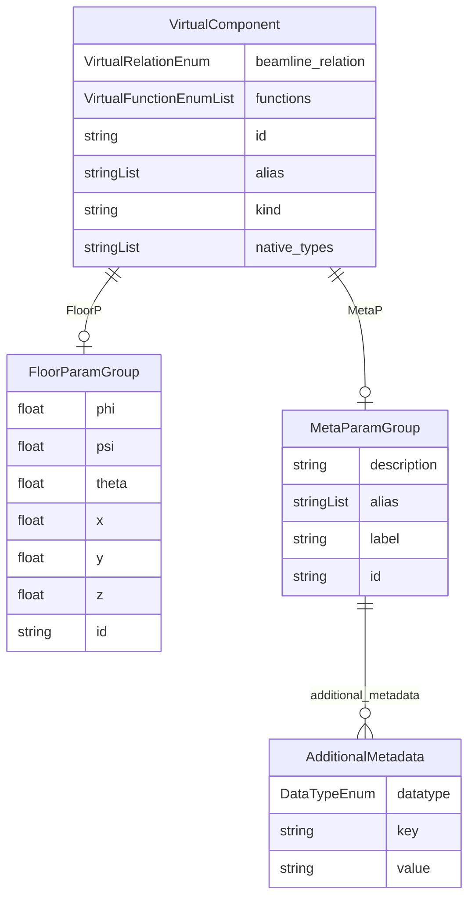

# Class: VirtualComponent 


_A virtual or logical component that represents a concept, function, or role in the accelerator  beamline operation but does not have a physical instantiation.  This can be used to capture abstract components, such as Markers, BeamLineSections, and FacilitySpaces that are important for understanding the structure and function of the accelerator system but are not physical devices._


URI: [pals_config:class/VirtualComponent](https://w3id.org/pals-config/class/VirtualComponent)





## Inheritance
* [Node](../classes/Node.md)
    * [Component](../classes/Component.md) [ [HasMetaP](../classes/HasMetaP.md)]
        * **VirtualComponent** [ [HasFloorP](../classes/HasFloorP.md)]
            * [BeamLine](../classes/BeamLine.md)
            * [BookkeepingComponent](../classes/BookkeepingComponent.md) [ [HasBodyShiftP](../classes/HasBodyShiftP.md)]
            * [Drift](../classes/Drift.md) [ [HasLongitudinalPlacementP](../classes/HasLongitudinalPlacementP.md)]


## Slots

| Name | Cardinality and Range | Description | Inheritance |
| ---  | --- | --- | --- |
| [functions](../slots/functions.md) | 1..* <br/> [VirtualFunctionEnum](../enums/VirtualFunctionEnum.md) | The function of the virtual component,  which can be used to identify the component across different source systems. | direct |
| [beamline_relation](../slots/beamline_relation.md) | 1 <br/> [VirtualRelationEnum](../enums/VirtualRelationEnum.md) | The relationship of the virtual component to the beamline,  which can be used to identify the component across different source systems. | direct |
| [FloorP](../slots/FloorP.md) | 0..1 <br/> [FloorParamGroup](../classes/FloorParamGroup.md) | A mixin for floor plan parameters that are aligned with PALS FloorP (Floor Plan Parameters) for interoperability with the Particle Accelerator Language Standard (PALS). | [HasFloorP](../classes/HasFloorP.md) |
| [native_types](../slots/native_types.md) | * <br/> [String](../types/String.md) | The native type of the component in the source system, which can be used to identify the component across different source systems. | [Component](../classes/Component.md) |
| [MetaP](../slots/MetaP.md) | 0..1 <br/> [MetaParamGroup](../classes/MetaParamGroup.md) | A mixin for metadata parameters that are aligned with PALS MetaP (Metadata Parameters) for interoperability with the Particle Accelerator Language Standard (PALS). | [HasMetaP](../classes/HasMetaP.md) |
| [id](../slots/id.md) | 1 <br/> [String](../types/String.md) | A unique identifier for the instance. | [Node](../classes/Node.md) |
| [kind](../slots/kind.md) | 1 <br/> [String](../types/String.md) | The LinkML class name of this instance, e.g. `Quadrupole` or `BeamProfileMonitor` (no prefix). | [Node](../classes/Node.md) |
| [alias](../slots/alias.md) | * <br/> [String](../types/String.md) | An alternative name or identifier for the instance. | [Node](../classes/Node.md) |


## Identifier and Mapping Information


### Schema Source


* from schema: https://w3id.org/pals-config


## Mappings

| Mapping Type | Mapped Value |
| ---  | ---  |
| self | pals_config:VirtualComponent |
| native | pals_config:VirtualComponent |
| broad | pals:Element, pals:BookkeepingElement |


## LinkML Source

<!-- TODO: investigate https://stackoverflow.com/questions/37606292/how-to-create-tabbed-code-blocks-in-mkdocs-or-sphinx -->

### Direct

<details>
```yaml
name: VirtualComponent
description: A virtual or logical component that represents a concept, function, or
  role in the accelerator  beamline operation but does not have a physical instantiation.  This
  can be used to capture abstract components, such as Markers, BeamLineSections, and
  FacilitySpaces that are important for understanding the structure and function of
  the accelerator system but are not physical devices.
from_schema: https://w3id.org/pals-config
broad_mappings:
- pals:Element
- pals:BookkeepingElement
is_a: Component
mixins:
- HasFloorP
slots:
- functions
- beamline_relation
slot_usage:
  functions:
    name: functions
    description: The function of the virtual component,  which can be used to identify
      the component across different source systems.
    close_mappings:
    - pals:virtual_function
    range: VirtualFunctionEnum
    required: true
    multivalued: true
  beamline_relation:
    name: beamline_relation
    description: The relationship of the virtual component to the beamline,  which
      can be used to identify the component across different source systems.
    close_mappings:
    - pals:virtual_beamline_relation
    range: VirtualRelationEnum
    required: true

```
</details>

### Induced

<details>
```yaml
name: VirtualComponent
description: A virtual or logical component that represents a concept, function, or
  role in the accelerator  beamline operation but does not have a physical instantiation.  This
  can be used to capture abstract components, such as Markers, BeamLineSections, and
  FacilitySpaces that are important for understanding the structure and function of
  the accelerator system but are not physical devices.
from_schema: https://w3id.org/pals-config
broad_mappings:
- pals:Element
- pals:BookkeepingElement
is_a: Component
mixins:
- HasFloorP
slot_usage:
  functions:
    name: functions
    description: The function of the virtual component,  which can be used to identify
      the component across different source systems.
    close_mappings:
    - pals:virtual_function
    range: VirtualFunctionEnum
    required: true
    multivalued: true
  beamline_relation:
    name: beamline_relation
    description: The relationship of the virtual component to the beamline,  which
      can be used to identify the component across different source systems.
    close_mappings:
    - pals:virtual_beamline_relation
    range: VirtualRelationEnum
    required: true
attributes:
  functions:
    name: functions
    description: The function of the virtual component,  which can be used to identify
      the component across different source systems.
    from_schema: https://w3id.org/pals-config
    close_mappings:
    - pals:virtual_function
    rank: 1000
    alias: functions
    owner: VirtualComponent
    domain_of:
    - PhysicalComponent
    - VirtualComponent
    range: VirtualFunctionEnum
    required: true
    multivalued: true
  beamline_relation:
    name: beamline_relation
    description: The relationship of the virtual component to the beamline,  which
      can be used to identify the component across different source systems.
    from_schema: https://w3id.org/pals-config
    close_mappings:
    - pals:virtual_beamline_relation
    rank: 1000
    alias: beamline_relation
    owner: VirtualComponent
    domain_of:
    - PhysicalComponent
    - VirtualComponent
    range: VirtualRelationEnum
    required: true
  FloorP:
    name: FloorP
    description: A mixin for floor plan parameters that are aligned with PALS FloorP
      (Floor Plan Parameters) for interoperability with the Particle Accelerator Language
      Standard (PALS).
    from_schema: https://w3id.org/pals-config
    rank: 1000
    alias: FloorP
    owner: VirtualComponent
    domain_of:
    - HasFloorP
    range: FloorParamGroup
    inlined: true
  native_types:
    name: native_types
    description: The native type of the component in the source system, which can
      be used to identify the component across different source systems.
    from_schema: https://w3id.org/pals-config
    rank: 1000
    alias: native_types
    owner: VirtualComponent
    domain_of:
    - Component
    range: string
    multivalued: true
  MetaP:
    name: MetaP
    description: A mixin for metadata parameters that are aligned with PALS MetaP
      (Metadata Parameters) for interoperability with the Particle Accelerator Language
      Standard (PALS).
    from_schema: https://w3id.org/pals-config
    rank: 1000
    alias: MetaP
    owner: VirtualComponent
    domain_of:
    - HasMetaP
    range: MetaParamGroup
    inlined: true
  id:
    name: id
    description: A unique identifier for the instance.
    from_schema: https://w3id.org/pals-config
    close_mappings:
    - pals:id
    rank: 1000
    identifier: true
    alias: id
    owner: VirtualComponent
    domain_of:
    - Node
    - Affiliation
    - ParamGroup
    - Edge
    range: string
    required: true
  kind:
    name: kind
    description: The LinkML class name of this instance, e.g. `Quadrupole` or `BeamProfileMonitor`
      (no prefix).
    from_schema: https://w3id.org/pals-config
    related_mappings:
    - rdf:type
    - saref:DeviceKind
    rank: 1000
    slot_uri: rdf:type
    designates_type: true
    alias: kind
    owner: VirtualComponent
    domain_of:
    - Node
    - PALSAccelerator
    range: string
    required: true
  alias:
    name: alias
    description: An alternative name or identifier for the instance.
    from_schema: https://w3id.org/pals-config
    close_mappings:
    - pals:alias
    rank: 1000
    alias: alias
    owner: VirtualComponent
    domain_of:
    - Node
    - MetaParamGroup
    range: string
    multivalued: true

```
</details>