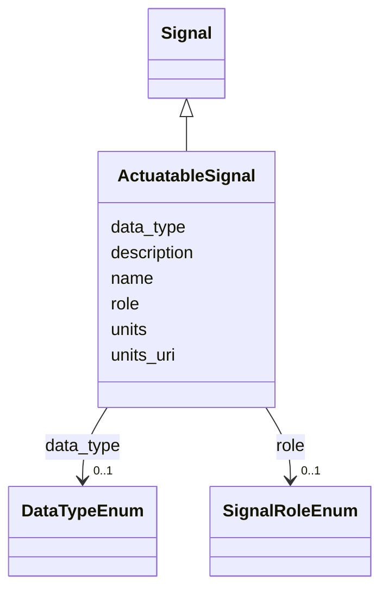

# Class: ActuatableSignal 


_A NARAD signal that can be commanded, set, or acted upon. Examples: current_setpoint, strength_setpoint, kick_setpoint, field_setpoint, current_min, current_max, gradient_setpoint. Aligned to sosa:ActuatableProperty._

__


URI: [narad:ActuatableSignal](https://w3id.org/narad_linkml/schema/narad/ActuatableSignal)





## Inheritance
* [NamedThing](NamedThing.md)
    * [Signal](Signal.md)
        * **ActuatableSignal**


## Slots

| Name | Cardinality and Range | Description | Inheritance |
| ---  | --- | --- | --- |
| [role](role.md) | 0..1 <br/> [SignalRoleEnum](SignalRoleEnum.md) | The semantic role of the signal within its capability | [Signal](Signal.md) |
| [data_type](data_type.md) | 0..1 <br/> [DataTypeEnum](DataTypeEnum.md) | The data type of the signal's value | [Signal](Signal.md) |
| [units](units.md) | 0..1 <br/> [String](String.md) | Conventional unit symbol (e | [Signal](Signal.md) |
| [units_uri](units_uri.md) | 0..1 <br/> [Uriorcurie](Uriorcurie.md) | Machine-resolvable QUDT unit reference (e | [Signal](Signal.md) |
| [name](name.md) | 1 <br/> [String](String.md) | Human-readable name or local string key for the entity | [NamedThing](NamedThing.md) |
| [description](description.md) | 0..1 <br/> [String](String.md) | Detailed description of the entity | [NamedThing](NamedThing.md) |


## Identifier and Mapping Information


### Schema Source


* from schema: https://w3id.org/narad_linkml/schema/narad/system


## Mappings

| Mapping Type | Mapped Value |
| ---  | ---  |
| self | narad:ActuatableSignal |
| native | narad:ActuatableSignal |
| broad | sosa:ActuatableProperty |


## LinkML Source

<!-- TODO: investigate https://stackoverflow.com/questions/37606292/how-to-create-tabbed-code-blocks-in-mkdocs-or-sphinx -->

### Direct

<details>
```yaml
name: ActuatableSignal
description: 'A NARAD signal that can be commanded, set, or acted upon. Examples:
  current_setpoint, strength_setpoint, kick_setpoint, field_setpoint, current_min,
  current_max, gradient_setpoint. Aligned to sosa:ActuatableProperty.

  '
from_schema: https://w3id.org/narad_linkml/schema/narad/system
broad_mappings:
- sosa:ActuatableProperty
is_a: Signal

```
</details>

### Induced

<details>
```yaml
name: ActuatableSignal
description: 'A NARAD signal that can be commanded, set, or acted upon. Examples:
  current_setpoint, strength_setpoint, kick_setpoint, field_setpoint, current_min,
  current_max, gradient_setpoint. Aligned to sosa:ActuatableProperty.

  '
from_schema: https://w3id.org/narad_linkml/schema/narad/system
broad_mappings:
- sosa:ActuatableProperty
is_a: Signal
attributes:
  role:
    name: role
    description: The semantic role of the signal within its capability.
    from_schema: https://w3id.org/narad_linkml/schema/narad/system
    rank: 1000
    alias: role
    owner: ActuatableSignal
    domain_of:
    - Signal
    range: SignalRoleEnum
  data_type:
    name: data_type
    description: The data type of the signal's value.
    from_schema: https://w3id.org/narad_linkml/schema/narad/system
    rank: 1000
    alias: data_type
    owner: ActuatableSignal
    domain_of:
    - Signal
    range: DataTypeEnum
  units:
    name: units
    description: Conventional unit symbol (e.g. A, MV/m, T*m, G/cm).
    from_schema: https://w3id.org/narad_linkml/schema/narad/system
    rank: 1000
    alias: units
    owner: ActuatableSignal
    domain_of:
    - Signal
    range: string
  units_uri:
    name: units_uri
    description: 'Machine-resolvable QUDT unit reference (e.g. si-unit:A for Ampere).
      The si-unit: prefix maps to http://qudt.org/vocab/unit/.'
    from_schema: https://w3id.org/narad_linkml/schema/narad/system
    rank: 1000
    alias: units_uri
    owner: ActuatableSignal
    domain_of:
    - Signal
    range: uriorcurie
  name:
    name: name
    description: Human-readable name or local string key for the entity.
    from_schema: https://w3id.org/narad_linkml/schema/narad/system
    rank: 1000
    identifier: true
    alias: name
    owner: ActuatableSignal
    domain_of:
    - NamedThing
    range: string
    required: true
  description:
    name: description
    description: Detailed description of the entity.
    from_schema: https://w3id.org/narad_linkml/schema/narad/system
    rank: 1000
    alias: description
    owner: ActuatableSignal
    domain_of:
    - NamedThing
    - SignalBinding
    range: string

```
</details>