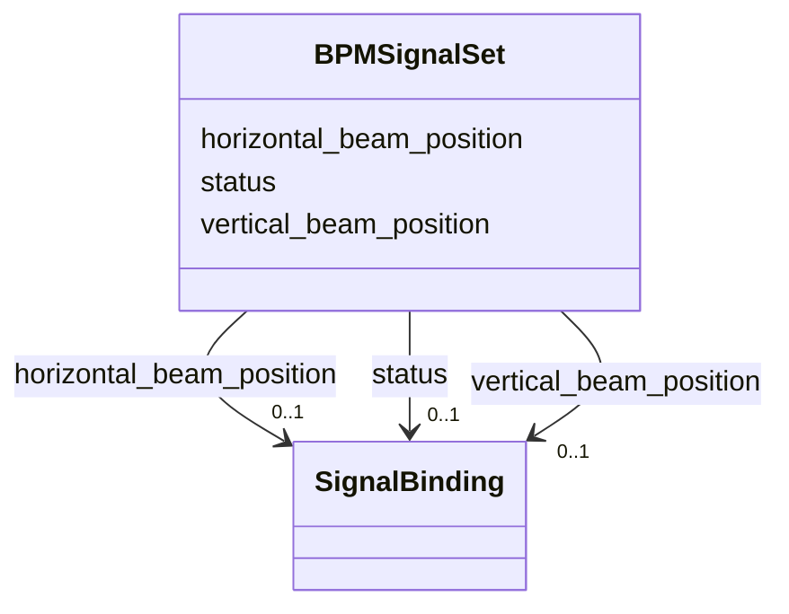

# Class: BPMSignalSet 


_BPM-specific signal bindings._


URI: [narad:BPMSignalSet](https://w3id.org/narad_linkml/schema/narad/BPMSignalSet)





<!-- no inheritance hierarchy -->


## Slots

| Name | Cardinality and Range | Description | Inheritance |
| ---  | --- | --- | --- |
| [horizontal_beam_position](horizontal_beam_position.md) | 0..1 <br/> [SignalBinding](SignalBinding.md) |  | direct |
| [vertical_beam_position](vertical_beam_position.md) | 0..1 <br/> [SignalBinding](SignalBinding.md) |  | direct |
| [status](status.md) | 0..1 <br/> [SignalBinding](SignalBinding.md) |  | direct |


## Usages

| used by | used in | type | used |
| ---  | --- | --- | --- |
| [TypeSignalSet](TypeSignalSet.md) | [bpm_signals](bpm_signals.md) | range | [BPMSignalSet](BPMSignalSet.md) |


## Identifier and Mapping Information


### Schema Source


* from schema: https://w3id.org/narad_linkml/schema/narad/system


## Mappings

| Mapping Type | Mapped Value |
| ---  | ---  |
| self | narad:BPMSignalSet |
| native | narad:BPMSignalSet |


## LinkML Source

<!-- TODO: investigate https://stackoverflow.com/questions/37606292/how-to-create-tabbed-code-blocks-in-mkdocs-or-sphinx -->

### Direct

<details>
```yaml
name: BPMSignalSet
description: BPM-specific signal bindings.
from_schema: https://w3id.org/narad_linkml/schema/narad/system
slots:
- horizontal_beam_position
- vertical_beam_position
- status

```
</details>

### Induced

<details>
```yaml
name: BPMSignalSet
description: BPM-specific signal bindings.
from_schema: https://w3id.org/narad_linkml/schema/narad/system
attributes:
  horizontal_beam_position:
    name: horizontal_beam_position
    from_schema: https://w3id.org/narad_linkml/schema/narad/system
    rank: 1000
    alias: horizontal_beam_position
    owner: BPMSignalSet
    domain_of:
    - BPMSignalSet
    range: SignalBinding
    inlined: true
  vertical_beam_position:
    name: vertical_beam_position
    from_schema: https://w3id.org/narad_linkml/schema/narad/system
    rank: 1000
    alias: vertical_beam_position
    owner: BPMSignalSet
    domain_of:
    - BPMSignalSet
    range: SignalBinding
    inlined: true
  status:
    name: status
    from_schema: https://w3id.org/narad_linkml/schema/narad/system
    rank: 1000
    alias: status
    owner: BPMSignalSet
    domain_of:
    - MagnetSignalSet
    - BPMSignalSet
    - RFCavitySignalSet
    range: SignalBinding
    inlined: true

```
</details>