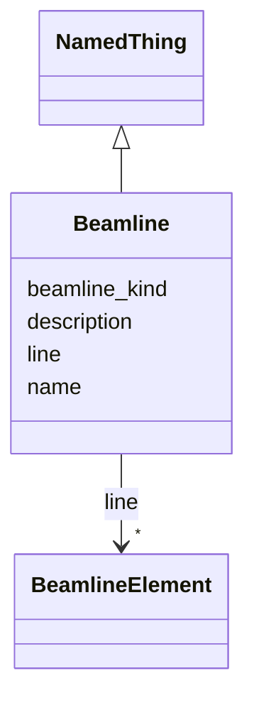

# Class: Beamline 


_An ordered sequence of beamline elements defining a beam path._


URI: [narad:Beamline](https://w3id.org/narad_linkml/schema/narad/Beamline)





## Inheritance
* [NamedThing](NamedThing.md)
    * **Beamline**


## Slots

| Name | Cardinality and Range | Description | Inheritance |
| ---  | --- | --- | --- |
| [beamline_kind](beamline_kind.md) | 0..1 <br/> [String](String.md) | Kind/type label for the beamline entry (e | direct |
| [line](line.md) | * <br/> [BeamlineElement](BeamlineElement.md) | Ordered sequence of cross-referenced element names forming a beamline | direct |
| [name](name.md) | 1 <br/> [String](String.md) | Human-readable name or local string key for the entity | [NamedThing](NamedThing.md) |
| [description](description.md) | 0..1 <br/> [String](String.md) | Detailed description of the entity | [NamedThing](NamedThing.md) |


## Usages

| used by | used in | type | used |
| ---  | --- | --- | --- |
| [NaradModel](NaradModel.md) | [beamlines](beamlines.md) | range | [Beamline](Beamline.md) |


## Identifier and Mapping Information


### Schema Source


* from schema: https://w3id.org/narad_linkml/schema/narad/system


## Mappings

| Mapping Type | Mapped Value |
| ---  | ---  |
| self | narad:Beamline |
| native | narad:Beamline |


## LinkML Source

<!-- TODO: investigate https://stackoverflow.com/questions/37606292/how-to-create-tabbed-code-blocks-in-mkdocs-or-sphinx -->

### Direct

<details>
```yaml
name: Beamline
description: An ordered sequence of beamline elements defining a beam path.
from_schema: https://w3id.org/narad_linkml/schema/narad/system
is_a: NamedThing
slots:
- beamline_kind
- line

```
</details>

### Induced

<details>
```yaml
name: Beamline
description: An ordered sequence of beamline elements defining a beam path.
from_schema: https://w3id.org/narad_linkml/schema/narad/system
is_a: NamedThing
attributes:
  beamline_kind:
    name: beamline_kind
    description: Kind/type label for the beamline entry (e.g. BeamLine).
    from_schema: https://w3id.org/narad_linkml/schema/narad/system
    aliases:
    - kind
    rank: 1000
    alias: beamline_kind
    owner: Beamline
    domain_of:
    - Beamline
    range: string
  line:
    name: line
    description: Ordered sequence of cross-referenced element names forming a beamline.
    from_schema: https://w3id.org/narad_linkml/schema/narad/system
    rank: 1000
    alias: line
    owner: Beamline
    domain_of:
    - Beamline
    range: BeamlineElement
    multivalued: true
    inlined: false
  name:
    name: name
    description: Human-readable name or local string key for the entity.
    from_schema: https://w3id.org/narad_linkml/schema/narad/system
    rank: 1000
    identifier: true
    alias: name
    owner: Beamline
    domain_of:
    - NamedThing
    range: string
    required: true
  description:
    name: description
    description: Detailed description of the entity.
    from_schema: https://w3id.org/narad_linkml/schema/narad/system
    rank: 1000
    alias: description
    owner: Beamline
    domain_of:
    - NamedThing
    - SignalBinding
    range: string

```
</details>