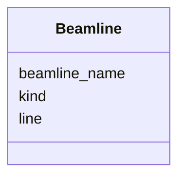

# Class: Beamline 


_An ordered sequence of beamline elements defining a beam path._


URI: [https://w3id.org/narad_linkml/schema/narad/Beamline](https://w3id.org/narad_linkml/schema/narad/Beamline)





<!-- no inheritance hierarchy -->


## Slots

| Name | Cardinality and Range | Description | Inheritance |
| ---  | --- | --- | --- |
| [beamline_name](beamline_name.md) | 1 <br/> [String](String.md) | Name of the beamline | direct |
| [kind](kind.md) | 0..1 <br/> [String](String.md) | Generic kind/type label | direct |
| [line](line.md) | * <br/> [String](String.md) | Ordered sequence of cross-referenced element names forming a beamline | direct |


## Usages

| used by | used in | type | used |
| ---  | --- | --- | --- |
| [NaradModel](NaradModel.md) | [beamlines](beamlines.md) | range | [Beamline](Beamline.md) |


## Identifier and Mapping Information


### Schema Source


* from schema: https://w3id.org/narad_linkml/schema/narad/


## Mappings

| Mapping Type | Mapped Value |
| ---  | ---  |
| self | https://w3id.org/narad_linkml/schema/narad/Beamline |
| native | https://w3id.org/narad_linkml/schema/narad/Beamline |


## LinkML Source

<!-- TODO: investigate https://stackoverflow.com/questions/37606292/how-to-create-tabbed-code-blocks-in-mkdocs-or-sphinx -->

### Direct

<details>
```yaml
name: Beamline
description: An ordered sequence of beamline elements defining a beam path.
from_schema: https://w3id.org/narad_linkml/schema/narad/
slots:
- beamline_name
- kind
- line
slot_usage:
  beamline_name:
    name: beamline_name
    identifier: true
    range: string
    required: true

```
</details>

### Induced

<details>
```yaml
name: Beamline
description: An ordered sequence of beamline elements defining a beam path.
from_schema: https://w3id.org/narad_linkml/schema/narad/
slot_usage:
  beamline_name:
    name: beamline_name
    identifier: true
    range: string
    required: true
attributes:
  beamline_name:
    name: beamline_name
    description: Name of the beamline.
    from_schema: https://w3id.org/narad_linkml/schema/narad/
    rank: 1000
    identifier: true
    alias: beamline_name
    owner: Beamline
    domain_of:
    - Beamline
    range: string
    required: true
  kind:
    name: kind
    description: 'Generic kind/type label. Used for Beamline entries (e.g. BeamLine).
      For ControlProfileFamily device domain use device_domain: DeviceDomainEnum.
      For CapabilityProfile device type use device_type: ElementKindEnum.'
    from_schema: https://w3id.org/narad_linkml/schema/narad/
    aliases:
    - type
    - profile_type
    rank: 1000
    alias: kind
    owner: Beamline
    domain_of:
    - BeamlineElement
    - Beamline
    range: string
  line:
    name: line
    description: Ordered sequence of cross-referenced element names forming a beamline.
    from_schema: https://w3id.org/narad_linkml/schema/narad/
    rank: 1000
    alias: line
    owner: Beamline
    domain_of:
    - Beamline
    range: string
    multivalued: true
    inlined: false

```
</details>