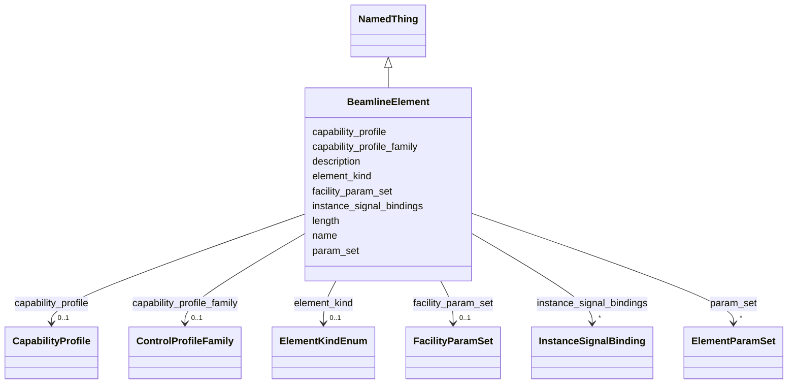

# Class: BeamlineElement 


_A single element in a beamline with its kind and optional NARAD capability annotations._


URI: [narad:BeamlineElement](https://w3id.org/narad_linkml/schema/narad/BeamlineElement)





## Inheritance
* [NamedThing](NamedThing.md)
    * **BeamlineElement**


## Slots

| Name | Cardinality and Range | Description | Inheritance |
| ---  | --- | --- | --- |
| [element_kind](element_kind.md) | 0..1 <br/> [ElementKindEnum](ElementKindEnum.md) | The type of this beamline element (e | direct |
| [length](length.md) | 0..1 <br/> [Float](Float.md) | Physical length of the element in metres | direct |
| [capability_profile_family](capability_profile_family.md) | 0..1 <br/> [ControlProfileFamily](ControlProfileFamily.md) | Cross-reference to the control profile family for this element | direct |
| [capability_profile](capability_profile.md) | 0..1 <br/> [CapabilityProfile](CapabilityProfile.md) | Cross-reference to the specific capability profile applied to this element | direct |
| [instance_signal_bindings](instance_signal_bindings.md) | * <br/> [InstanceSignalBinding](InstanceSignalBinding.md) | Facility-specific bindings of signals to control-system interfaces (e | direct |
| [param_set](param_set.md) | * <br/> [ElementParamSet](ElementParamSet.md) | Named physics-parameter blocks for this element (e | direct |
| [facility_param_set](facility_param_set.md) | 0..1 <br/> [FacilityParamSet](FacilityParamSet.md) | Facility-specific element parameters (type designation, model name, open prop... | direct |
| [name](name.md) | 1 <br/> [String](String.md) | Human-readable name or local string key for the entity | [NamedThing](NamedThing.md) |
| [description](description.md) | 0..1 <br/> [String](String.md) | Detailed description of the entity | [NamedThing](NamedThing.md) |


## Usages

| used by | used in | type | used |
| ---  | --- | --- | --- |
| [NaradModel](NaradModel.md) | [elements](elements.md) | range | [BeamlineElement](BeamlineElement.md) |
| [Beamline](Beamline.md) | [line](line.md) | range | [BeamlineElement](BeamlineElement.md) |


## Identifier and Mapping Information


### Schema Source


* from schema: https://w3id.org/narad_linkml/schema/narad/system


## Mappings

| Mapping Type | Mapped Value |
| ---  | ---  |
| self | narad:BeamlineElement |
| native | narad:BeamlineElement |


## LinkML Source

<!-- TODO: investigate https://stackoverflow.com/questions/37606292/how-to-create-tabbed-code-blocks-in-mkdocs-or-sphinx -->

### Direct

<details>
```yaml
name: BeamlineElement
description: A single element in a beamline with its kind and optional NARAD capability
  annotations.
from_schema: https://w3id.org/narad_linkml/schema/narad/system
is_a: NamedThing
slots:
- element_kind
- length
- capability_profile_family
- capability_profile
- instance_signal_bindings
- param_set
- facility_param_set

```
</details>

### Induced

<details>
```yaml
name: BeamlineElement
description: A single element in a beamline with its kind and optional NARAD capability
  annotations.
from_schema: https://w3id.org/narad_linkml/schema/narad/system
is_a: NamedThing
attributes:
  element_kind:
    name: element_kind
    description: The type of this beamline element (e.g. Quadrupole, BPM, RFCavity).
    from_schema: https://w3id.org/narad_linkml/schema/narad/system
    aliases:
    - kind
    rank: 1000
    alias: element_kind
    owner: BeamlineElement
    domain_of:
    - BeamlineElement
    range: ElementKindEnum
  length:
    name: length
    description: Physical length of the element in metres.
    from_schema: https://w3id.org/narad_linkml/schema/narad/system
    rank: 1000
    alias: length
    owner: BeamlineElement
    domain_of:
    - BeamlineElement
    range: float
  capability_profile_family:
    name: capability_profile_family
    description: Cross-reference to the control profile family for this element.
    from_schema: https://w3id.org/narad_linkml/schema/narad/system
    rank: 1000
    alias: capability_profile_family
    owner: BeamlineElement
    domain_of:
    - BeamlineElement
    range: ControlProfileFamily
    inlined: false
  capability_profile:
    name: capability_profile
    description: Cross-reference to the specific capability profile applied to this
      element.
    from_schema: https://w3id.org/narad_linkml/schema/narad/system
    rank: 1000
    alias: capability_profile
    owner: BeamlineElement
    domain_of:
    - BeamlineElement
    range: CapabilityProfile
    inlined: false
  instance_signal_bindings:
    name: instance_signal_bindings
    description: Facility-specific bindings of signals to control-system interfaces
      (e.g. EPICS PVs) for a specific beamline element instance. These are the concrete
      implementations of the abstract SignalBindings referenced by the element's capability
      profile.
    from_schema: https://w3id.org/narad_linkml/schema/narad/system
    rank: 1000
    alias: instance_signal_bindings
    owner: BeamlineElement
    domain_of:
    - BeamlineElement
    range: InstanceSignalBinding
    multivalued: true
    inlined: true
  param_set:
    name: param_set
    description: Named physics-parameter blocks for this element (e.g. RFP, BendP,
      MagneticMultipoleP).
    from_schema: https://w3id.org/narad_linkml/schema/narad/system
    rank: 1000
    alias: param_set
    owner: BeamlineElement
    domain_of:
    - BeamlineElement
    range: ElementParamSet
    multivalued: true
    inlined: true
    inlined_as_list: true
  facility_param_set:
    name: facility_param_set
    description: Facility-specific element parameters (type designation, model name,
      open property map).
    from_schema: https://w3id.org/narad_linkml/schema/narad/system
    rank: 1000
    alias: facility_param_set
    owner: BeamlineElement
    domain_of:
    - BeamlineElement
    range: FacilityParamSet
    inlined: true
  name:
    name: name
    description: Human-readable name or local string key for the entity.
    from_schema: https://w3id.org/narad_linkml/schema/narad/system
    rank: 1000
    identifier: true
    alias: name
    owner: BeamlineElement
    domain_of:
    - NamedThing
    range: string
    required: true
  description:
    name: description
    description: Detailed description of the entity.
    from_schema: https://w3id.org/narad_linkml/schema/narad/system
    rank: 1000
    alias: description
    owner: BeamlineElement
    domain_of:
    - NamedThing
    - SignalBinding
    range: string

```
</details>