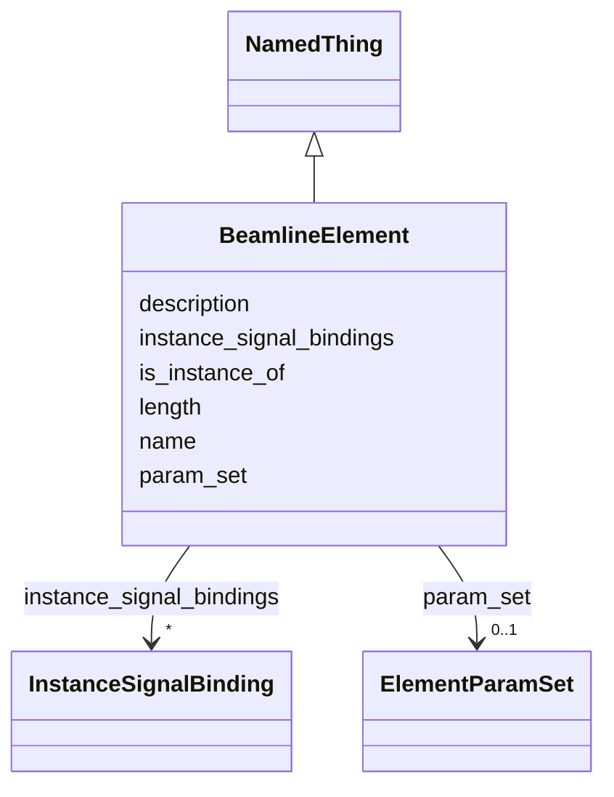

# Class: BeamlineElement 


_A single element in a beamline with its kind and optional NARAD capability annotations._


URI: [narad:BeamlineElement](https://w3id.org/narad_linkml/schema/narad/BeamlineElement)





## Inheritance
* [NamedThing](NamedThing.md)
    * **BeamlineElement**


## Slots

| Name | Cardinality and Range | Description | Inheritance |
| ---  | --- | --- | --- |
| [is_instance_of](is_instance_of.md) | 0..1 <br/> [Uriorcurie](Uriorcurie.md) | NARAD alias for rdf:type | direct |
| [length](length.md) | 0..1 <br/> [Float](Float.md) | Physical length of the element in metres | direct |
| [instance_signal_bindings](instance_signal_bindings.md) | * <br/> [InstanceSignalBinding](InstanceSignalBinding.md) | Facility-specific bindings of signals to control-system interfaces (e | direct |
| [param_set](param_set.md) | 0..1 <br/> [ElementParamSet](ElementParamSet.md) | Named physics-parameter blocks for this element (e | direct |
| [name](name.md) | 1 <br/> [String](String.md) | Human-readable name or local string key for the entity | [NamedThing](NamedThing.md) |
| [description](description.md) | 0..1 <br/> [String](String.md) | Detailed description of the entity | [NamedThing](NamedThing.md) |


## Usages

| used by | used in | type | used |
| ---  | --- | --- | --- |
| [NaradModel](NaradModel.md) | [elements](elements.md) | range | [BeamlineElement](BeamlineElement.md) |
| [Beamline](Beamline.md) | [line](line.md) | range | [BeamlineElement](BeamlineElement.md) |


## Identifier and Mapping Information


### Schema Source


* from schema: https://w3id.org/narad_linkml/schema/narad/system


## Mappings

| Mapping Type | Mapped Value |
| ---  | ---  |
| self | narad:BeamlineElement |
| native | narad:BeamlineElement |


## LinkML Source

<!-- TODO: investigate https://stackoverflow.com/questions/37606292/how-to-create-tabbed-code-blocks-in-mkdocs-or-sphinx -->

### Direct

<details>
```yaml
name: BeamlineElement
description: A single element in a beamline with its kind and optional NARAD capability
  annotations.
from_schema: https://w3id.org/narad_linkml/schema/narad/system
is_a: NamedThing
slots:
- is_instance_of
- length
- instance_signal_bindings
- param_set
slot_usage:
  is_instance_of:
    name: is_instance_of
    multivalued: false

```
</details>

### Induced

<details>
```yaml
name: BeamlineElement
description: A single element in a beamline with its kind and optional NARAD capability
  annotations.
from_schema: https://w3id.org/narad_linkml/schema/narad/system
is_a: NamedThing
slot_usage:
  is_instance_of:
    name: is_instance_of
    multivalued: false
attributes:
  is_instance_of:
    name: is_instance_of
    description: 'NARAD alias for rdf:type. Links a facility-specific instance node
      to the LinkML class or semantic class it instantiates. In the graph this edge
      is labelled narad:isInstanceOf. Values are typically the rdf:type of the Class
      that implements the signal binding.

      '
    from_schema: https://w3id.org/narad_linkml/schema/narad/system
    exact_mappings:
    - rdf:type
    rank: 1000
    alias: is_instance_of
    owner: BeamlineElement
    domain_of:
    - BeamlineElement
    - InstanceSignalBinding
    range: uriorcurie
    multivalued: false
  length:
    name: length
    description: Physical length of the element in metres.
    from_schema: https://w3id.org/narad_linkml/schema/narad/system
    rank: 1000
    alias: length
    owner: BeamlineElement
    domain_of:
    - BeamlineElement
    range: float
  instance_signal_bindings:
    name: instance_signal_bindings
    description: Facility-specific bindings of signals to control-system interfaces
      (e.g. EPICS PVs) for a specific beamline element instance. These are the keyed
      by the semantic signal name (e.g. current_readback) rather than the control-system
      suffix, which is captured in the SignalBinding. The semantic signal name links
      the instance binding to the abstract Signal definition and its place in the
      capability profile, while the SignalBinding captures the concrete implementations
      of the abstract SignalBindings referenced by the element's capability profile.
    from_schema: https://w3id.org/narad_linkml/schema/narad/system
    rank: 1000
    alias: instance_signal_bindings
    owner: BeamlineElement
    domain_of:
    - BeamlineElement
    range: InstanceSignalBinding
    multivalued: true
    inlined: true
  param_set:
    name: param_set
    description: Named physics-parameter blocks for this element (e.g. RFP, BendP,
      MagneticMultipoleP).
    from_schema: https://w3id.org/narad_linkml/schema/narad/system
    rank: 1000
    alias: param_set
    owner: BeamlineElement
    domain_of:
    - BeamlineElement
    range: ElementParamSet
    multivalued: false
    inlined: true
  name:
    name: name
    description: Human-readable name or local string key for the entity.
    from_schema: https://w3id.org/narad_linkml/schema/narad/system
    rank: 1000
    identifier: true
    alias: name
    owner: BeamlineElement
    domain_of:
    - NamedThing
    range: string
    required: true
  description:
    name: description
    description: Detailed description of the entity.
    from_schema: https://w3id.org/narad_linkml/schema/narad/system
    rank: 1000
    alias: description
    owner: BeamlineElement
    domain_of:
    - NamedThing
    range: string

```
</details>