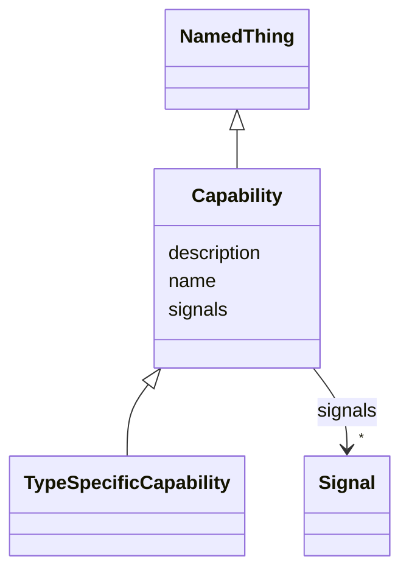

# Class: Capability 


_A named, shared grouping of semantically related signals for a control aspect (e.g. MagnetCurrentControlCapability)._


URI: [narad:Capability](https://w3id.org/narad_linkml/schema/narad/Capability)





## Inheritance
* [NamedThing](NamedThing.md)
    * **Capability**
        * [TypeSpecificCapability](TypeSpecificCapability.md)


## Slots

| Name | Cardinality and Range | Description | Inheritance |
| ---  | --- | --- | --- |
| [signals](signals.md) | * <br/> [Signal](Signal.md) | Signals within a capability, keyed by signal name | direct |
| [name](name.md) | 1 <br/> [String](String.md) | Human-readable name or local string key for the entity | [NamedThing](NamedThing.md) |
| [description](description.md) | 0..1 <br/> [String](String.md) | Detailed description of the entity | [NamedThing](NamedThing.md) |


## Usages

| used by | used in | type | used |
| ---  | --- | --- | --- |
| [ControlProfileFamily](ControlProfileFamily.md) | [shared_capabilities](shared_capabilities.md) | range | [Capability](Capability.md) |
| [CapabilityProfile](CapabilityProfile.md) | [inherits_shared_capabilities](inherits_shared_capabilities.md) | range | [Capability](Capability.md) |


## Identifier and Mapping Information


### Schema Source


* from schema: https://w3id.org/narad_linkml/schema/narad/system


## Mappings

| Mapping Type | Mapped Value |
| ---  | ---  |
| self | narad:Capability |
| native | narad:Capability |


## LinkML Source

<!-- TODO: investigate https://stackoverflow.com/questions/37606292/how-to-create-tabbed-code-blocks-in-mkdocs-or-sphinx -->

### Direct

<details>
```yaml
name: Capability
description: A named, shared grouping of semantically related signals for a control
  aspect (e.g. MagnetCurrentControlCapability).
from_schema: https://w3id.org/narad_linkml/schema/narad/system
is_a: NamedThing
slots:
- signals

```
</details>

### Induced

<details>
```yaml
name: Capability
description: A named, shared grouping of semantically related signals for a control
  aspect (e.g. MagnetCurrentControlCapability).
from_schema: https://w3id.org/narad_linkml/schema/narad/system
is_a: NamedThing
attributes:
  signals:
    name: signals
    description: Signals within a capability, keyed by signal name.
    from_schema: https://w3id.org/narad_linkml/schema/narad/system
    rank: 1000
    alias: signals
    owner: Capability
    domain_of:
    - Capability
    range: Signal
    multivalued: true
    inlined: true
  name:
    name: name
    description: Human-readable name or local string key for the entity.
    from_schema: https://w3id.org/narad_linkml/schema/narad/system
    rank: 1000
    identifier: true
    alias: name
    owner: Capability
    domain_of:
    - NamedThing
    range: string
    required: true
  description:
    name: description
    description: Detailed description of the entity.
    from_schema: https://w3id.org/narad_linkml/schema/narad/system
    rank: 1000
    alias: description
    owner: Capability
    domain_of:
    - NamedThing
    - SignalBinding
    range: string

```
</details>