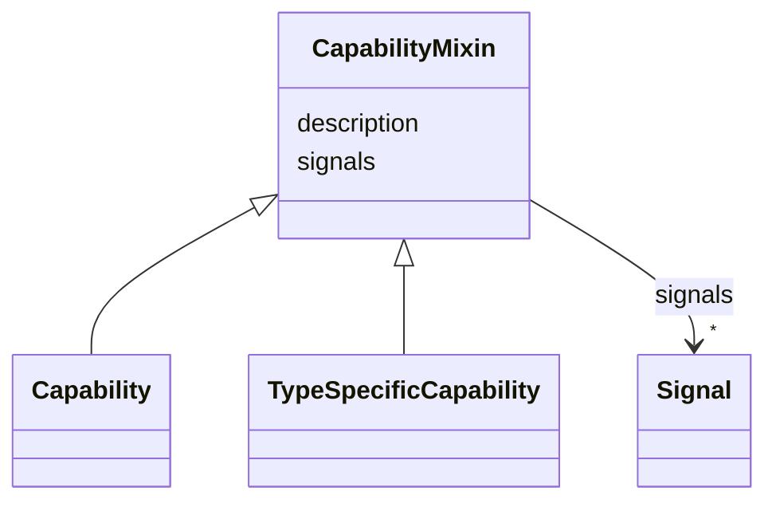

# Class: CapabilityMixin 


_Shared structure common to all capability types: a description and an ordered list of signals._


URI: [https://w3id.org/narad_linkml/schema/narad/CapabilityMixin](https://w3id.org/narad_linkml/schema/narad/CapabilityMixin)





<!-- no inheritance hierarchy -->


## Slots

| Name | Cardinality and Range | Description | Inheritance |
| ---  | --- | --- | --- |
| [description](description.md) | 0..1 <br/> [String](String.md) |  | direct |
| [signals](signals.md) | * <br/> [Signal](Signal.md) | Signals within a capability | direct |


## Mixin Usage

| mixed into | description |
| --- | --- |
| [Capability](Capability.md) | A named, shared grouping of semantically related signals for a control aspect |
| [TypeSpecificCapability](TypeSpecificCapability.md) | An inline capability declared within a device-type profile, with its own iden... |


## Identifier and Mapping Information


### Schema Source


* from schema: https://w3id.org/narad_linkml/schema/narad/


## Mappings

| Mapping Type | Mapped Value |
| ---  | ---  |
| self | https://w3id.org/narad_linkml/schema/narad/CapabilityMixin |
| native | https://w3id.org/narad_linkml/schema/narad/CapabilityMixin |


## LinkML Source

<!-- TODO: investigate https://stackoverflow.com/questions/37606292/how-to-create-tabbed-code-blocks-in-mkdocs-or-sphinx -->

### Direct

<details>
```yaml
name: CapabilityMixin
description: 'Shared structure common to all capability types: a description and an
  ordered list of signals.'
from_schema: https://w3id.org/narad_linkml/schema/narad/
mixin: true
slots:
- description
- signals

```
</details>

### Induced

<details>
```yaml
name: CapabilityMixin
description: 'Shared structure common to all capability types: a description and an
  ordered list of signals.'
from_schema: https://w3id.org/narad_linkml/schema/narad/
mixin: true
attributes:
  description:
    name: description
    from_schema: https://w3id.org/narad_linkml/schema/narad/
    rank: 1000
    alias: description
    owner: CapabilityMixin
    domain_of:
    - SignalBinding
    - CapabilityMixin
    - Signal
    - CapabilityProfile
    - ControlProfileFamily
    range: string
  signals:
    name: signals
    description: Signals within a capability.
    from_schema: https://w3id.org/narad_linkml/schema/narad/
    rank: 1000
    alias: signals
    owner: CapabilityMixin
    domain_of:
    - CapabilityMixin
    range: Signal
    multivalued: true
    inlined: true
    inlined_as_list: true

```
</details>