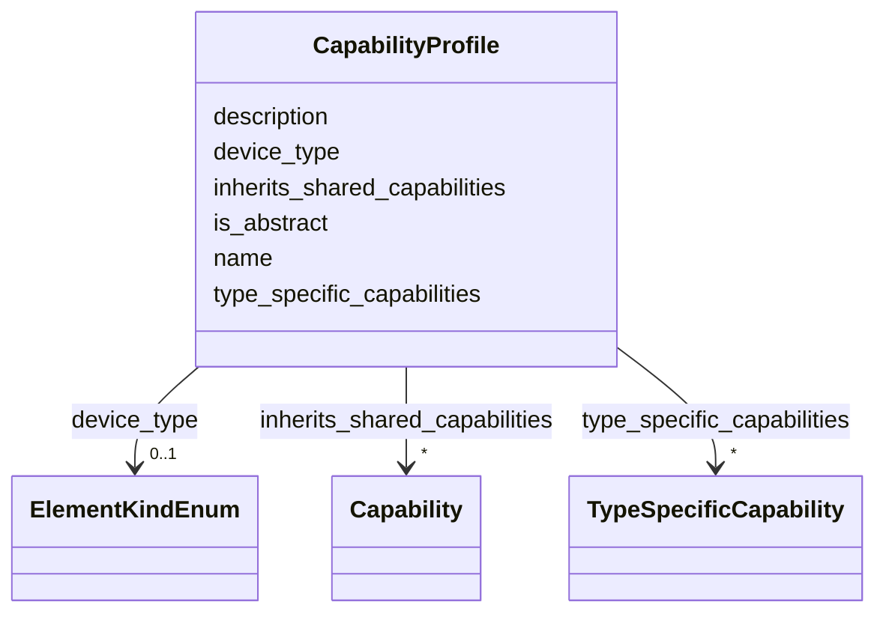

# Class: CapabilityProfile 


_A device-type profile that reuses shared capabilities and adds specific capabilities._


URI: [https://w3id.org/narad_linkml/schema/narad/CapabilityProfile](https://w3id.org/narad_linkml/schema/narad/CapabilityProfile)





<!-- no inheritance hierarchy -->


## Slots

| Name | Cardinality and Range | Description | Inheritance |
| ---  | --- | --- | --- |
| [name](name.md) | 1 <br/> [String](String.md) | Name/identifier of the entity | direct |
| [device_type](device_type.md) | 0..1 <br/> [ElementKindEnum](ElementKindEnum.md) | The specific device type this capability profile targets (e | direct |
| [description](description.md) | 0..1 <br/> [String](String.md) |  | direct |
| [is_abstract](is_abstract.md) | 0..1 <br/> [Boolean](Boolean.md) | If true, this profile is a template or abstract definition not intended to be... | direct |
| [inherits_shared_capabilities](inherits_shared_capabilities.md) | * <br/> [Capability](Capability.md) | Shared capabilities inherited by this profile, cross-referenced by name | direct |
| [type_specific_capabilities](type_specific_capabilities.md) | * <br/> [TypeSpecificCapability](TypeSpecificCapability.md) | Type-specific capabilities declared directly in a profile, each with an id, c... | direct |


## Usages

| used by | used in | type | used |
| ---  | --- | --- | --- |
| [ControlProfileFamily](ControlProfileFamily.md) | [type_profiles](type_profiles.md) | range | [CapabilityProfile](CapabilityProfile.md) |
| [ElementNaradRef](ElementNaradRef.md) | [capability_profile](capability_profile.md) | range | [CapabilityProfile](CapabilityProfile.md) |


## Identifier and Mapping Information


### Schema Source


* from schema: https://w3id.org/narad_linkml/schema/narad/


## Mappings

| Mapping Type | Mapped Value |
| ---  | ---  |
| self | https://w3id.org/narad_linkml/schema/narad/CapabilityProfile |
| native | https://w3id.org/narad_linkml/schema/narad/CapabilityProfile |


## LinkML Source

<!-- TODO: investigate https://stackoverflow.com/questions/37606292/how-to-create-tabbed-code-blocks-in-mkdocs-or-sphinx -->

### Direct

<details>
```yaml
name: CapabilityProfile
description: A device-type profile that reuses shared capabilities and adds specific
  capabilities.
from_schema: https://w3id.org/narad_linkml/schema/narad/
slots:
- name
- device_type
- description
- is_abstract
- inherits_shared_capabilities
- type_specific_capabilities

```
</details>

### Induced

<details>
```yaml
name: CapabilityProfile
description: A device-type profile that reuses shared capabilities and adds specific
  capabilities.
from_schema: https://w3id.org/narad_linkml/schema/narad/
attributes:
  name:
    name: name
    description: Name/identifier of the entity.
    from_schema: https://w3id.org/narad_linkml/schema/narad/
    rank: 1000
    identifier: true
    alias: name
    owner: CapabilityProfile
    domain_of:
    - Facility
    - SignalBinding
    - DeviceTypeSignalSet
    - Signal
    - Capability
    - CapabilityProfile
    - ControlProfileFamily
    - BeamlineElement
    - PVBinding
    range: string
    required: true
  device_type:
    name: device_type
    description: The specific device type this capability profile targets (e.g. Quadrupole,
      Corrector, BPM). Uses ElementKindEnum to stay in sync with BeamlineElement.kind.
    from_schema: https://w3id.org/narad_linkml/schema/narad/
    rank: 1000
    alias: device_type
    owner: CapabilityProfile
    domain_of:
    - CapabilityProfile
    range: ElementKindEnum
  description:
    name: description
    from_schema: https://w3id.org/narad_linkml/schema/narad/
    rank: 1000
    alias: description
    owner: CapabilityProfile
    domain_of:
    - SignalBinding
    - CapabilityMixin
    - Signal
    - CapabilityProfile
    - ControlProfileFamily
    range: string
  is_abstract:
    name: is_abstract
    description: If true, this profile is a template or abstract definition not intended
      to be directly assigned to a beamline element. Concrete profiles that refine
      a template should set this to false (the default).
    from_schema: https://w3id.org/narad_linkml/schema/narad/
    rank: 1000
    ifabsent: 'false'
    alias: is_abstract
    owner: CapabilityProfile
    domain_of:
    - CapabilityProfile
    range: boolean
  inherits_shared_capabilities:
    name: inherits_shared_capabilities
    description: Shared capabilities inherited by this profile, cross-referenced by
      name. The validator checks that referenced names exist in the parent family's
      shared_capabilities.
    from_schema: https://w3id.org/narad_linkml/schema/narad/
    rank: 1000
    alias: inherits_shared_capabilities
    owner: CapabilityProfile
    domain_of:
    - CapabilityProfile
    range: Capability
    multivalued: true
    inlined: false
  type_specific_capabilities:
    name: type_specific_capabilities
    description: Type-specific capabilities declared directly in a profile, each with
      an id, class label, description, and signals.
    from_schema: https://w3id.org/narad_linkml/schema/narad/
    rank: 1000
    alias: type_specific_capabilities
    owner: CapabilityProfile
    domain_of:
    - CapabilityProfile
    range: TypeSpecificCapability
    multivalued: true
    inlined: true
    inlined_as_list: true

```
</details>