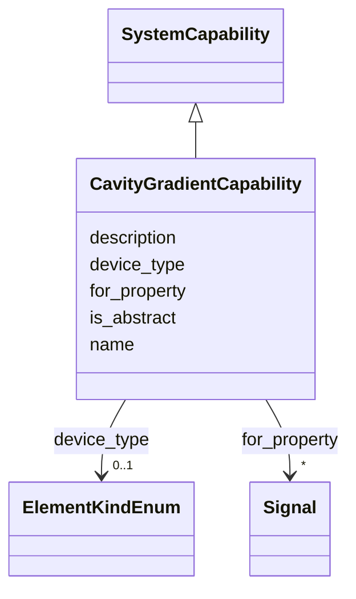

# Class: CavityGradientCapability 


_RF cavity capability with gradient control, readback, and status signals._


URI: [narad:CavityGradientCapability](https://w3id.org/narad_linkml/schema/narad/CavityGradientCapability)





## Inheritance
* [NamedThing](NamedThing.md)
    * [SystemCapability](SystemCapability.md)
        * **CavityGradientCapability**


## Slots

| Name | Cardinality and Range | Description | Inheritance |
| ---  | --- | --- | --- |
| [for_property](for_property.md) | * <br/> [Signal](Signal.md) | SystemCapability → Signal: the capability can expose, monitor, control, or ac... | [SystemCapability](SystemCapability.md) |
| [device_type](device_type.md) | 0..1 <br/> [ElementKindEnum](ElementKindEnum.md) | The specific device type this capability profile or system capability targets... | [SystemCapability](SystemCapability.md) |
| [is_abstract](is_abstract.md) | 0..1 <br/> [Boolean](Boolean.md) | If true, this profile is a template not intended to be directly assigned to a... | [SystemCapability](SystemCapability.md) |
| [name](name.md) | 1 <br/> [String](String.md) | Human-readable name or local string key for the entity | [NamedThing](NamedThing.md) |
| [description](description.md) | 0..1 <br/> [String](String.md) | Detailed description of the entity | [NamedThing](NamedThing.md) |


## Identifier and Mapping Information


### Schema Source


* from schema: https://w3id.org/narad_linkml/schema/narad/system


## Mappings

| Mapping Type | Mapped Value |
| ---  | ---  |
| self | narad:CavityGradientCapability |
| native | narad:CavityGradientCapability |


## LinkML Source

<!-- TODO: investigate https://stackoverflow.com/questions/37606292/how-to-create-tabbed-code-blocks-in-mkdocs-or-sphinx -->

### Direct

<details>
```yaml
name: CavityGradientCapability
description: RF cavity capability with gradient control, readback, and status signals.
from_schema: https://w3id.org/narad_linkml/schema/narad/system
is_a: SystemCapability

```
</details>

### Induced

<details>
```yaml
name: CavityGradientCapability
description: RF cavity capability with gradient control, readback, and status signals.
from_schema: https://w3id.org/narad_linkml/schema/narad/system
is_a: SystemCapability
attributes:
  for_property:
    name: for_property
    description: 'SystemCapability → Signal: the capability can expose, monitor, control,
      or actuate that signal.

      '
    from_schema: https://w3id.org/narad_linkml/schema/narad/system
    exact_mappings:
    - ssn:forProperty
    rank: 1000
    alias: for_property
    owner: CavityGradientCapability
    domain_of:
    - SystemCapability
    range: Signal
    multivalued: true
  device_type:
    name: device_type
    description: The specific device type this capability profile or system capability
      targets (e.g. Quadrupole, Corrector, BPM).
    from_schema: https://w3id.org/narad_linkml/schema/narad/system
    rank: 1000
    alias: device_type
    owner: CavityGradientCapability
    domain_of:
    - CapabilityProfile
    - SystemCapability
    range: ElementKindEnum
  is_abstract:
    name: is_abstract
    description: If true, this profile is a template not intended to be directly assigned
      to a beamline element. Concrete profiles set this to false (default).
    from_schema: https://w3id.org/narad_linkml/schema/narad/system
    rank: 1000
    ifabsent: 'false'
    alias: is_abstract
    owner: CavityGradientCapability
    domain_of:
    - CapabilityProfile
    - SystemCapability
    range: boolean
  name:
    name: name
    description: Human-readable name or local string key for the entity.
    from_schema: https://w3id.org/narad_linkml/schema/narad/system
    rank: 1000
    identifier: true
    alias: name
    owner: CavityGradientCapability
    domain_of:
    - NamedThing
    range: string
    required: true
  description:
    name: description
    description: Detailed description of the entity.
    from_schema: https://w3id.org/narad_linkml/schema/narad/system
    rank: 1000
    alias: description
    owner: CavityGradientCapability
    domain_of:
    - NamedThing
    - SignalBinding
    range: string

```
</details>