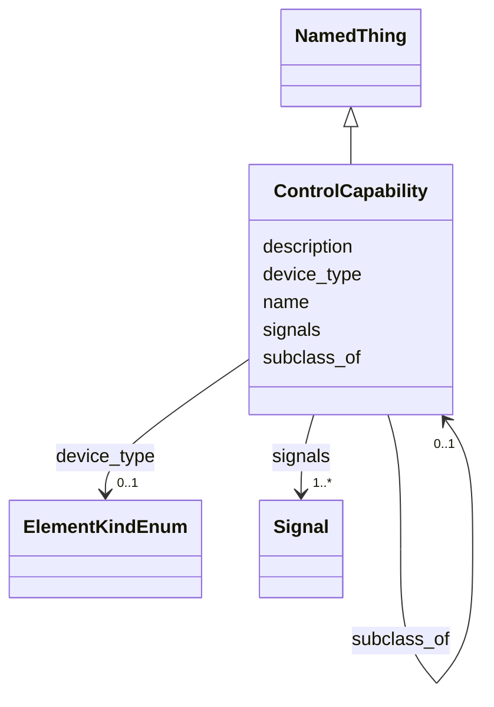

# Class: ControlCapability 


_A reusable device-type control profile that extends a generic shared capability with type-specific signals (e.g. QuadrupoleCurrentControlProfile)._


URI: [narad:ControlCapability](https://w3id.org/narad_linkml/schema/narad/ControlCapability)





## Inheritance
* [NamedThing](NamedThing.md)
    * **ControlCapability**


## Slots

| Name | Cardinality and Range | Description | Inheritance |
| ---  | --- | --- | --- |
| [device_type](device_type.md) | 0..1 <br/> [ElementKindEnum](ElementKindEnum.md) | The specific device type this capability profile or system capability targets... | direct |
| [subclass_of](subclass_of.md) | 0..1 <br/> [ControlCapability](ControlCapability.md) | -> NARAD alias for rdfs:subClassOf | direct |
| [signals](signals.md) | 1..* <br/> [Signal](Signal.md) | Signals within a capability, keyed by a semantic signal name | direct |
| [name](name.md) | 1 <br/> [String](String.md) | Human-readable name or local string key for the entity | [NamedThing](NamedThing.md) |
| [description](description.md) | 0..1 <br/> [String](String.md) | Detailed description of the entity | [NamedThing](NamedThing.md) |


## Usages

| used by | used in | type | used |
| ---  | --- | --- | --- |
| [NaradConfig](NaradConfig.md) | [control_capability_layer](control_capability_layer.md) | range | [ControlCapability](ControlCapability.md) |
| [CapabilityLayer](CapabilityLayer.md) | [control_capabilities](control_capabilities.md) | range | [ControlCapability](ControlCapability.md) |
| [ControlCapability](ControlCapability.md) | [subclass_of](subclass_of.md) | range | [ControlCapability](ControlCapability.md) |


## Identifier and Mapping Information


### Schema Source


* from schema: https://w3id.org/narad_linkml/schema/narad/system


## Mappings

| Mapping Type | Mapped Value |
| ---  | ---  |
| self | narad:ControlCapability |
| native | narad:ControlCapability |


## LinkML Source

<!-- TODO: investigate https://stackoverflow.com/questions/37606292/how-to-create-tabbed-code-blocks-in-mkdocs-or-sphinx -->

### Direct

<details>
```yaml
name: ControlCapability
description: A reusable device-type control profile that extends a generic shared
  capability with type-specific signals (e.g. QuadrupoleCurrentControlProfile).
from_schema: https://w3id.org/narad_linkml/schema/narad/system
is_a: NamedThing
slots:
- device_type
- subclass_of
- signals
slot_usage:
  signals:
    name: signals
    required: true

```
</details>

### Induced

<details>
```yaml
name: ControlCapability
description: A reusable device-type control profile that extends a generic shared
  capability with type-specific signals (e.g. QuadrupoleCurrentControlProfile).
from_schema: https://w3id.org/narad_linkml/schema/narad/system
is_a: NamedThing
slot_usage:
  signals:
    name: signals
    required: true
attributes:
  device_type:
    name: device_type
    description: The specific device type this capability profile or system capability
      targets (e.g. Quadrupole, Corrector, BPM).
    from_schema: https://w3id.org/narad_linkml/schema/narad/system
    rank: 1000
    alias: device_type
    owner: ControlCapability
    domain_of:
    - ControlCapability
    - SignalDefinitions
    - InstrumentSystem
    - SystemCapability
    range: ElementKindEnum
  subclass_of:
    name: subclass_of
    description: -> NARAD alias for rdfs:subClassOf. Links a type-specific capability
      to the generic capability it extends. In the graph this edge is labelled narad:subclassOf.
    from_schema: https://w3id.org/narad_linkml/schema/narad/system
    exact_mappings:
    - rdfs:subClassOf
    rank: 1000
    alias: subclass_of
    owner: ControlCapability
    domain_of:
    - ControlCapability
    range: ControlCapability
    multivalued: false
  signals:
    name: signals
    description: Signals within a capability, keyed by a semantic signal name.
    from_schema: https://w3id.org/narad_linkml/schema/narad/system
    rank: 1000
    alias: signals
    owner: ControlCapability
    domain_of:
    - ControlCapability
    range: Signal
    required: true
    multivalued: true
    inlined: true
  name:
    name: name
    description: Human-readable name or local string key for the entity.
    from_schema: https://w3id.org/narad_linkml/schema/narad/system
    rank: 1000
    identifier: true
    alias: name
    owner: ControlCapability
    domain_of:
    - NamedThing
    range: string
    required: true
  description:
    name: description
    description: Detailed description of the entity.
    from_schema: https://w3id.org/narad_linkml/schema/narad/system
    rank: 1000
    alias: description
    owner: ControlCapability
    domain_of:
    - NamedThing
    range: string

```
</details>