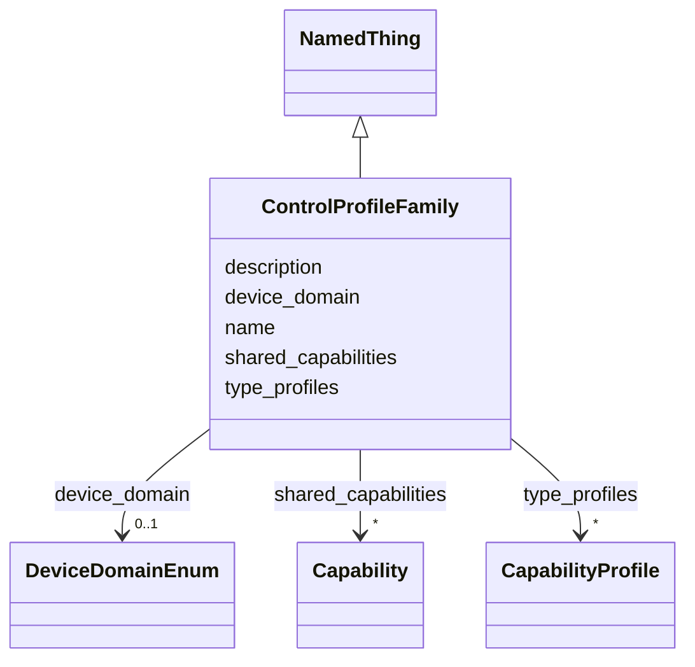

# Class: ControlProfileFamily 


_A reusable family of control profiles sharing common semantics and structure (e.g. MagnetCurrentControlProfileFamily)._


URI: [narad:ControlProfileFamily](https://w3id.org/narad_linkml/schema/narad/ControlProfileFamily)





## Inheritance
* [NamedThing](NamedThing.md)
    * **ControlProfileFamily**


## Slots

| Name | Cardinality and Range | Description | Inheritance |
| ---  | --- | --- | --- |
| [device_domain](device_domain.md) | 0..1 <br/> [DeviceDomainEnum](DeviceDomainEnum.md) | High-level device domain that this profile family governs | direct |
| [shared_capabilities](shared_capabilities.md) | * <br/> [Capability](Capability.md) | Named shared capabilities reused by profile types in a family | direct |
| [type_profiles](type_profiles.md) | * <br/> [CapabilityProfile](CapabilityProfile.md) | Device-type profile definitions for this family, keyed by profile name | direct |
| [name](name.md) | 1 <br/> [String](String.md) | Human-readable name or local string key for the entity | [NamedThing](NamedThing.md) |
| [description](description.md) | 0..1 <br/> [String](String.md) | Detailed description of the entity | [NamedThing](NamedThing.md) |


## Usages

| used by | used in | type | used |
| ---  | --- | --- | --- |
| [CapabilityLayer](CapabilityLayer.md) | [profiles](profiles.md) | range | [ControlProfileFamily](ControlProfileFamily.md) |
| [BeamlineElement](BeamlineElement.md) | [capability_profile_family](capability_profile_family.md) | range | [ControlProfileFamily](ControlProfileFamily.md) |


## Identifier and Mapping Information


### Schema Source


* from schema: https://w3id.org/narad_linkml/schema/narad/system


## Mappings

| Mapping Type | Mapped Value |
| ---  | ---  |
| self | narad:ControlProfileFamily |
| native | narad:ControlProfileFamily |


## LinkML Source

<!-- TODO: investigate https://stackoverflow.com/questions/37606292/how-to-create-tabbed-code-blocks-in-mkdocs-or-sphinx -->

### Direct

<details>
```yaml
name: ControlProfileFamily
description: A reusable family of control profiles sharing common semantics and structure
  (e.g. MagnetCurrentControlProfileFamily).
from_schema: https://w3id.org/narad_linkml/schema/narad/system
is_a: NamedThing
slots:
- device_domain
- shared_capabilities
- type_profiles

```
</details>

### Induced

<details>
```yaml
name: ControlProfileFamily
description: A reusable family of control profiles sharing common semantics and structure
  (e.g. MagnetCurrentControlProfileFamily).
from_schema: https://w3id.org/narad_linkml/schema/narad/system
is_a: NamedThing
attributes:
  device_domain:
    name: device_domain
    description: High-level device domain that this profile family governs.
    from_schema: https://w3id.org/narad_linkml/schema/narad/system
    rank: 1000
    alias: device_domain
    owner: ControlProfileFamily
    domain_of:
    - ControlProfileFamily
    range: DeviceDomainEnum
  shared_capabilities:
    name: shared_capabilities
    description: Named shared capabilities reused by profile types in a family.
    from_schema: https://w3id.org/narad_linkml/schema/narad/system
    rank: 1000
    alias: shared_capabilities
    owner: ControlProfileFamily
    domain_of:
    - ControlProfileFamily
    range: Capability
    multivalued: true
    inlined: true
  type_profiles:
    name: type_profiles
    description: Device-type profile definitions for this family, keyed by profile
      name.
    from_schema: https://w3id.org/narad_linkml/schema/narad/system
    rank: 1000
    alias: type_profiles
    owner: ControlProfileFamily
    domain_of:
    - ControlProfileFamily
    range: CapabilityProfile
    multivalued: true
    inlined: true
  name:
    name: name
    description: Human-readable name or local string key for the entity.
    from_schema: https://w3id.org/narad_linkml/schema/narad/system
    rank: 1000
    identifier: true
    alias: name
    owner: ControlProfileFamily
    domain_of:
    - NamedThing
    range: string
    required: true
  description:
    name: description
    description: Detailed description of the entity.
    from_schema: https://w3id.org/narad_linkml/schema/narad/system
    rank: 1000
    alias: description
    owner: ControlProfileFamily
    domain_of:
    - NamedThing
    - SignalBinding
    range: string

```
</details>